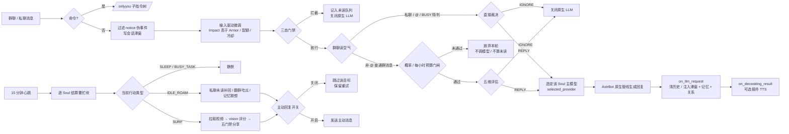

# OnlyYou (只有你) —— 技术架构设计 (v3.1)

> 适用版本：插件 **v3.1.1**（`metadata.yaml` / `main.py @register` 为版本真源）。
> 本文只描述**当前实现**的架构、数据契约与运行机制；代码是最终真源，文档与代码冲突时以代码为准。
> 生产升级、迁移校验、回滚与「清理 vs 保留」语义见 [`UPGRADE.md`](UPGRADE.md)。

---

## 一、 架构总览

OnlyYou 是一个 AstrBot `Star` 插件：在**不接管平台底层**的前提下，为角色赋予「三态门禁 + 24h 自主日程 + 分级记忆 + 主动行为」四层拟人能力。

| 层次 | 组成 | 职责 |
| :--- | :--- | :--- |
| 接入层 | `main.py` 的 `@filter` 钩子、`core/platform_bridge.py` | 接收消息、命令分流、群聊读空气、与 AstrBot 原生管线协同（唤醒 / 分段 / 流式 / TTS） |
| 决策与状态层 | `state_machine.py`、`roguelite_deck.py`、`schedule_mutator.py`、`atmosphere_reader.py` | 三态门禁、24h 时间轴、输入驱动微调、是否接话 |
| 能力层 | `memory_manager.py`、`context_budget.py`、`soul_manager.py`、`model_hub.py`、`provider_factory.py`、`user_relation.py`、`surfing/` | 记忆（RAG）、上下文、角色配置、多角色模型（含 Embedding / Rerank）、用户关系、赛博冲浪 |
| 持久化层 | `storage/db.py`、`core/runtime_state.py`、`souls/*.json` | SQLite 业务表 + 角色 JSON 唯一真源 + 运行态快照 |
| 控制台 | `core/web_api.py` + `views/console/` | 34 条 Web API 与 9 页无构建 Plugin Pages |



**核心设计取舍**

1. **零 Token 前置过滤**：三态门禁在 LLM 之前完成，休息/繁忙时的拦截不花任何模型费用。
2. **单一行为权威**：`ActionType` 是唯一行为枚举，`state` 与 `armor` 均由它派生，杜绝「标题像冲浪、实际在睡觉」。
3. **配置唯一真源**：每个角色一份 `souls/<soul_id>.json`，SQLite 只做索引；运行参数留在 AstrBot 配置，插件自治设置留在 SQLite KV。
4. **平台能力优先**：主模型仍走 AstrBot 原生管线（分段、流式、工具调用、平台黑白名单全部保留），插件只负责「选谁回复、带什么上下文」。
5. **优雅降级**：所有 LLM / 写文件 / DB / 平台内部结构访问都有回退，单点失败不阻塞聊天主流程。
6. **低打扰优先**：非 @ 普通群消息在进入读空气决策模型前，先过概率 / 每小时预算门闸；拒绝不花模型费用、不算未读。
7. **主动 / 被动分离**：用户与群聊可单独关闭「主动回复」，只影响 Bot 主动发起的补回、翻群、联想与分享，被动回复与 @ 不受影响。

---

## 二、 目录与模块职责

```text
OnlyYou/
├── metadata.yaml                # 插件元数据（name / version / help）
├── requirements.txt
├── main.py                      # 插件入口：钩子、门禁、心跳、未读、指令树、生命周期
├── core/
│   ├── config_manager.py         # 运行配置中心：6 大分组 / 默认值 / 钳制 / 旧配置迁移 / 原地热更新
│   ├── state_machine.py         # BotState / ActionType / UserTier / StateController 门禁矩阵
│   ├── roguelite_deck.py        # 24h 时间轴：卡片、SlotInstance、作息曲线、拼接与重排
│   ├── schedule_mutator.py      # 三重门禁微调、Impact 计算、BUSY 切分 / SLEEP 唤醒 / IDLE 加钟
│   ├── character_card.py        # CARD_SCHEMA 10 分区 × 36 字段、归一化、Persona 渲染
│   ├── soul_manager.py          # Soul JSON 真源、revision/哈希裁决、平台绑定、resolve_soul、AI 造卡
│   ├── user_relation.py         # 全局身份 + 按 Soul 关系（含 proactive_enabled）、群聊档案、身份规范化与迁移
│   ├── memory_manager.py        # 分级记忆、T1 去重/上限/清理、MEMORY_MUSE 抽样、Forgetting GC、形成时间字段
│   ├── context_budget.py        # SessionBuffer、Persona 接管、记忆预算、关系上下文、时间戳提炼窗口
│   ├── time_utils.py            # 本地时间格式化：星期 / 形成时间锚点 / 窗口跨度 / 时间戳，非法值安全降级
│   ├── model_hub.py             # 多角色模型网关（四对话角色 + Embedding/Rerank，按 Soul 读写）
│   ├── provider_factory.py      # 唯一触碰 AstrBot Provider 内部结构的封装
│   ├── platform_bridge.py       # 唤醒决策、平台实例枚举、分段回复、主动消息 / 语音
│   ├── runtime_state.py         # runtime_state_v1 快照（去重 / 冷却 / ★L3 目标）
│   ├── web_api.py               # 34 条 Plugin Pages 后端路由
│   └── atmosphere_reader.py     # 防抖窗口、引用/@ 解线团、五维读空气、概率与每小时预算门闸
├── views/console/               # 9 页控制台（无构建 classic script）
├── surfing/
│   ├── pipeline.py              # 冲浪流水线（仅 IDLE）
│   ├── video_vision.py          # 多模态看片评分（role=vision）
│   └── adapters/                # bilibili.py / douyin.py / base.py
├── storage/db.py                # aiosqlite（stdlib sqlite3 自动回退）持久化
├── prompts/templates.py         # 全部 Prompt 模板
├── tests/                       # 812 条离线 unittest（零网络）
└── docs/                        # ARCHITECTURE.md / UPGRADE.md
```

---

## 三、 三态门禁与四类行动卡

### 3.1 枚举

```python
class BotState(str, Enum):   RESTING | BUSY | IDLE
class ActionType(str, Enum): SLEEP | SURF | IDLE_ROAM | BUSY_TASK
class UserTier(int, Enum):   L1_NORMAL=1 | L2_IMPORTANT=2 | L3_CORE=3
```

| 行动卡 | 绑定状态 | 固定护甲 | 后台真实行为 | 回消息策略 |
| :--- | :--- | :---: | :--- | :--- |
| `SLEEP` 睡觉 | `RESTING` | 80（Lv.4） | 完全静默 | 全拦截；仅 ★L3 私聊强呼叫可击穿 |
| `SURF` 冲浪 | `IDLE` | 40（Lv.2） | 抓取 B站/抖音 → vision 看片 → 生成吐槽 / 分享 | 全量放行，进读空气 |
| `IDLE_ROAM` 闲逛 | `IDLE` | 25（Lv.1） | 私聊未读补回 / 翻群吃瓜 / 记忆联想 | 全量放行，进读空气 |
| `BUSY_TASK` 繁忙 | `BUSY` | 65（Lv.3） | 进度条 + 结束时结算一条 Tier 1 成果 | 拦截 L1；L2/L3 可简短回复 |

护甲是**行动类型的固定属性**（`ActionType.fixed_armor` / `armor_tier`），排轴、强制切换、卡片保存、AI 造卡、微调产物一律重写为固定档位，不再接受手填 `armor`。

### 3.2 门禁矩阵

`StateController.check_message_gate(state, user_tier, is_private_chat)` 在写任何 LLM 请求之前执行：

| 状态 | L1 普通 | ◆L2 重要 | ★L3 核心 |
| :--- | :--- | :--- | :--- |
| `RESTING` | 拦截 | 拦截 | 拦截（先经微调切出清醒窗才放行） |
| `BUSY` | 拦截 | 放行（群聊需 @/引用或 L3 才回） | 放行 |
| `IDLE` | 放行 | 放行 | 放行 |

- 私聊放行后直接回复；群聊放行后：@ / 唤醒 / 引用与 `BUSY` 特判直接裁决，其他普通消息先过 §10.2 的概率/预算门闸，再进入防抖与五维读空气。
- 被门禁拦截的消息写入**未读队列**；放行后读空气判 `IGNORE` 的视为已读，不入队。
- 两处例外在任何门禁之前处理：① OneBot `notice` / `request` / `meta_event` 等非聊天伪事件（QQ 戳一戳、撤回等）直接跳过并关闭原生 LLM；② 以 `/` 开头的命令直接放行给 AstrBot 指令树。
- 纯 `@` 无文字消息补占位文案后继续走流程，不当空消息丢弃。

### 3.3 与原生管线的协同

`PlatformBridge.apply_reply_decision(event, should_reply)` 统一封装唤醒标志：

- 放行：`is_at_or_wake_command = True`、`is_wake = True`、`should_call_llm(False)`（`call_llm` 的语义是「禁用原生 LLM」）。
- 拦截：`is_at_or_wake_command = False`、`should_call_llm(True)`，并显式阻止原生管线回复，不调用 `stop_event()` 破坏平台统计。

---

## 四、 24h 动态时间轴

### 4.1 数据模型（`core/roguelite_deck.py`）

| 结构 | 关键字段 | 说明 |
| :--- | :--- | :--- |
| `StateEventCard` | `card_id` `title` `action_type` `base_weight` `min_hours` `max_hours` `synergy_tags` | 角色专属卡池中的一张卡；`state` / `armor` 由 `action_type` 强制派生 |
| `SlotInstance` | `slot_key` `start_hour` `end_hour` `action_type` `armor` `mutated` `mutation_monologue` `busy_settled` `completion_result` | 时间轴上的一个时间块（浮点小时，0.5h 网格） |
| `DailyScheduleRun` | `soul_id` `date_str` `vigor_*` `slots[]` `mutations_used` `last_mutation_ts` `chronotype` | 某角色某天的完整日程；`encounters` 已废弃且恒为 `[]` |

- 行动卡标题规则：`normalize_action_card_title()` 在卡片构造与反序列化时强制执行——剥离「正事：/主业：」等分类前缀 → 只取第一个分句（不足 4 字时合并下一句）→ 去引号括号 → 截断 12 字 → 空值回退行动类型默认标题。
- `SlotInstance.get_progress_pct(now)` 输出 `0~100`；`format_time_range()` 输出 `"13:30-15:00"`。

### 4.2 排轴算法

从 `t = 0.0` 循环到 `24.0`：

1. **作息曲线**：`get_chronotype_weights(chronotype, hour)` 按 `early` / `normal` / `night_owl` 给出四类行动的小时级权重（如夜猫子 03:30 前 `SURF=3.0`，11:30 前 `SLEEP=7.0`）。
2. **加权抽卡**：叠加今日基调卡（`DayVigorCard`）、卡片 `base_weight`、相邻连携 `synergy_tags`，并做防呆（刚睡醒不连睡、连续繁忙超过阈值后提高冲浪/闲逛权重）。
3. **掷时长**：在 `[min_hours, max_hours]` 内按 `0.5h` 步长随机，截断到当日剩余时间。
4. **收尾重排**：`_rebalance_blocks()` 把块数收敛到 **7~11**，重排连续 `slot_key`，钉死末块 `end_hour = 24.0`。

**时间轴不变量**（构造、重排与微调后必须成立；`is_valid_timeline()` 在加载时校验连续性与首尾边界，块数 / 0.5h 网格 / 编号由排轴与 `_reindex_slots` 保证）：

- 首块 `start_hour == 0.0`，末块 `end_hour == 24.0`；
- 相邻块 `end == next.start`，每块时长是 `0.5h` 正数倍且 `>= 0.5h`；
- 块数在动态模式下为 `7~11`，`slot_key` 为连续的 `block_0 … block_n`；
- 加载到不满足连续性 / 首尾边界的旧日程时直接丢弃并重抽（不做旧格式兼容）。

`enable_roguelite_schedule=false` 时改用 `_build_static_slots()` 的固定模板（`0:00-7:00` 睡眠 / `7:00-19:00` 闲逛 / `19:00-24:00` 冲浪共 3 块），仍满足首尾与连续性，但不套用动态模式的块数规则。

### 4.3 卡池与重抽（v2.9 语义）

- 卡池由 `SoulProfile.state_event_cards` 持有；重抽 / 卡片页 AI 生成按 **SLEEP 2 / BUSY_TASK 3 / SURF 2 / IDLE_ROAM 2 = 9 张** 的比例生成，缺失类型用兜底卡补齐，保证四类行动始终可抽。原生 Persona 导入时的一次性种子卡池可以是 8~12 张，排轴时缺类同样由默认卡补齐。
- 通用兜底卡池 `DEFAULT_STATE_EVENT_CARDS` 只保留四类行动**各 1 张中性卡**；`_normalize_pool` 对自定义池只按**缺失的行动类型各补 1 张**，不会把整套默认卡并入卡池，避免稀释自定义卡的加权抽中概率。
- `regenerate_action_cards()` **清空旧池**后重抽；调用方（`schedule/reroll`、`/onlyyou reroll`、`cards/ai_generate`）会先物化今日时间轴，所以**今日已排好的块保持不变，新卡池从明天 00:00 生效**。三处入口语义一致。
- 无有效 `action_type` 的旧卡片在解析时直接丢弃并记 warning，不再按标题关键词猜测类型。
- 卡池若缺少某一行动类型，`_normalize_pool()` 会用内置默认卡补齐，不会排不出完整一天。

时间轴按 `(soul_id, date_str)` 存 `daily_schedules` 表，同日重载稳定；跨天首次访问自动重抽。

---

## 五、 输入驱动的受限微调

`BoundedScheduleMutator` 是**唯一**允许修改当天时间轴的组件，且必须同时通过三道硬门禁：

| # | 门禁 | 配置 / 默认 |
| :--- | :--- | :--- |
| 1 | 每日配额 `run.mutations_used < max_mutations_per_day` | `roguelite_schedule_config.max_mutations_per_day`（2） |
| 2 | 冷却锁 `now - last_mutation_ts >= cooldown` | `mutation_cooldown_minutes`（120） |
| 3 | 冲击力 `impact > current_slot.armor`（固定 25/40/65/80） | 由行动类型决定 |

**Impact 计算**（0~100，`compute_message_impact`）：

- `SLEEP`：仅 ★L3 **私聊**可产生冲击（连续两条或含「急/快看/救命/醒醒」等关键词 → 88，否则 45）；L1/L2 与群聊恒为 0；`allow_l3_wake_from_resting=false` 时完全关闭。
- `BUSY_TASK`：L1=10；L2 基础 38（近期 2 条以上 L2/L3 连发 52），紧急 +15，上限 85；L3 基础 62~78，紧急或长文本 +12，上限 98。
- 临睡/临忙前（`SURF` / `IDLE_ROAM` → `SLEEP` / `BUSY_TASK`）：L3 紧急或群内 L2/L3 连发 3 条 → 75；L2 连发 4 条且紧急 → 68。

**三条分支**：

| 当前行动 | 产物 | 结算 |
| :--- | :--- | :--- |
| `BUSY_TASK` | 按最近半点切分：前半保留忙碌、后半转 `IDLE_ROAM` | 前半调用注入的 `settle_busy_block` 做**半途结算**（写入 `completion_result` / `busy_settled` / Tier 1 记忆） |
| `SLEEP` | 从当前时刻切出 `0.5h` 的 `IDLE_ROAM` 清醒窗，其余睡眠段保留 | 不结算繁忙 |
| `SURF` / `IDLE_ROAM` | 当前块 +0.5h，顺延或吞并下一块 | 不结算繁忙 |

微调成功后统一重排 `slot_key`、重写固定护甲、保持 24h 连续无缝。任何异常都被模块吞掉并记日志，绝不让消息钩子崩溃。

**繁忙结算契约**：`main.settle_busy_block()` 调主模型生成一句当天专属完成结果 → 写块字段 → `save_run` → `memory_manager.add_memory(memory_tier=1, importance=4)`；心跳、`/onlyyou status`、Web API 惰性结算三处共用，并用 in-flight 集合防并发重复结算。

---

## 六、 记忆与上下文工程

### 6.1 记忆分类与三级生命周期（v2.12）

每条记忆同时带两个维度：

| 维度 | 取值 | 说明 |
| :--- | :--- | :--- |
| `memory_type` | `profile` 人物画像 / `relationship` 关系共识 / `state` 近期状态 / `episode` 短期情节 | 决定能否晋升 T3；旧行默认 `episode` |
| `memory_tier` | T1 瞬时 / T2 近期 / T3 核心 | 决定 GC 与注入优先级 |

| 层级 | 划分规则 | 生命周期 | 典型来源 |
| :--- | :--- | :--- | :--- |
| Tier 1 瞬时 | `importance <= 4` | 48h（自创建或**降级为 T1** 起算）；每角色上限 30 条 | 繁忙成果、看片见闻、翻群吃瓜 |
| Tier 2 近期 | `5 <= importance <= 7` | 按活力值每日衰减，归零删除；可晋升 T3 | 日常对话提炼 |
| Tier 3 核心 | 直出仅限 `profile` / `relationship` 且 `importance >= 9`；或 T2 满足严苛条件后晋升 | 永久 | 真实身份、严重忌口 / 雷点、长期承诺 |

L1 普通用户即使重要度 8 也只能进 T2；`episode` / `state` 永远不会晋升 T3。

**写入规则（`add_memory`）**：

1. 内容截断 60 字；`memory_type` / `event_at` / 向量随行落库；
2. **语义去重（全层级）**：与同 Soul、同用户（或公共记忆）的未归档记忆比较——有向量时余弦 `>= 0.85`，无向量时字符 Bigram Jaccard `>= 0.65` 判定重复；重复只刷新 `last_accessed_at`、合并 `keywords`、取更高 `importance`，**绝不重复插入**；
3. **版本替代（Supersede）**：显式 `supersedes_id`，或同为 `state` 且相似度在 `[0.72, 0.85)`，插入新记忆后把旧记忆 `superseded_by = 新 id`（归档备查，不再参与召回 / 主动联想）；
4. T1 保留期锚点为 `tier1_since`：新建 T1 取 `created_at`，从 T2/T3 **降级**为 T1 时重置为降级时刻（旧行 `tier1_since=0` 回退 `created_at`）；超限项按 `COALESCE(NULLIF(tier1_since,0), created_at) ASC, id ASC` FIFO 淘汰；`enable_tiered_memory=false` 时全部写入与召回为 no-op。

**每日遗忘 GC**（`run_forgetting_gc`，`last_forgetting_gc_date` 保证跨重启每天一次）：

- 删除 `tier1_since + 48h` 已过的 T1；`cleanup_tier1()` 在启动、每次心跳与记忆列表读取前做实时清理（过期项最迟 15 分钟内回收；降级为 T1 时锚点重置为降级时刻）；
- T2 每日衰减：`daily_decay = 35 / (importance × tier_factor × (1 + 0.5·ln(1+access_count)))`，`tier_factor` L1=0.6 / L2=1.2 / L3=2.0；活力 <= 0 物理删除；
- **T3 晋升硬门闸**：`memory_type IN (profile, relationship)`、`importance >= 8`、`access_count >= 8` 才晋升；其余 T2 继续自然代谢。

### 6.2 RAG 多路混合召回与注入（v2.12）

`ContextBudgetManager.apply_context_and_memory_budget()` 的执行顺序固定：

1. **Persona 接管**：用角色卡渲染结果替换 `req.system_prompt` 中的 `# Persona Instructions` 段（精确替换 → 正则兜底 → 前置三分支）；头像与原生人设原文永不注入。渲染预算由 `memory_and_context_config.persona_prompt_max_chars` 控制（默认 4000 字，Pages「设置 → 记忆与上下文」可调 500~20000）；超预算时按 `examples > background > appearance > extra/rhythm > interests` 顺序整段丢弃低价值分区，角色卡页据此显示「完整渲染字数 / 预算 / 超出」告警。
2. **清空原生历史**：`req.contexts.clear()`，注入插件 `SessionBuffer` 滑窗（默认 15 条，剔除与当前 prompt 重复的最新用户消息）。
3. **上下文感知 Query**：当前消息 + 滑窗内该用户最近 2 条发言；有 `embedding` 角色时同时取 Query 向量。
4. **三路粗排候选池（Top-24）**：仅 `superseded_by IS NULL`；Dense（向量余弦）+ Sparse（`content + keywords` BM25）+ T3/T2/T1 分桶保底，防止高 tier 吃满候选名额。
5. **Rerank 精排**：有 `rerank` 角色时调用 `rerank(query, docs)` 得到 `sem_score`；否则用向量余弦，两个角色都关闭时用「内容 N-gram + 关键词命中」的词法相似度。综合分 `total = 0.55×sem + 0.25×recency(event_at) + 0.20×importance`。
6. **最低相关性门闸**：`total < 0.38` 或 `sem < 0.25` 的记忆直接丢弃（默认值可在 Pages「设置 → 记忆」调整），绝不 0 分硬凑。
7. **滑窗去重 + 预算裁剪**：跳过 10 分钟内刚提炼且内容仍在当前滑窗内的记忆；最多 6 条、总字符 <= 400，**字符预算计入时间标签**，超长项 `continue` 而不是 `break`，让后面更短的相关记忆仍能注入。
8. **True-Hit 强化**：仅 `sem >= 0.55` 且距上次强化超过 6 小时才 `access_count += 1`；T3 晋升见 6.1。
9. **状态 / 关系注入**：繁忙进度、空闲繁忙成果与看片、变卦独白；`USER_RELATION_CONTEXT_PROMPT` 注入三级法则 + 当前对话人档案 + **身份归一说明** + 群聊其他活跃对话者摘要（≤4 条）。整段异常静默降级为空。

### 6.3 记忆时间锚点（v2.10 / v2.12）

- **统一格式化**：`core/time_utils.py` 提供 `format_local_datetime` / `describe_time_anchor` / `current_datetime_text` / `describe_time_span`，固定中文星期，非法 / 未来时间戳安全降级。
- **事件时间 `event_at`（v2.12）**：提炼时优先使用模型返回的 `event_at`；否则按 transcript 中该发言人的**最后一条真实消息时间**推断，再否则用窗口最新时间。注入锚点使用 `event_at`（为 0 时回退 `created_at`），解决冷群跨天提炼的时间偏移。
- **注入格式**：`- [核心记忆 · 人物画像 · 形成于 2026-11-05（星期四，10 天前）] 正文`；块前注入 `MEMORY_TIME_CONTEXT_PROMPT`。正文保持原样。
- **预算语义（v2.12）**：时间标签计入 `max_memory_chars_budget`，`injected_chars` 也统计标签长度。

### 6.4 Embedding / Rerank 角色（v2.12）

- **配置真源**：与四角色一样存 Soul JSON 的 `model_config.embedding / .rerank`，结构为 `{mode, provider_id, source_id, model}`。
- **来源模式**：`off`（默认，自动降级） / `provider`（复用 AstrBot 已启用实例） / `source`（按 `(source_id, model)` 复用或自建插件实例）。
- **Provider 封装**：`ProviderFactory` 新增 `list_embedding_providers` / `list_rerank_providers` / `get_embedding_provider` / `get_rerank_provider`；`ModelHub` 新增 `get_embeddings` / `get_embedding` / `rerank_documents` 与 `test_role` 的 RAG 分支。
- **优雅降级**：Embedding + Rerank 全开 → 向量 + BM25 粗排 + Rerank 精排；仅 Embedding → 向量 + 词法融合；两者皆关 → 纯词法检索；任何实例创建 / 调用失败都只降级，不抛异常。
- **向量存储**：`memories.embedding_json` 缓存归一化浮点向量，纯 Python 内积（单 Soul 百条量级耗时 < 2ms），不引入 FAISS 等外部向量库。旧记忆不强制启动回填；被真实召回后由后台任务惰性补算（不阻塞回复），编辑内容时同步重算。
- **控制台**：模型页新增「向量模型 / 重排模型」两张卡片（三档来源模式 + 提供商列表 + 测试），记忆页展示分类标签、已归档状态、向量缓存数量。

---

## 七、 用户关系与群聊档案

### 7.1 v2.9 两层数据模型

- `users`：**全局身份**——`global_uid`（主键，规范形如 `platform_id:native_uid`）、`display_name`、`platform_ids`、`aliases`（v2.12 曾用名 / 多端昵称）。
- `user_relations`：**按角色隔离的关系状态**——`(soul_id, global_uid)` → `tier / interaction_count / affinity / nickname / attitude / proactive_enabled`。
- 读取时优先 `user_relations`；缺少当前角色的关系行时，只从 `users` 旧关系列继承可搬运的状态（`tier / interaction_count / affinity / proactive_enabled`）。`nickname / attitude` 是**角色专属文本**（前一个角色对该用户的称呼与语气），新角色一律从空开始，绝不从旧全局列播种；`users.nickname / attitude` 只服务于不带 `soul_id` 的 legacy 读取。所有关系 API 都接受可选 `soul_id`，不传时保持 v2.8 全局视图。
- `proactive_enabled` 在 v2.11 加入：`user_relations` 为权威值，`users` 同名列作为无 Soul 调用的 legacy 回退；合并账号时按**双方都允许才开启**的 AND 语义。
- 合并用户只能从**当前角色**的关系列表下拉选择；删除默认只删当前角色关系，全部角色都无关系行时才删全局身份；记忆不随用户档案删除。
- **身份归一（v2.12）**：用户改名时旧 `display_name` 自动收入 `aliases`（上限 10 条、单条 <= 40 字、过滤平台账号）；`canonical_name` 优先取角色专属 `nickname`，其次主 `display_name`，最后 `global_uid`。滑窗 transcript、记忆提炼与关系上下文统一使用规范称呼。
- **孤立记忆归并**：关系页修改 `platform_ids` 或合并用户时，`users` / `user_relations` 主键不变，`memories.user_id` 指向旧账号 / 曾用名的孤儿记忆自动改写到主 `global_uid`。
- **历史裸 ID 迁移**：启动时一次性把 `memories.user_id` 中的裸平台 uid（如 `"42"`）与曾用名归并到唯一确定的 `global_uid`（`legacy_memory_user_ids_migrated_v1` 幂等 flag）；Native uid 同时属于多个用户的歧义行不自动改写。

### 7.2 三级关系

| 等级 | 产生方式 | 行为差异 |
| :--- | :--- | :--- |
| L1 普通 | 默认 | 仅 `IDLE` 可互动，`BUSY` 直接忽略 |
| ◆L2 重要 | 管理员设置 / 有效互动自动晋升（`enable_auto_promotion_l2` + `auto_promote_l2_min_interactions` AND `auto_promote_l2_min_affinity`） | `BUSY` 可被放行；`IDLE` 可被主动 @ 分享 |
| ★L3 核心 | AstrBot `admins_id` 自动确定，或关系页 / `/onlyyou tier <uid> 3` 显式设置 | 唯一能通过私聊强呼叫唤醒睡眠、最易击穿繁忙护甲；**不参与好感度与自动晋升** |

**好感度曲线（v2.12）**：只有 Bot **真正生成回复**的回合才结算（`on_llm_response_hook` → `record_effective_interaction`）。同用户 180s 冷却只计一次；普通群聊接话 `+0.4`、直接 @ / 引用 / 私聊 `+0.6`；好感 `>= 60` 后增速减半；每人每日 `+5.0` 封顶。L1 → L2 必须**同时**满足互动次数（默认 40）与好感度（默认 30.0）。`resolve_user()` 只解析身份，不再因消息到达加好感。

### 7.3 群聊档案

`GroupProfile`（群名 / 备注 / 平台 / 绑定角色 / 最近活跃 / `proactive_enabled`）持久化在 `plugin_settings["group_profiles"]`，由 `touch_group` 在群消息到达时刷新（已有群最多 60s 落盘一次），供关系页群聊分区与后台翻群使用；滑窗与未读计数不存档案，由 `SessionBuffer` 按 UMO 提供。

### 7.4 主动回复开关（v2.11）

- **作用范围**：只拦截 Bot **主动发起**的消息——私聊未读补回、`GROUP_LURK` 翻群冒泡、`MEMORY_MUSE` 发呆联想、`SURF` 视频分享；被动回复、@ / 引用、读空气接话与指令一律不受影响。
- **判定入口**：`_proactive_target_allowed(soul, umo)` 统一分流——群聊读 `GroupProfile.proactive_enabled`，私聊读当前 Soul 的 `user_relations.proactive_enabled`。
- **失败保留重试**：关闭的私聊不 ACK 未读、不调决策模型；关闭的群聊在 `_pick_group_unread_candidate()` 阶段直接跳过，避免挤占其他群；视频分享用 `_latest_allowed_l3_umo()` 跳过关闭的 ★L3，改投下一位允许的目标。
- **默认与迁移**：旧数据默认 `True`（允许），DB 幂等补列，群档案缺键按 `True` 处理；不删除任何记忆 / 关系 / 群档案。

---

## 八、 Soul、平台绑定与运行态

### 8.1 Soul 独立 JSON（唯一真源）

路径：`<db 所在目录>/souls/<安全文件名>.json`；非法文件名字符替换为 `_`，发生替换时追加 `__<sha1 前 8 位>` 防撞。文件内容即 `SoulProfile.to_dict()`（下例为节选，另含 `name` / `archetype` / `speaking_style` / `surfing_preferences` 等旧扁平兼容字段）：

```json
{
  "soul_id": "酒狐",
  "card": { "...": "10 分区 × 36 字段" },
  "state_event_cards": [
    {"card_id": "evt_1", "title": "赶插画线稿", "action_type": "BUSY_TASK",
     "state": "BUSY", "min_hours": 1.5, "max_hours": 3.0, "base_weight": 60, "armor": 65}
  ],
  "model_config": {"main": {}, "dialogue": {}, "decision": {}, "vision": {}, "tts": {}},
  "bound_platforms": ["aiocqhttp"],
  "settings": {"surfing_enabled": true, "surfing_sources": ["bilibili", "douyin"]},
  "updated_at": 1762840000,
  "revision": 7
}
```

SQLite `souls` 表（`soul_id / persona_hash / profile_json / updated_at / revision`）仅作索引。

### 8.2 双写一致性

| 场景 | 裁决 |
| :--- | :--- |
| 仅 JSON 存在 | 以文件为准，重建索引 |
| 仅索引行存在（旧库） | 以索引为准，自动落盘 JSON |
| revision 不同 | revision 大者胜 |
| revision 相同、内容哈希相同 | 文件为准（已同步） |
| revision 相同、内容哈希不同 | **文件胜**（尊重手工编辑），重建索引并 warning |
| 索引 revision 更高 | 上次写文件失败/被回滚 → 索引胜并回写文件自愈 |
| JSON 损坏 / 不可读 | warning 后回退索引，下次成功写入自愈 |
| `souls/` 不可写 | 降级 SQLite-only：数据不丢，`last_file_write_error` + API `data.storage` 显式告警；恢复权限后自动回填 |

`revision = max(文件, 索引, 缓存, 本次传入) + 1`，`updated_at = max(now, 已有 + 1)`，时钟回拨不会导致版本倒退。写入采用「唯一临时文件 + flush + fsync + os.replace」，失败重试一次并清理临时文件。

### 8.3 平台绑定与路由

- 一个 Soul 可绑定多个机器人接口（`platform_id`），同一接口严格互斥；`platform_id` 非空、不含 `:`、长度 ≤ 64。
- `resolve_soul(umo)` 五级优先级：**平台绑定 → 旧 UMO 绑定（兼容）→ `default_soul_id` → 最近更新的角色 → 自动创建默认角色**。
- 15 分钟心跳按 Soul 驱动：有绑定的 Soul 只处理自身平台范围；默认兜底 Soul 处理所有未被绑定接口的会话；无任何绑定时退化为单角色。
- 解绑时清理该平台的内存滑窗 / 未读 / 冷却缓存与运行态，**不删持久化记忆**（完整语义见 `UPGRADE.md` §9）。

### 8.4 运行态快照

`plugin_settings["runtime_state_v1"]`（`version: 1`）由 `RuntimeStateStore` 读写，`initialize()` 加载、状态变更点 best-effort 落盘、`terminate()` 再保存：

| 键 | 内容 / 上限 |
| :--- | :--- |
| `shared_video_ids` | `{soul_id: [video_id]}`，每角色 ≤200 |
| `mused_busy_keys` | `{soul_id: [busy_key]}`，每角色 ≤100（成果单次消费） |
| `mused_memory_ids` | `{soul_id: [memory_id]}`，每角色 ≤30（MUSE 轮转） |
| `last_surf_share_ts` / `last_idle_roam_ts` / `last_group_lurk_ts` / `last_private_catchup_ts` | 冷却时间戳，仅保留最近 7 天 |
| `known_l3_umos` | `{global_uid: umo}`，≤100，MRU |
| `recent_proactive_messages` | `{soul_id: [主动消息文本]}`，每角色最近 5 条（v2.12 反反复读） |
| `idle_roam_daily_counts` | `{soul_id: {"date": "YYYY-MM-DD", "count": n}}`（v2.12 每日主动上限） |

非法数据类型、未知键、超限项全部在归一化时降级或裁剪，存储异常只记 warning。

---

## 九、 多角色模型（对话 / 主 / 决策 / 视觉 + Embedding / Rerank）、TTS 与平台协同

### 9.1 角色与继承（role layout v2）

当前共 **7 个角色**：`main` / `dialogue` / `decision` / `vision` / `tts` / `embedding` / `rerank`。`main` 是**基模**（唯一不继承其他角色的根配置）；旧布局（`main` = 对话、`decision` = 混合生成/读空气）会在加载时自动迁移：旧 `main` → `dialogue`，旧 `decision` → `main`（基模），其余角色按原有效模型保留。

| 角色 | 用途 | 继承规则 |
| :--- | :--- | :--- |
| `main` 主模型 / 基模 | 后台生成：AI 造卡 / 记忆提炼 / 行动卡 / 繁忙成果 / 主动消息 | 根部角色，必填、无继承 |
| `dialogue` 对话 | **只**生成聊天回复（原生管线 `selected_provider`） | 默认继承 `main`，也可独立配置 |
| `decision` 决策 | **只**做读空气 / 是否接话判断 | 默认继承 `main`；`mode="judge"` 时走判断模型 |
| `vision` 视觉 | 看片评分 | 默认继承 `main`，也可继承 `dialogue` |
| `tts` 语音 | 插件 TTS | 不继承；`mode=off` 关闭 |
| `embedding` / `rerank` | RAG 记忆角色 | 三档 `mode`，不参与继承，关闭/失败自动降级 |

关闭继承且源/模型留空 = **该角色停用**，绝不回退其他角色。配置存于各 Soul JSON 的 `model_config`；旧全局 `plugin_settings["model_config"]` 仅作一次性迁移源保留。

**决策方式（`decision.mode`）**：

- `chat`（默认）：普通聊天模型接收读空气 Prompt，输出 `{"decision":"REPLY|IGNORE","confidence":…}`。
- `judge`：走 OpenRouter Decisions API（`https://openrouter.ai/api/alpha/decisions`），用 `choice` 型问题（`REPLY` / `IGNORE`）返回概率，不生成文本；`decision.threshold`（0~1，默认 0.5）为 REPLY 概率门槛。Jev（`~typesafe/jev-latest` / `typesafe/jev-1.14`）与 OpenRouter 上其他 decisions 模型共用该协议。
- 判断模型与普通模型一样必须选择提供商源，使用该源的 API Key；源 / 模型留空即未配置，不回退环境变量。`decision.endpoint` 可覆盖接口地址（自定义网关）。密钥不会出现在 Web API 状态里。

### 9.2 Provider 与主模型

- `provider_factory.py` 是唯一触碰 AstrBot Provider 内部结构的模块：优先复用已启用且同源同模型的实例，否则按 `(source_id, model)` 自建并初始化。
- 自建实例不进入平台 `provider_insts`；**对话模型**按需注册为 `onlyyou::main::<soul_id>`（历史 id 前缀保持不变），换模型 / 删除角色 / 卸载时移除并 `terminate()`。主模型 / 决策模型不会注册为聊天 Provider。
- 门禁与读空气放行后执行 `event.set_extra("selected_provider", dialogue_provider_id)`，AstrBot `_select_provider()` 从 `provider_manager.inst_map` 解析该实例，分段 / 流式 / 工具调用能力不变。

### 9.3 TTS 时序

`on_decorating_result` 钩子先于原生分段回复与原生 TTS 执行：把结果链中的 `Plain` 合成为 `Record` 后，原生 TTS 已无可读文字，不会重复播报。钩子内先确认 `result.is_llm_result()` 且存在非空 `Plain`；失败时静默保留原文字链，绝不阻塞回复。`dual_output=true` 时才同时发送语音与文字。

---

## 十、 冲浪、主动行为与未读

### 10.1 赛博冲浪（仅 `SURF` / IDLE 心跳）

`CyberSurfingPipeline.surf_once()`：按角色 `settings.surfing_sources` 选择平台适配器 → 拉推荐流 + 热评（候选耗尽直接跳过，不回退已看过的视频）→ `vision` 模型评分与第一人称吐槽 → 写入 `surfing_history` 与 T1 记忆 → 高分视频可触发微调 → 满足门禁时分享。

**分享五门禁**（全部满足且存在 ★L3 私聊目标才发）：

1. 不是视觉兜底结果（`is_fallback=False`）；
2. 该 `video_id` 未被本角色分享过；
3. 评分 `>= surf_share_min_score`（默认 80）；
4. 距上次冲浪分享 `>= surf_share_cooldown_minutes`（默认 90）；
5. 距上次主动搭话 `>= idle_roam_cooldown_minutes`（默认 45）。

分享成功才记录去重与时间戳；失败保留重试。目标 ★L3 还需通过 §7.4 的主动回复开关（`_latest_allowed_l3_umo`），全部关闭时跳过分享并保留重试。总开关与视频源由 Pages「冲浪」页按角色管理（`settings.surfing_enabled` / `settings.surfing_sources`），关闭 SURF 时心跳自动降级为 `IDLE_ROAM`。

### 10.2 群聊读空气与概率/预算门闸（v2.10）

`AtmosphereReader.evaluate_should_reply()` 在主模型之前完成「要不要接话」的裁决，顺序固定：

1. 私聊直接返回 `True`；`takeover_group_chat=false` 时只跟随原生 `@` / 唤醒标志。
2. 空文本 `@` 按直接提及处理；`BUSY` 下只有「被直接提及」或「★L3」才继续。
3. `IDLE` 下被直接提及（`@` / 唤醒 / 引用）快速放行，不经过门闸。
4. **概率 / 预算门闸**（仅非 @ 普通群消息）：`reply_gate_enabled`（默认 `true`）关闭时直接通过；否则先按 `random.random()*100 < reply_gate_probability`（默认 `80`，clamp 0~100）抽样，再按 `reply_gate_hourly_limit`（默认 `0` = 不限）做同一 UMO 的滚动 1 小时上限。未通过则放弃本轮：**不推进防抖 seq、不调决策模型、不进入未读队列**，日志 `[OnlyYou] Reply gate dropped non-@ group message (...)`。
5. **防抖窗口**：未被 @ 的群消息等待 `debounce_seconds`（默认 4s，最多 6s）；等待期间同群出现更新消息则让新消息处理本轮。
6. **五维读空气**：调 `decision` 角色输出 `REPLY` / `IGNORE`。`mode=chat` 时解析模型 JSON；`mode=judge` 时把同一上下文作为 `state` 发给 Decisions API 的 `choice` 问题，按 REPLY 概率与 `threshold` 裁决。判定失败时退回「提到角色名或冲浪偏好」启发式。

门闸预算 `_gate_pass_ts` 为内存态，重启或 `clear_gate_budget()`（按 UMO / 平台）清空；平台解绑时同步清理。

### 10.3 空闲闲逛（`IDLE_ROAM`，v2.12 重设计）

心跳先做**私聊未读补回**（每会话冷却，单次最多 2 个会话，失败保留），然后：

1. **冷却**：`idle_roam_cooldown_minutes` 默认 **120**；
2. **每日上限**：`idle_roam_daily_max_count` 默认 **3**（0 = 不限），按角色按本地自然日计数；
3. **`GROUP_LURK` 翻群吃瓜**：按未读数选群 → 读空气决策 `REPLY` 才生成并发送，`IGNORE` 也 ack 消费；受群冷却与 §7.4 主动回复开关约束。发送成功即结束本轮；
4. **触发概率门闸**：`idle_roam_trigger_probability` 默认 **35%**，冷却到点也不再机械必发；
5. **话题模式**：`PERSONA_TOPIC` : `MEMORY_MUSE` = `idle_roam_persona_topic_ratio`（默认 **70**）: 其余。
   - **`PERSONA_TOPIC`（新增主力）**：不读旧记忆，从 6 个灵感切面随机选 1 个（当下行动 / 兴趣癖好 / 居所氛围 / 主业吐槽 / 好奇提问 / 世界观日常），结合角色卡与当前时间块生成全新日常话题；今日繁忙成果每项只能用一次；
   - **`MEMORY_MUSE`**：只抽 **1 条**记忆，且 72 小时内被聊过（召回 / 联想）的记忆跳过；抽不到时**无缝切到 `PERSONA_TOPIC`**，绝不回退 `list_memories()` 全量硬抽（旧版复读 bug 根因）；
6. **反反复读**：`runtime_state_v1.recent_proactive_messages[soul_id]` 保存最近 5 条主动消息，Prompt 中注入「禁止重复话题 / 禁止使用这些句首字 / 句尾字」；发送成功后才写入。

### 10.3b 运行态与提炼重试

- `runtime_state_v1` 新增 `recent_proactive_messages`（每角色 5 条）与 `idle_roam_daily_counts`（`{date, count}`），随原有冷却 / 去重快照一起持久化，重启不重置每日上限与反反复读环。
- `SessionBuffer` 保存提炼后台任务强引用；回调返回 `False`（LLM 失败 / JSON 解析失败）时把该批消息放入**单批重试缓冲**，下一次提炼自动前置重合并，不再永久丢失。

### 10.4 未读消息

- **定义**：被三态门禁拦截的消息（`RESTING` 全部、`BUSY` 的 L1）。门禁放行后被读空气判 `IGNORE`、或被 §10.2 概率门闸拦截的都不算未读。
- 存储于 `SessionBuffer._unread`，按 UMO 区分群聊/私聊，独立于 15 条滑窗；TTL、单会话容量、冷却均可配（见 §十一）。
- 消费即清空该批；私聊补回失败会保留重试；**队列为内存态，重启清空**（既定产品语义）。

### 10.5 指令树

`/onlyyou`（别名 `/oy`）以 `command_group` + 子指令注册，默认仅管理员可用（Dashboard 可按指令覆盖权限）：

| 子指令 | 作用 |
| :--- | :--- |
| `status` | 角色卡 / 作息 / 24h 时间轴 / 进度 / 微调配额 / 今日繁忙成果 |
| `state <RESTING\|BUSY\|IDLE> [标题]` | 强制覆写当前块状态（护甲仍按行动类型固定） |
| `reroll` | 重抽角色行动卡池（今日时间轴不变，明日生效） |
| `tier [uid] [1\|2\|3]` | 查看或设置用户等级 |
| `memory [list\|add\|extract\|gc]` | 记忆列表 / 手动写入 / 立即提炼 / 触发 GC |
| `surf` | 在 `IDLE` 下立即触发一次冲浪 |
| `unread [list\|flush\|clear]` | 未读队列查看 / 立即补回 / 清空 |
| `help` | 完整指令列表（未知子指令也回退到此处） |

---

## 十一、 配置与持久化

### 11.1 三层配置归属

| 层 | 存放位置 | 内容 |
| :--- | :--- | :--- |
| 运行配置（Pages「设置」） | SQLite `plugin_settings["runtime_config"]` | 6 大分组的全部运行参数；保存后原地热更新（心跳唤醒 / 模块 `reload_config`），AstrBot 原生配置面板已退场 |
| 插件自治设置 | SQLite `plugin_settings` | `default_soul_id`、迁移 flag、`runtime_state_v1`、`group_profiles`、旧全局 `model_config` |
| 角色配置 | `souls/<soul_id>.json` | 角色卡、行动卡池、多角色模型（含 Embedding / Rerank）、平台绑定、冲浪开关与视频源 |

配置项**不得**跨层重复：用户等级/名单、角色冲浪开关、后台视频源、模型配置都不在普通配置里。

### 11.2 `runtime_config` 六大分组

配置 Schema 定义在 `core/config_manager.py`（`ConfigSection` / `ConfigField`），Pages「设置」页按
「常规配置（默认展开）+ 高级参数（默认折叠）」两层渲染。存储分组沿用原 `plugin_config` 嵌套结构，
所有子模块继续读取同一份共享字典，因此保存后无需重建实例：

| 前端分组 | 存储分组 | 主要内容 |
| :--- | :--- | :--- |
| `schedule` | `roguelite_schedule_config` | 随机日程开关、心跳周期、微调配额/冷却、★L3 唤醒、GC 周期、紧急关键词、刷片分数线、连发窗口、冲击力表 |
| `proactive` | `roguelite_schedule_config` | 闲逛搭话概率/冷却/日上限、人设话题占比、未读补回开关/冷却/TTL/容量、翻群/联想/防复读预算 |
| `atmosphere` | `atmosphere_config` | 接管群聊、防抖秒数、概率门闸与每小时预算、读空气上下文轮数 |
| `memory` | `memory_and_context_config` | 分级记忆开关、滑窗/提炼/注入预算、单条记忆字数上限、T1 上限与 TTL、召回池与分层配额、去重/替代/强化/晋升阈值、RAG 三权重 |
| `relationship` | `relationship_config` | L1→L2 自动晋升阈值、好感冷却/日上限/单次增益/减速门槛、群备注与曾用名上限 |
| `surfing` | `surfing_config` | B站 Cookie、抖音解析接口、直发视频、分享评分/冷却、抓取条数、HTTP 超时、热评数、看片兜底分、冲浪历史保留上限 |

**热更新契约**：`settings/save` 先在 Schema 层做类型归一化与范围钳制，写入 SQLite 后
**原地**更新共享配置字典（保持 dict / 分组对象同一引用），再依次调用各模块可选的
`reload_config()` 并 `set()` 心跳唤醒事件；后台心跳与 GC 巡检按新的周期重新计时。

**一次性迁移**：首次启动若检测到旧版 AstrBotConfig 中的非默认值，会合并进
`runtime_config` 并写入 `legacy_astrbot_config_migrated = True`；已由 Pages 保存过的新值
优先，旧配置不再覆盖。仓库不再携带 `_conf_schema.json`，AstrBot 原生插件配置面板
不会再出现重复配置项。

### 11.3 SQLite 表

| 表 | 主键 | 用途 |
| :--- | :--- | :--- |
| `memories` | `id` | 分级记忆（活力 / 访问次数 / 时间戳 + v2.12 `memory_type` / `event_at` / `embedding_json` / `superseded_by` / `last_reinforced_at` + v2.12 `tier1_since`） |
| `souls` | `soul_id` | 角色索引（`profile_json` + `revision`） |
| `daily_schedules` | `(soul_id, date_str)` | 当日 24h 时间轴快照 |
| `users` | `global_uid` | 全局用户身份（`aliases_json` 曾用名 v2.12；旧关系列 + `proactive_enabled` 仅作无 `soul_id` 的 legacy 回退，`nickname / attitude` 不向新角色播种） |
| `user_relations` | `(soul_id, global_uid)` | 按角色的关系状态（含 `proactive_enabled`） |
| `umo_soul_bindings` | `umo` | 旧版单会话绑定（仅兼容） |
| `plugin_settings` | `key` | JSON KV：自治设置 / flag / 运行态 |
| `surfing_history` | `id` | 已刷视频卡片墙 |

### 11.4 `plugin_settings` 关键键

`runtime_config`、`legacy_astrbot_config_migrated`、`default_soul_id`、`model_config`（旧全局，仅迁移源）、`legacy_model_migrated`、`model_config_migrated_to_souls`、`legacy_umo_bindings_migrated`、`legacy_user_identity_migrated_v2`、`user_relations_migrated_v1`、`group_profiles`、`runtime_state_v1`、`last_forgetting_gc_date`。

---

## 十二、 Web API（34 条）

- 挂载：`context.register_web_api`，实际路径 **`/api/plug/astrbot_plugin_only_you/<route>`**，与 Dashboard 同端口、同 JWT 体系。
- 信封：成功 `{status:"ok", message, data}`；失败 `{status:"error", message, data:{code}}`。

| 分组 | 路由 |
| :--- | :--- |
| 运行配置（3） | `settings/get`、`settings/save`、`settings/reset` |
| 角色与初始化（6） | `init_summary`、`souls/detail`、`souls/save`、`souls/rename`、`souls/delete`、`souls/import_persona` |
| 日程与卡片（6） | `schedule/reroll`、`schedule/force_state`、`cards/list`、`cards/save`、`cards/delete`、`cards/ai_generate` |
| 角色卡（4） | `card/schema`、`card/save`、`card/ai_generate`、`card/preview_prompt` |
| 关系与记忆（4） | `users/list`、`users/update`、`memories/list`、`memories/mutate` |
| 冲浪与概览（2） | `surfing/list_and_trigger`、`dashboard/overview` |
| 模型（4） | `models/sources`、`models/list`、`models/config`、`models/test` |
| 机器人接口（5） | `sessions/default_soul`、`sessions/platforms`、`sessions/bind_platform`、`sessions/unbind_platform`、`sessions/clear_memory` |

`users/*`、`models/*`、`sessions/*`、`cards/*` 的读写均支持 `soul_id`；不传时回退默认角色或旧全局视图。`users/list` 的 `users[]` / `groups[]` 均返回 `proactive_enabled`，`users/update`（默认 action 与 `update_group`）按 body 是否包含该字段决定是否透传。

`souls/import_persona` 支持两种导入模式（`mode`）：`new`（默认）新建一个 Soul；`regenerate` 只重写 `target_soul_id` 对应角色的**角色卡**，该 Soul 的 `model_config`、`bound_platforms`、`settings`、行动卡池与今日时间轴保持不变，未随本次导入上传头像时保留原头像。`regenerate` 模式下 `auto_generate_cards` 默认 `false`，只有显式传 `true` 才重抽卡池并重排今日时间轴；AI 整卡生成失败时返回错误并保留原角色卡，不会静默退回基础卡。两种模式下 `target_soul_id` 已存在时都会保留该 Soul 的 `model_config` / `bound_platforms` / `settings`，只替换角色卡（以及显式要求重抽时的行动卡池）。

控制台 `views/console/` 为无构建 classic script：`index.html` + `style.css` + `app.js`（bridge / hash 路由 / `isDirty` 守卫）+ `icons.js` + `charts.js` + 8 个 `page-*.js` + `mock.js`（`?mock=1` 离线预览）。页面为概览、日程、角色卡、关系与群聊、记忆、冲浪、模型、机器人接口。

---

## 十三、 测试与验证

```bash
python3 -m unittest discover -s tests -v      # 812 条，全部离线、零网络
python3 -m compileall -q core storage surfing prompts main.py
node --check views/console/*.js
```

| 测试文件 | 覆盖重点 |
| :--- | :--- |
| `test_regressions.py` | 时间轴不变量、门禁矩阵、繁忙结算、未读、微调、上下文裁剪 |
| `test_v26_*` | 固定护甲、可选继承、单用户态度、头像归一化 |
| `test_v28_*` | Soul 双写一致性、运行态、迁移、notice 伪事件、配置职责 |
| `test_v29_*` | 全局身份 + 按 Soul 关系、关系 API、行动卡标题与卡池重抽 |
| `test_v210_*` | 时间工具边界、滑窗时间戳、提炼与注入时间基准、读空气概率/预算门闸 |
| `test_v211_*` | 主动回复开关的 schema/迁移、按角色持久化、API、GROUP_LURK/MUSE/分享跳过 |
| `test_v212_rag_memory.py` | 表迁移、Embedding/Rerank 提供商与 ModelHub、全层级语义去重、Supersede、混合召回分桶、强化 / T3 晋升门闸、提炼上限与身份归一、召回门槛与预算 `continue` |
| `test_v212_identity_relation.py` | 曾用名 / 规范称呼、孤儿记忆归并、合并用户、好感冷却 / 上限 / 减速 / AND 晋升、身份归一 Prompt |
| `test_v212_proactive.py` | 冷却 / 概率 / 每日上限、PERSONA_TOPIC 与繁忙成果单次消费、MEMORY_MUSE 不回退全量列表、最近 5 条反反复读、运行态新键、提炼单批重试 |
| `test_v212_api.py` | `models/sources` 的 RAG 提供商、`models/config` 六角色读写与状态、`models/test`、记忆分类 / 归档 / 过滤统计 |
| `test_web_api.py` / `test_v26_api.py` | 34 路由信封与 payload |
| `test_js_syntax.py` | 控制台脚本语法与 `index.html` 清单 |

改动以下契约时必须同步测试：时间轴不变量、`ActionType` 固定护甲、`settle_busy_block` 单次结算、未读定义、Soul JSON 真源与 revision 裁决、记忆时间 / 事件时间锚点、记忆分类与去重 / Supersede、召回门槛与 T3 晋升门闸、身份归一与好感曲线、主动对话节奏与反反复读、读空气概率/预算门闸、主动回复开关、配置文件热更新与 34 条路由形状。

---

## 十四、 设计边界与已知取舍

1. **不接管平台**：插件不修改 AstrBot 黑白名单、平台适配器与原生 TTS 配置，只通过公开 extra / 钩子协同。
2. **向量检索为可选增强**：默认不配置 Embedding / Rerank（自动降级为词法检索，零额外模型成本）；配置后走「向量 + BM25 粗排 → Rerank 精排」，向量缓存在本地 SQLite，不引入 FAISS 等外部向量库，也不做跨 Soul 全局索引。
3. **不主动删用户数据**：解绑、清空会话、移除群档案、关闭主动回复都不删除持久化记忆与用户关系；唯一自动删除的是过期 T1 与活力归零的 T2。
4. **未读队列不持久化**：重启后不补回旧未读；主动消息去重与冷却则通过 `runtime_state_v1` 跨重启保留。
5. **门闸预算不持久化**：读空气概率/每小时预算的 `_gate_pass_ts` 为内存态，重启或平台解绑后清零。
6. **旧版日程不做格式兼容**：不符合 24h 不变量的历史日程会被重抽；无 `action_type` 的旧行动卡会被丢弃并记 warning。
7. **主动开关只控主动**：`proactive_enabled=false` 不改变被动回复、@ / 引用、读空气接话与指令权限。
8. **单机单进程**：`souls/*.json` 与 SQLite 均按单进程写入设计，多实例共享数据目录不在支持范围内。
