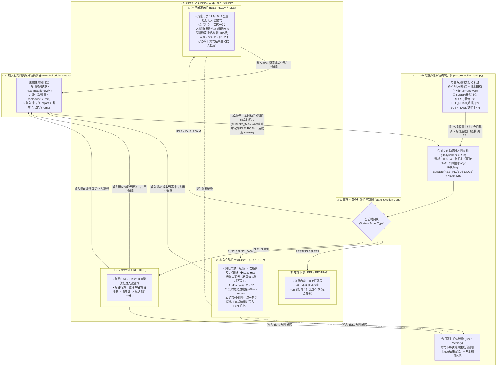

# OnlyYou (只有你) —— 技术架构与 AstrBot 实现方案设计 (v2.8)

> 本文档紧密结合 [AstrBot 插件开发指南 (`Star` 规范)](https://docs.astrbot.app/dev/star/plugin-new.html)，详细定义 `astrbot_plugin_only_you` 的核心工程设计，重点包含：**三态门禁（休息中 / 繁忙中 / 空闲中）× 四类可执行行动卡（`SLEEP` / `SURF` / `IDLE_ROAM` / `BUSY_TASK`）**、**基于作息曲线的 24h 动态弹性时间轴**、**基于外部输入的时间块切分 / 延展微调（含繁忙半途结算）**、参考并精简自 `livingmemory` 的 **分级记忆、定时自动遗忘清理 (`Forgetting GC`) 与简易上下文预算管理器 (`Context Budget Manager`)**，以及 v2.4 引入、v2.5 延续的 **详细角色卡（10 分区 × 36 字段）接管原生 Persona** 与 **插件自治四角色模型体系（`ProviderFactory` + `ModelHub` + `selected_provider`）**；v2.6 带来 **ModelHub 可选继承（`inherit_from`）、按单用户自定义态度 + 关系等级提示词注入、四类行动绑定的四档固定护甲（25/40/65/80）、Pages 记忆面板分层结构化列表、以及支持 Data URL 的角色图片头像（绝不注入 Persona）**。**v2.8 的核心变化是「一个角色一份 JSON 文件」的持久化层：`<db 目录>/souls/<安全文件名>.json` 成为唯一真源（SQLite `souls` 仅作索引），配合 `revision` + 内容哈希的双写冲突裁决、原子写与索引自愈；同一层新增机器人接口（`platform_id`）绑定路由、按 Soul 读写的四角色模型、`runtime_state_v1` 运行态持久化（主动消息去重 / 冷却 / ★L3 目标跨重启）、SURF 分享五条件门禁、MEMORY_MUSE 三层分桶与繁忙成果单次消费、T1 记忆去重 / 上限 / 实时清理，以及 Web API 从 27 条扩展到 31 条。**

**文档版本历史（append-only，滚动更新）**

| 文档版本 | 适用产品版本 | 主要变化 |
| :--- | :--- | :--- |
| v2.8（当前） | 插件 v2.8 | Soul 独立 JSON 唯一真源（revision/内容哈希冲突裁决、原子写、索引自愈、写失败显式告警）；机器人接口绑定与 `resolve_soul` 五级路由；ModelHub 按 Soul 读写与 `onlyyou::main::<soul_id>`；`runtime_state_v1` 运行态持久化；SURF 分享五条件门禁 + 冲浪总开关；MEMORY_MUSE 三层分桶 + 繁忙成果单次消费；T1 去重 / 上限 / 跨重启 GC；Web API 31 条；关系页与会话页改版 |
| v2.7 | 插件 v2.7 | 模型页 0.7s 防抖即时生效、顶栏 tooltip、页面未保存修改守卫、★L3 管理员级入口 |
| v2.6 | 插件 v2.6 | ModelHub 可选继承、单用户专属态度注入、四档固定护甲（25/40/65/80）、记忆页分层列表、Data URL 头像 |
| v2.5 | 插件 v2.5 | 24h 动态弹性时间轴、四类行动卡、繁忙完成结果、未读消息队列、移除奇遇卡 |
| v2.4 | 插件 v2.4 | 详细角色卡（10 分区）接管 Persona、插件自治四角色模型、Pages 控制台 |

---

## 一、 核心状态与四类行动卡控制架构图



---

## 二、 插件标准目录结构

遵循 AstrBot 插件命名规范，仓库与目录命名为 `astrbot_plugin_only_you`：

```text
astrbot_plugin_only_you/
├── metadata.yaml                # 插件元数据声明 (name: astrbot_plugin_only_you)
├── _conf_schema.json            # AstrBot WebUI 配置 Schema（仅运行参数；模型配置按 Soul 存 JSON，见 §5.1/§六）
├── requirements.txt             # 依赖库 (httpx, aiosqlite, pillow, imageio-ffmpeg)
├── main.py                      # 插件入口类 OnlyYouPlugin(Star)：三态门禁 + selected_provider + on_decorating_result TTS + 心跳按 Soul 分发 + SURF 分享门禁 + 运行态持久化 + 生命周期
├── core/
│   ├── state_machine.py         # 🚦 三态枚举 (RESTING/BUSY/IDLE) + 四类行动卡枚举 ActionType（含固定护甲 fixed_armor / armor_tier）门禁控制器
│   ├── roguelite_deck.py        # 🎲 24h 动态积木时间轴引擎（角色专属四类卡池 / 作息曲线 / 弹性块拼接 / 繁忙完成结果字段）
│   ├── schedule_mutator.py      # 🔄 输入驱动的受限微调器（BUSY_TASK 半点切分半途结算 / SLEEP 唤醒窗 / IDLE 加钟 + 三重门禁）
│   ├── character_card.py        # 🎭 详细角色卡单一数据源：CARD_SCHEMA(10 分区/36 字段)、normalize/migrate（含 avatar Data URL 归一化）、Persona Prompt 渲染（头像不注入）
│   ├── soul_manager.py          # 🗂️ Soul 持久化与路由：souls/*.json 唯一真源 + revision/内容哈希冲突裁决 + 原子写/自愈 + 机器人接口绑定 + 五级 resolve_soul + AI 造卡 / 原生 Persona 导入
│   ├── user_relation.py         # 三级用户关系管理 (L1普通 / L2重要熟人 / ★L3核心用户) + 单用户专属态度 attitude + 跨平台映射 + 群聊档案 GroupProfile
│   ├── memory_manager.py        # 🧠 精简版分级记忆引擎 (Tier1瞬时/Tier2近期/Tier3核心 + T1 去重/上限/实时清理 + MEMORY_MUSE 三层分桶 + 定时遗忘GC)
│   ├── context_budget.py        # 🛡️ 上下文/记忆预算管理器 + _takeover_persona 三分支 + USER_RELATION_CONTEXT_PROMPT 关系上下文注入 + SessionBuffer 平台内存清理
│   ├── provider_factory.py      # 🔧 唯一触碰 AstrBot Provider 内部结构的封装（复用/自建实例、inst_map 自定义 id、TTS、dispose）
│   ├── model_hub.py             # 🔌 插件自治四角色模型网关 (main/decision/vision/tts，可选继承；v2.8 按 Soul 读写，写 Soul JSON 的 model_config)
│   ├── platform_bridge.py       # 🤝 AstrBot 平台配置协同桥 (extract_platform_id / list_platform_instances / 原生分段回复 / 流式 / 语音主动消息)
│   ├── runtime_state.py         # 💾 v2.8 运行态持久化：runtime_state_v1 快照（分享去重 / muse 轮转 / 冷却 / ★L3 目标）跨重启恢复
│   ├── web_api.py               # 🖥️ 31 条 Plugin Pages Web API 路由（v2.7 的 27 条 + v2.8 新增 sessions/* 4 条）
│   └── atmosphere_reader.py     # 群聊主战场：防抖等待窗口、多人对话“解线团”、五维读空气器
├── views/                       # 🎨 AstrBot 插件自定义页面 (Plugin Pages / Views，兼容 pages/)
│   └── console/                 # 灰白+青绿极简控制台（48px 顶栏 + 216px 侧栏，8 个页面；v2.8 关系页/会话页改版）
│       ├── index.html           # 外壳：顶栏、侧栏导航、main#view、toast/modal/drawer 容器
│       ├── style.css            # 设计令牌 + 组件样式（浅/深色；v2.8 追加 relations/sessions 等区段）
│       ├── app.js               # bridge 封装、轻量状态、hash 路由、通用 UI、页面 isDirty 守卫、宽幅 modal（无构建 classic script）
│       ├── icons.js             # ≥20 个内联 SVG 线性图标（替代 emoji）
│       ├── charts.js            # 纯 SVG 环形表 / 24h 弹性动态时间轴（浮点时间 / 行动徽章 / 进度 tooltip）/ 环形图 / 条形图
│       ├── page-overview.js     # 概览：状态环形表 + 24h 弹性轴 + 行动徽章/繁忙进度条/今日繁忙成果(Tier1) + 基调/配额/关系/记忆/模型小卡
│       ├── page-schedule.js     # 日程：24h 弹性时间轴 + 四类行动卡网格/筛选/编辑器（已无奇遇卡） + 重抽/强制切换
│       ├── page-character.js    # 角色卡：10 分区动态表单 + AI 整卡生成/分区补全 + Prompt 预览 + 图片头像上传（Canvas 裁剪压缩）
│       ├── page-relations.js    # 关系与群聊（v2.8）：筛选 chips + 即时搜索 + ★L3→◆L2→L1 横向 relation-row + 居中宽幅详情弹窗 + 💬 群聊分区/详情弹窗（已移除 kanban / 拖拽 / ⋯ 菜单）
│       ├── page-memory.js       # 记忆：v2.6 分层列表 + v2.8 T1「⏳ 剩余 Xh 清除」倒计时与「上限 N 条」
│       ├── page-surfing.js      # 冲浪：视频卡片墙 + 分享/删除 + 手动触发冲浪 + v2.8 顶部「赛博冲浪总开关」（乐观更新 + 失败回滚）
│       ├── page-models.js       # 模型：按当前角色读写四角色配置（models/config?soul_id=）+ 源/模型拉取 + 模型来源模式 + 测试 + TTS 试听
│       ├── page-sessions.js     # 机器人接口（v2.8）：接口绑定/解绑（解绑清理平台内存）+ 手动预配 platform_id + 默认兜底角色 + 活跃会话内存概览（已移除旧 UMO 绑定表）
│       └── mock.js              # ?mock=1 / file:// 打开时的本地 Mock bridge（v2.8 同步 sessions/platforms、groups、tier1_limit、toggle_surfing 等形状）
├── surfing/
│   ├── pipeline.py              # 📱 赛博冲浪主控流水线（仅在 IDLE 空闲状态下运行；is_enabled(soul) 总开关、候选耗尽返回 None）
│   ├── video_vision.py          # 多模态视频预处理器（统一 role="vision" 评分，短视频流直传 / FFmpeg 3x3 抽帧；v2.8 is_fallback 标记）
│   └── adapters/
│       ├── base.py              # 抽象平台接口 BaseVideoAdapter & VideoItem 模型
│       ├── bilibili.py          # B站适配器（推荐流/热门/UP主动态、热评抓取、CC字幕/流解析）
│       └── douyin.py            # 抖音适配器（热点榜/推荐流、无水印直链解析、热评抓取）
├── storage/
│   └── db.py                    # 基于 aiosqlite 的持久化层（plugin_settings KV 表 + souls 索引 revision 列幂等迁移）
├── prompts/
│   └── templates.py             # 集中管理角色卡生成/分区补全、卡池、受限微调、读空气、看片、记忆提炼等 Prompt
├── tests/                       # 离线 unittest 测试套件（v2.5~v2.8 全量回归：时间轴/记忆/模型/Web API/Soul 双写一致性/运行态持久化）
└── docs/                        # 产品与架构文档 (PRD.md / ARCHITECTURE.md / PROMPTS_AND_FLOWS.md / WEBUI_DESIGN.md / UPGRADE.md)
```

---

## 三、 主动决策力核心工程设计

### 3.1 三态枚举、四类行动卡与 24h 动态时间块定义 (`core/roguelite_deck.py`)

为兼顾“清晰的三态门禁”、“真实可执行的后台动作”与“千人千面的虚构角色贴合度”，每张行动卡同时具备 **`state`（三态门禁）**、**`action_type`（四类可执行动作）** 与 **`duration_range`（动态时长范围）**：

```python
from enum import Enum
from dataclasses import dataclass, field
from typing import Optional

class BotState(str, Enum):
    RESTING = "RESTING"   # 💤 休息中：不回任何消息，不刷视频
    BUSY = "BUSY"         # 🔥 繁忙中：只回 L2重要用户 & L3核心用户消息
    IDLE = "IDLE"         # ☕ 空闲中：L1/L2/L3 全量读空气回复，可执行冲浪/翻群吃瓜/记忆联想

class ActionType(str, Enum):
    SLEEP = "SLEEP"           # ① 睡觉卡 (绑定 RESTING)：什么都不做，完全静默
    SURF = "SURF"             # ② 冲浪卡 (绑定 IDLE)：触发 B站/抖音真实刷视频管线
    IDLE_ROAM = "IDLE_ROAM"   # ③ 空闲游荡卡 (绑定 IDLE)：翻群吃瓜 / 发呆记忆联想
    BUSY_TASK = "BUSY_TASK"   # ④ 角色繁忙卡 (绑定 BUSY)：行为记忆 + 进度条 + 完成结果写 Tier1

class UserTier(int, Enum):
    L1_NORMAL = 1         # 普通用户（群友）
    L2_IMPORTANT = 2      # 重要用户（混熟的老水友/熟人）
    L3_CORE = 3           # ★ 核心用户（管理员 / OnlyYou）

@dataclass
class StateEventCard:
    """24h 动态行动卡（兼容旧名 StateEventCard）"""
    card_id: str
    title: str                        # 贴合人设的行动名称，如 "丹房炼制回春丹" / "躺沙发刷B站"
    state: BotState = BotState.IDLE   # 绑定的唯一状态（由 action_type 强制同步）
    valid_slots: list[str] = field(default_factory=list)  # 仅旧数据兼容字段，排轴已不再使用
    base_weight: int = 50             # 基础抽取权重
    armor: Optional[int] = None       # v2.6 起默认 None -> __post_init__ 取 action.fixed_armor；字段保留仅为旧数据兼容
    synergy_tags: dict[str, float] = field(default_factory=dict)  # 相邻卡片连携系数
    action_type: Optional[ActionType] = None  # SLEEP | SURF | IDLE_ROAM | BUSY_TASK（显式优先）
    min_hours: float = 1.0            # 随机最短时长（小时，0.5h 网格，0.5 ~ 8.0）
    max_hours: float = 2.5            # 随机最长时长（小时，0.5h 网格）

# from_dict() 旧数据迁移：无 action_type 时按 state + title 推导
#   RESTING -> SLEEP / BUSY -> BUSY_TASK / IDLE 且标题含"刷 B站 抖音 视频 冲浪" -> SURF / 其余 IDLE -> IDLE_ROAM
# 显式 action_type 优先并强制 state = action_type.bound_state；时长夹取到 0.5h 网格且 min <= max。
# v2.6 固定护甲：ActionType.fixed_armor -> SLEEP=80 / BUSY_TASK=65 / SURF=40 / IDLE_ROAM=25，
#                 ActionType.armor_tier -> 4 / 3 / 2 / 1；排轴、force_state、cards/save、cards/ai_generate 一律按档位覆盖。

@dataclass
class SlotInstance:
    """24h 动态时间轴上的单个弹性时间块实例（文档旧称 ScheduleBlock；类名沿用 SlotInstance）"""
    slot_key: str                     # 连续编号 "block_0", "block_1" ...（force_state 用它定位）
    start_hour: float                 # 起始小时 (0.0 ~ 23.5，0.5h 网格)
    end_hour: float                   # 结束小时 (0.5 ~ 24.0)
    state: BotState                   # RESTING | BUSY | IDLE
    card_id: str = "evt_default"
    title: str = "日常摸鱼"           # 当前正在做的事（繁忙卡即作为【当前行为记忆】）
    label: str = ""                   # 行动类型中文标签，如 "繁忙主业"
    action_type: Optional[ActionType] = None  # SLEEP | SURF | IDLE_ROAM | BUSY_TASK
    armor: int = 50                   # 固定档位护甲（v2.6：由 action_type 决定 25/40/65/80，非用户可调）
    mutated: bool = False             # 是否因外部输入发生过微调
    mutation_monologue: str = ""      # 微调心理独白
    delay_minutes: int = 0            # 旧字段保留，新时间轴恒为 0
    # --- 仅 BUSY_TASK 使用的极简三要素字段 ---
    busy_settled: bool = False        # 该繁忙块是否已结算完成结果记忆
    completion_result: str = ""       # 100% 完成（或中途被打断）时生成的一句话结果（写入 Tier1 记忆）

    def get_progress_pct(self, now_dt: Optional[datetime] = None) -> int:
        """实时计算当前时间块进度百分比 (0% -> 100%)；now_dt 缺省取 datetime.now()"""
        dt = now_dt or datetime.now()
        now_hour = dt.hour + dt.minute / 60.0 + dt.second / 3600.0
        if now_hour <= self.start_hour:
            return 0
        if now_hour >= self.end_hour:
            return 100
        return int(round(100.0 * (now_hour - self.start_hour) / (self.end_hour - self.start_hour)))

    def format_time_range(self) -> str:
        """浮点小时转 "13:30-15:00"（24.0 -> "24:00"）"""
        return "%02d:%02d-%02d:%02d" % (
            int(self.start_hour), int(round((self.start_hour % 1) * 60)),
            int(self.end_hour), int(round((self.end_hour % 1) * 60)),
        )
```

#### 24h 作息曲线 (`chronotype`) 与动态时长拼接算法
引擎根据角色卡 `rhythm.chronotype`（`early` 早起型 / `normal` 规律型 / `night_owl` 夜猫子）提供小时级状态权重曲线 `get_chronotype_weights(chronotype, hour_t)`，并在每日零点（或重抽时）从 `t = 0.0` 循环拼接到 `24.0`：

```python
def _build_dynamic_slots(
    self,
    chronotype: str,
    vigor: DayVigorCard,
    pool: list[StateEventCard],
    rng: Any = None,
) -> list[SlotInstance]:
    """把角色专属卡池无缝拼成 0.0 -> 24.0 的弹性时间轴（0.5h 网格，最终 7~11 块）"""
    t = 0.0
    blocks: list[SlotInstance] = []
    prev_block: Optional[SlotInstance] = None
    consecutive_busy_hours = 0.0
    hours_since_long_sleep = 99.0

    while t < 24.0 - 1e-6:
        remaining = round(24.0 - t, 1)
        # 1. 查询角色作息类型在时刻 t 的四类行动权重倍率
        state_weights = self.get_chronotype_weights(chronotype, t)
        # 2. 叠加今日基调卡倍率 + 防呆连携（刚睡醒不连睡 / 连续忙 >3.5h 后提高 SURF/IDLE_ROAM 权重）
        card = self._weighted_draw_card(
            pool, remaining, state_weights, vigor, prev_block,
            consecutive_busy_hours, hours_since_long_sleep, rng=rng,
        )
        # 3. 在卡片 [min_hours, max_hours] 内按 0.5h 步长随机掷出时长，并截断到 24.0
        duration = self._roll_duration(card.min_hours, card.max_hours, remaining, rng=rng)
        block = SlotInstance(
            slot_key=f"block_{len(blocks)}",
            start_hour=round(t, 1),
            end_hour=round(t + duration, 1),
            state=card.state,
            card_id=card.card_id,
            title=card.title,
            label=card.action_type.label,
            action_type=card.action_type,
            armor=max(0, min(100, card.armor + vigor.armor_offset)),
        )
        blocks.append(block)
        if block.action_type == ActionType.SLEEP and duration >= 3.0:
            hours_since_long_sleep = 0.0
        else:
            hours_since_long_sleep += duration
        consecutive_busy_hours = (
            consecutive_busy_hours + duration if block.state == BotState.BUSY else 0.0
        )
        prev_block = block
        t = round(block.end_hour, 1)

    # 4. 收尾重排：合并/拆分到 7~11 块、重排连续 slot_key、钉死末块 end_hour = 24.0；
    #    旧日程（6 时段 / 过夜 end<start）由 is_valid_timeline() 校验失败后自动重抽。
    target = int(rng.choice([8, 9, 10, 11]))
    return self._rebalance_blocks(blocks, target=target)
```

---

### 3.2 三态门禁与四类行动卡执行控制器 (`core/state_machine.py` & `main.py`)

#### 1. 对被动消息【回消息】的三态拦截与放行逻辑 (`main.py`)
当 AstrBot 收到任何群聊或私聊消息 `event` 时，第一步直接经过三态门禁（零 Token 消耗完成前置过滤）：

```python
@filter.event_message_type(filter.EventMessageType.ALL, priority=999)
async def on_any_message(self, event: AstrMessageEvent):
    if event.message_str.startswith("/"):
        return  # 放行系统指令

    soul = await self.soul_manager.resolve_soul(event.unified_msg_origin)
    user = await self.user_relation.resolve_user(event)
    current_block = await self.deck_engine.get_current_slot(soul.soul_id)

    # 1. 将消息静默记入群聊/私聊滑动窗口（供后续苏醒或 IDLE_ROAM 翻群吃瓜时读取）
    self.atmosphere_reader.record_message(event, user)

    # 2. 检查是否因高冲击力消息触发【受限日程微调】（如把 BUSY_TASK 半途打断切分为 IDLE_ROAM）
    mutated = await self.schedule_mutator.on_message_input(soul, current_block, event, user)
    if mutated:
        current_block = await self.deck_engine.get_current_slot(soul.soul_id)

    # 3. 🚦 三态核心门禁裁决：通过 PlatformBridge.apply_reply_decision 协同原生管线
    #    被门禁拦截的消息 = Bot 当时不可用而错过的消息 -> 记入【未读队列】
    if current_block.state == BotState.RESTING:
        # 💤 睡觉卡 (SLEEP)：撤回唤醒，不回任何消息；所有未读都进未读队列
        self.session_buffer.mark_unread(umo, buffered_message, is_private=is_private)
        self.platform_bridge.apply_reply_decision(event, False)
        return

    elif current_block.state == BotState.BUSY:
        # 🔥 角色繁忙卡 (BUSY_TASK)：忽略 L1 普通用户；仅放行 ◆L2 与 ★L3，并在 Prompt 注入当前行为 + 进度条 (0~100%)
        if user.tier == UserTier.L1_NORMAL:
            self.session_buffer.mark_unread(umo, buffered_message, is_private=is_private)
            self.platform_bridge.apply_reply_decision(event, False)
            return

    # 4. 群聊走读空气裁决 -> 若决定开口，放行交由 AstrBot 原生管线生成与分段发送
    #    注意：门禁放行后即使读空气判 IGNORE，这条消息也属于「已读」，不进未读队列
    should_reply = await self.atmosphere_reader.evaluate_should_reply(event, soul, user, current_block)
    self.platform_bridge.apply_reply_decision(event, should_reply)
```

> **未读消息定义**：只统计**被三态门禁拦截**的消息（`RESTING` 全部 / `BUSY` 的 `L1`）；被放行后读空气判 `IGNORE` 的消息是“已读但不想回”，不算未读。未读队列由 `SessionBuffer._unread` 独立维护（不依赖 15 条滑窗驱逐、按群聊/私聊分类、TTL/容量/冷却可配）。

#### 2. 四类行动卡 (`SLEEP` / `BUSY_TASK` / `SURF` / `IDLE_ROAM`) 的后台心跳调度
后台异步心跳循环（每 15 分钟）按当前时间块 `current_block.action_type` 驱动真实行为。**v2.8 起心跳按 Soul 驱动**（`_souls_for_heartbeat()`：有机器人接口绑定的 Soul + 默认兜底 Soul 各自独立跑时间轴 / 模型配置 / 未读范围，详见 §6.3），先执行 `_maybe_run_scheduled_gc()` 再做逐 Soul 分发：
1. **当刚跨过一个 `BUSY_TASK` 时间块（进度到达 `100%` 且 `busy_settled == False`）**：
   - 自动结算该繁忙块：调用决策模型（或轻量模板回退）生成**一句话完成结果**（如 *“忙活两小时终于把回春丹炼出来了，成色还不错”*），赋值给 `block.completion_result`，并直接调用 `memory_manager.add_memory(memory_tier=1, ...)` 写入 **Tier 1 短时记忆库**，标记 `busy_settled = True`。
2. **当当前块为 `① SLEEP` (`BotState.RESTING`)**：
   - **什么都不做**！直接返回，完全静默。
3. **当当前块为 `④ BUSY_TASK` (`BotState.BUSY`)**：
   - 不刷视频、不主动找人闲聊；由 `current_block.get_progress_pct(now_dt)` 随时间自动推進 `0% -> 100%` 进度条，供被动回复 ◆L2/★L3 时展示 `[正在忙：{title} | 进度：{progress}%]`。
4. **任意 `IDLE` 块（`SURF` / `IDLE_ROAM`）在驱动自身行为前，先执行【私聊未读补回】**：
   - `_catch_up_private_unread()` 取私聊未读队列，按会话逐条喂给 `UNREAD_PRIVATE_CATCHUP_PROMPT`，生成一句“刚睡醒/刚忙完才看到”的自然补回消息并经 `PlatformBridge.send_proactive_message()` 发送；每个私聊会话受 `unread_private_cooldown_minutes` 冷却限制，单次心跳最多补回 2 个会话，发送成功即 ack 该批未读（失败保留重试）。
5. **当当前块为 `② SURF` (`BotState.IDLE`)**：
   - **总开关优先**：若该 Soul 的 `settings.surfing_enabled == False`（缺失时回退全局 `_conf_schema.json → surfing_config.surfing_enabled`），本次 `SURF` 自动**降级为 `IDLE_ROAM` 分支**，不刷视频；
   - **触发真实刷视频 (`CyberSurfingPipeline`)**：结合角色卡 `surfing_prefs` 拉取 B站/抖音推荐流与热评，由 `vision` 模型看片打分，写入看片记忆；随后由 `_maybe_share_surfed_video()` 做**五条件分享门禁**（非 fallback 结果 / 本 Soul 未分享过该视频 / 分数 ≥ `surf_share_min_score` / 冲浪分享冷却 / IDLE_ROAM 冷却 / 存在 ★L3 私聊目标），**发送成功才记录 video_id 与时间戳**（失败保留重试机会），详见 §6.8。
6. **当当前块为 `③ IDLE_ROAM` (`BotState.IDLE`)**：
   - **分支 A —— 翻群记录吃瓜 (`GROUP_LURK`，先决策后回复)**：从【群聊未读队列】按「未读条数 × 新鲜度」排序选一个群 → 先用 `ATMOSPHERE_EVAL_PROMPT` 对“未读批次 + 最近窗口”跑一次决策模型（`REPLY` / `IGNORE`）；只有 `REPLY` 才用 `IDLE_ROAM_PROACTIVE_PROMPT` 生成冒泡/私聊 ★L3 吐槽并发送；`IGNORE` 则静默消费该批未读（不重复评估）。消费即从队列移除，并受 `unread_group_cooldown_minutes` 每群冷却限制；
   - **分支 B —— 发呆记忆联想 (`MEMORY_MUSE`，v2.8 三层分桶)**：当无群聊未读、或群聊决策为 `IGNORE` 时，**先消费今日已结算、且本 Soul 尚未主动聊过的 `BUSY_TASK` 完成结果**（`_mused_busy_keys[soul_id]`，同一成果最多聊 1 次）；全部聊过后再用 `MemoryManager.sample_muse_memories(soul_id, exclude_ids=...)` 对 **T1/T2/T3 三个分桶独立抽样**（各桶旧访问优先，按重要度 / 层级加权抽 ≤2 条）。**发送成功才** `touch_memories_for_muse()`（仅刷新 `last_accessed_at`，不加 `access_count`、不改 vitality / tier）并写入 `_mused_memory_ids`（环形上限 30）；两者皆空则安全跳过。

---

### 3.3 🔄 输入驱动的受限日程状态微调器 (`core/schedule_mutator.py`)

机器人如何根据**读取到的用户消息**或**刷到的视频**动态微调自己的 24h 弹性时间轴，同时保证不失控？

#### 1. 触发微调的两类输入与动态时间块切分规则
| 输入来源 | 触发条件（输入冲击力 `Impact > 当前卡片护甲 Armor`，v2.6 起 Armor 恒为 action_type 固定档位 25/40/65/80） | 动态时间轴微调效果（Block Split / Delay） |
| :--- | :--- | :--- |
| **输入一：读取到的用户消息** | **场景 1（摸鱼突变 + 繁忙半途结算）**：当前为 `🔥 BUSY_TASK`，收到 ★L3 核心用户呼叫，或群内多位 ◆L2 熟人高热度爆发聊大瓜 | 在当前时刻 `now_h` 将原 `BUSY_TASK` 时间块一分为二：<br/>① 前半段（`start_h ~ now_h`）按当前进度百分比结算一条**半途被打断的完成结果记忆**写入 Tier 1；<br/>② 后半段（`now_h ~ end_h`）切分为 **`IDLE_ROAM（空闲中）`**（放下手头正事，专心水群/陪聊）。切分后前半段护甲固定为 `BUSY_TASK=65`、后半段固定为 `IDLE_ROAM=25` |
| **输入一：读取到的用户消息** | **场景 2（热聊熬夜）**：当前为 `☕ SURF / IDLE_ROAM` 且即将进入下一时间块 `💤 SLEEP`，但正与 ★L3 核心用户或熟人群热聊 | 将当前空闲块的 `end_hour` 延长 `0.5 ~ 1.0 小时`，并将下一块 `SLEEP` 的 `start_hour` 同步向后推迟 |
| **输入一：读取到的用户消息** | **场景 3（核心唤醒）**：当前为 `💤 SLEEP`，★L3 核心用户在私聊连续发消息强呼叫（普通/重要用户无法触发） | 从当前时刻 `now_h` 切分出一段 `0.5 ~ 1.0 小时` 的 **`IDLE_ROAM`**（迷迷糊糊醒来回复核心用户） |
| **输入二：刚刷到的抖音/B站视频** | **场景 4（刷片上头）**：当前在 `☕ SURF` 刷到了多模态评分 `>= 88` 的超搞笑/高能神作，且下一块原本要进入 `BUSY_TASK` 或 `SLEEP` | 触发“再刷亿会儿”：将当前 `SURF` 块延长 `0.5 ~ 1.0 小时`、推迟下一块 `BUSY_TASK / SLEEP` 的开始时间，并立刻把该视频分享出去！ |

#### 2. 三重防失控硬性限制（代码级强约束）
```python
class BoundedScheduleMutator:
    async def can_mutate(self, run: DailyScheduleRun, current_slot: SlotInstance, impact: int) -> bool:
        # 限制 1：每日最大微调次数配额（默认每天最多只允许变卦 2 次）
        if run.mutations_used >= self.config.max_mutations_per_day:
            return False

        # 限制 2：微调冷却时间锁（每次微调后，至少锁定 120 分钟不允许再次改动规划）
        if time.time() - run.last_mutation_ts < self.config.mutation_cooldown_seconds:
            return False

        # 限制 3：定力护甲门槛（输入冲击力必须严格大于当前卡片的固定档位护甲，
        #         v2.6：armor 由 action_type 决定，不再接受用户手动设置）
        if impact <= current_slot.armor:
            return False

        return True
```

---

## 四、 精简版分级记忆、定时遗忘与简易上下文管理器设计

参考 [`astrbot_plugin_livingmemory`](https://github.com/lxfight-s-Astrbot-Plugins/astrbot_plugin_livingmemory) 的生命周期思想，本插件**彻底剔除**了复杂的 2D/3D 图谱前端、知识图谱与高延迟的 Agent Tool 函数调用，仅用 **1 张轻量 SQLite 表 + 定时遗忘清理协程 + 上下文预算裁剪器** 实现高性价比记忆管理。

### 4.1 记忆表结构与三级分类模型 (`core/memory_manager.py`)

在 SQLite 中仅维护一张核心表 `memories`（配合 SQLite 原生全文索引或关键词标签匹配）：

```sql
CREATE TABLE IF NOT EXISTS memories (
    id INTEGER PRIMARY KEY AUTOINCREMENT,
    soul_id TEXT NOT NULL,           -- 所属 AI 角色卡 ID (支持跨平台共享同一角色记忆)
    user_id TEXT,                    -- 关联的全局用户 ID (NULL 则代表 Bot 自身的繁忙成果/冲浪记忆)
    user_tier INTEGER DEFAULT 1,     -- 产生记忆时的用户等级 (1:普通, 2:重要, 3:核心)
    memory_tier INTEGER NOT NULL,    -- 记忆分级: 1=EPHEMERAL(瞬时), 2=RECENT(近期), 3=CORE(核心永久)
    content TEXT NOT NULL,           -- 精炼的一句话记忆内容 (严格控制在 60 字以内)
    keywords TEXT NOT NULL,          -- 逗号分隔的检索关键词标签 (如 "火锅,海鲜过敏,饮食")
    importance INTEGER DEFAULT 5,    -- 初始重要度评分 (1 ~ 10)
    vitality REAL DEFAULT 100.0,     -- 记忆当前活力值 (0.0 ~ 100.0，<=0 时被定时程序物理清理)
    access_count INTEGER DEFAULT 0,  -- 被召回使用的次数 (用于访问强化与晋升)
    created_at INTEGER NOT NULL,     -- 创建时间戳
    last_accessed_at INTEGER         -- 最后一次被召回的时间戳
);
```

#### 记忆写入与自动分级规则：
1. **Tier 1 (`EPHEMERAL = 1`，瞬时记忆)**：
   - 每日 `BUSY_TASK` 走完 / 被打断时随机结算的一句话【完成结果】、刚看完的 B站/抖音视频、或重要度 `<= 4` 的普通群聊小事。
2. **Tier 2 (`RECENT = 2`，近期记忆)**：
   - 对话累计满 `N` 条（默认 15 条）后，由后台**决策模型**（`role="decision"`）异步提炼出的近期事件（重要度 `5 ~ 7`），初始 `vitality = 100.0`。
3. **Tier 3 (`CORE = 3`，核心长效记忆)**：
   - 重要度 `>= 8`（如 ★L3核心用户 / ◆L2重要用户 的核心偏好、身份设定、重要约定），或由 Tier 2 记忆累计被召回 `access_count >= 4` 次后自动晋升而来。

> **Tier 1 的 v2.8 写入约束**（`MemoryManager.add_memory()` / `cleanup_tier1()`）：
> 1. **去重**：同一 `soul_id` + `memory_tier=1` 且 **content 完全相同** 的记忆已存在时，只刷新其 `last_accessed_at` 并返回原 id，**不新增行**（避免同一繁忙成果被重复结算 / 用户反复手动写入导致 T1 膨胀）；
> 2. **上限**：插入后该 Soul 的 T1 数量超过 `memory_and_context_config.max_tier1_memories`（默认 30）时，按 `created_at ASC, id ASC` 淘汰最旧（FIFO）；T2 / T3 行为不变；
> 3. **实时清理**：`cleanup_tier1()` 删除 `> 48h` 的 T1 并逐 Soul 裁剪超上限部分，返回 `{deleted_expired, deleted_overflow}`；由 `main._maybe_run_scheduled_gc()` 在**启动与每次心跳**调用（详见 §4.2）；
> 4. **对记忆注入的影响**：T1 参与 `ContextBudgetManager` 的混合打分（关键词 / 新鲜度 / 重要度）与 MEMORY_MUSE 抽样，因此去重 + 上限 + 48h 清理共同保证「瞬时记忆不会挤掉 T2/T3 的注入预算」；T3 始终优先、T2 次之。

---

### 4.2 🗑️ 定时遗忘与自动清理程序 (`run_forgetting_gc`)

后台定时任务每 24 小时（每天凌晨）执行一次物理清理，确保数据库绝不无限膨胀：

> **v2.8 跨重启幂等**：`main._maybe_run_scheduled_gc()` 在 `initialize()` 与**每次心跳**都会调用，先用 `memory_manager.cleanup_tier1()` 做实时 T1 清理（48h 过期 + 每 Soul 超上限），再检查 `plugin_settings["last_forgetting_gc_date"]`：等于今天则只做实时清理，否则执行 `run_forgetting_gc()` 成功后才写入当天日期。因此插件重启 / 热重载不会重复跑每日 GC，也不会漏跑。

```python
import math
import time

class MemoryManager:
    async def run_forgetting_gc(self):
        """
        每日定时遗忘清理程序：保留重要记忆与最近记忆，物理删除不重要且衰减殆尽的记忆
        """
        now = int(time.time())
        
        # 1. 清理超过 48 小时的 Tier 1 (瞬时短时记忆)
        await self.db.execute(
            "DELETE FROM memories WHERE memory_tier = 1 AND (? - created_at) > 172800",
            (now,)
        )

        # 2. 结算所有 Tier 2 (近期记忆) 的每日活力衰减
        rows = await self.db.fetchall("SELECT id, importance, user_tier, vitality, access_count FROM memories WHERE memory_tier = 2")
        for row in rows:
            # 用户等级保护系数: L1普通=0.6(忘得快), L2重要=1.2, ★L3核心=2.0(忘得慢)
            tier_factor = {1: 0.6, 2: 1.2, 3: 2.0}.get(row["user_tier"], 1.0)
            reinforce_factor = 1.0 + 0.5 * math.log(1 + row["access_count"])
            
            # 计算当日衰减量 (基础衰减率设为 35.0)
            daily_decay = 35.0 / (max(1, row["importance"]) * tier_factor * reinforce_factor)
            new_vitality = row["vitality"] - daily_decay

            if new_vitality <= 0:
                # 🗑️ 活力归零：彻底遗忘，直接物理删除！
                await self.db.execute("DELETE FROM memories WHERE id = ?", (row["id"],))
            elif row["access_count"] >= 4 and row["importance"] >= 6:
                # 💎 多次被提及强化：从 Tier 2 (近期记忆) 自动晋升为 Tier 3 (核心永久记忆)！
                await self.db.execute("UPDATE memories SET memory_tier = 3, vitality = 100.0 WHERE id = ?", (row["id"],))
            else:
                await self.db.execute("UPDATE memories SET vitality = ? WHERE id = ?", (new_vitality, row["id"]))
```

---

### 4.3 🛡️ 简易上下文与预算管理器 (`core/context_budget.py`)

在 `@filter.on_llm_request()` 钩子中，通过 **`ContextBudgetManager`** 同时管控 **“原生历史对话长度”** 与 **“插入记忆的字数上限”**，防止上下文超载与费用失控：

```python
class ContextBudgetManager:
    async def apply_context_and_memory_budget(self, event: AstrMessageEvent, req, soul_id: str, user: UserProfile):
        # =====================================================================
        # 第一步：完全清空平台原生历史 (req.contexts.clear())，由插件全权接管上下文！
        # =====================================================================
        # 为什么要完全舍弃平台原生 req.contexts？
        # 1. 平台 ConversationManager 不会记录插件通过 context.send_message() 主动发送的视频/搭话消息，用平台上下文会导致 Bot 对自己刚主动发的话“失忆”；
        # 2. 平台群聊历史缺乏[引用回复解线团]与[L1/L2/L3关系等级]标注，且若平台开启了 group_icl_enable 会导致重复注入；
        # 3. 由插件统一维护固定长度滑窗 (滑出窗口即送去提炼分级记忆并销毁)，可形成“滑窗 -> 提炼记忆 -> 定时遗忘”的完美闭环！
        req.contexts.clear()

        # 注入插件自身维护的高信噪比会话滑窗 (含 Bot 主动发出的消息、引用拓扑与关系标记)
        session_window_msgs = self.session_buffer.get_formatted_window(
            umo=event.unified_msg_origin,
            max_turns=self.config.sliding_window_size  # 默认保留最近 15 条
        )
        req.contexts.extend(session_window_msgs)

        # =====================================================================
        # 第二步：按 [关键词匹配 + 时间新鲜度 + 重要度] 检索候选记忆
        # =====================================================================
        query_text = event.message_str
        candidates = await self.memory_manager.retrieve_candidates(soul_id=soul_id, user_id=user.global_uid)
        
        now = time.time()
        scored_memories = []
        for mem in candidates:
            # 1. 关键词命中分 (0.0 ~ 1.0)
            kw_list = [k.strip() for k in mem.keywords.split(",") if k.strip()]
            kw_hits = sum(1 for k in kw_list if k in query_text)
            kw_score = min(1.0, kw_hits * 0.5) if kw_list else 0.0
            
            # 2. 时间新鲜度分 Recency (越近越容易被想起，指数衰减)
            days_old = max(0.0, (now - mem.created_at) / 86400.0)
            recency_score = math.exp(-0.15 * days_old)
            
            # 3. 重要度分 Importance (0.1 ~ 1.0)
            imp_score = mem.importance / 10.0
            
            # 综合得分：保证“重要的(Core)”和“最近的(Recent)”以及“当前聊到的”排在最前
            total_score = 0.40 * kw_score + 0.35 * recency_score + 0.25 * imp_score
            scored_memories.append((total_score, mem))

        scored_memories.sort(key=lambda x: x[0], reverse=True)

        # =====================================================================
        # 第三步：硬性预算裁剪 (Hard Budget Gate：限制最大条数与最大字符数)
        # =====================================================================
        selected_lines = []
        current_chars = 0
        recalled_ids = []

        for score, mem in scored_memories:
            if len(selected_lines) >= self.config.max_injected_memories:  # 默认最多 6 条
                break
            if current_chars + len(mem.content) > self.config.max_memory_chars_budget:  # 默认最多 400 字
                break
            
            tag = "核心记忆" if mem.memory_tier == 3 else "近期记忆"
            selected_lines.append(f"- [{tag}] {mem.content}")
            current_chars += len(mem.content)
            recalled_ids.append(mem.id)

        # 异步更新被选中记忆的访问次数 (触发访问强化，延缓被遗忘)
        if recalled_ids:
            await self.memory_manager.reinforce_memories(recalled_ids)

        # 注入精简后的记忆块到 System Prompt
        if selected_lines:
            req.system_prompt += "\n\n[脑海中的相关记忆 (精简注入)]:\n" + "\n".join(selected_lines)
```

> **v2.6 关系上下文注入**：在追加记忆块之前，`ContextBudgetManager` 还会用 `USER_RELATION_CONTEXT_PROMPT` 组装并注入「三级关系重要度法则 + 当前对话人档案 + 群聊其他活跃对话者摘要」，其中包含当前用户的 `tier_label / affinity / nickname / attitude / relation_notes`（缺省分别回退「默认自然称呼」「按关系等级与你的人设性格自然相处」「无」）；`window_peers_block` 由 `UserRelationManager.list_users()` 结合当前 UMO 滑窗中的 sender 过滤得到（最多 4 条），整段用 try/except 包裹、失败静默跳过。`ContextBudgetManager` 通过构造参数 `user_relation` 注入该依赖（默认 None 时跳过 peers 段）。

> 完整的 `apply_context_and_memory_budget()` 执行顺序为：**① 角色卡接管 Persona 段（`_takeover_persona`）→ ② `req.contexts.clear()` 并注入插件滑窗 → ③ 记忆混合打分与硬预算裁剪 → ④ 追加三态指令 / 变卦独白 / 关系上下文（v2.6）/ 记忆块**。其中第 ① 步见 §4.5。

---

### 4.4 🗂️ 插件自治设置表 (`plugin_settings`) 与旧配置迁移

v2.4 起，插件不再把模型选择写入 `AstrBotConfig`（`_conf_schema.json`）：AstrBot 会按 schema 做配置完整性检查，未声明的键可能被删掉，所以 **插件自治配置统一存放在 SQLite 的通用 KV 表**：

```sql
CREATE TABLE IF NOT EXISTS plugin_settings (
    key TEXT PRIMARY KEY,
    value_json TEXT NOT NULL,
    updated_at INTEGER NOT NULL
);
```

`storage/db.py` 提供 `async get_setting(key, default)`（JSON 反序列化）与 `async set_setting(key, value)`（JSON 序列化 UPSERT）。约定 key：

| key | value 类型 | 说明 |
| :--- | :--- | :--- |
| `default_soul_id` | str | 插件默认角色（「机器人接口」页的默认兜底角色，未绑定机器人接口的会话由它接管） |
| `runtime_state_v1` | dict | **v2.8** 运行态快照：`shared_video_ids / last_surf_share_ts / mused_busy_keys / mused_memory_ids / last_idle_roam_ts / last_group_lurk_ts / last_private_catchup_ts / known_l3_umos`（结构 / 上限 / 恢复点见 §6.5） |
| `group_profiles` | list[dict] | **v2.8** 群聊档案 `GroupProfile`（`umo / group_id / platform_id / display_name / notes / bound_soul_id / last_active_at`），由消息到达时 `touch_group` 采集、关系页维护 |
| `last_forgetting_gc_date` | str | **v2.8** 最近一次成功执行每日遗忘 GC 的日期（`YYYY-MM-DD`），保证跨重启幂等 |
| `legacy_umo_bindings_migrated` | bool | **v2.8** 旧 UMO 绑定 → 机器人接口绑定的一次性迁移标记；**只有全部迁移成功才写 True**，失败保留未写状态下次启动重试 |
| `model_config_migrated_to_souls` | bool | **v2.8** 旧全局 `model_config` → 各 Soul JSON 的一次性迁移标记；同样只在全部成功（或无需迁移）后写 True |
| `model_config` | dict | **v2.7 兼容保留**：旧全局四角色模型配置；`ModelHub` 未 attach `SoulManager` 时仍走这里（历史单测依赖）；v2.8 attach 后实际读写各 Soul JSON 的 `model_config` |
| `legacy_model_migrated` | bool | 旧版模型配置（`model_hub_config`）是否已尝试迁移，只尝试一次（v2.4 遗留） |

> 旧版单会话 UMO 绑定仍存 SQLite `umo_soul_bindings` 表，v2.8 仅作兼容读取（`get_umo_bindings` / `set_umo_binding`），主导路由已改为机器人接口绑定（见 §6.3）。

首次启动时 `ModelHub.load()` 会读取旧插件配置中的 `*_llm_provider_id`，经 `ProviderFactory.find_source_model_by_provider_id()` 反查出 `(source_id, model)` 迁移到全局 `model_config`。无论成功与否都会写入 `legacy_model_migrated = true`，之后不再重试；旧配置值从此不再生效，需在「模型」页重新确认。

> **v2.8 迁移 flag 的写入时机**：`legacy_umo_bindings_migrated` 与 `model_config_migrated_to_souls` 都**不是**「尝试即写」——只有本轮全部迁移成功（或本就不需要迁移）才落 True；任何一条失败都保持未写，下次启动自动重试（迁移本身幂等：已迁移的绑定 / 已有有效模型配置的 Soul 会被跳过），日志会出现 `migration incomplete ... next startup retries` 警告。

---

### 4.5 🎭 角色卡接管原生 Persona 段 (`_takeover_persona`)

`ContextBudgetManager.apply_context_and_memory_budget()` 在**最开始**调用 `_takeover_persona(req, soul)`，把 AstrBot 原生注入的 `# Persona Instructions` 段整体替换为角色卡渲染结果：

```python
card_block = f"\n# Persona Instructions\n\n{render_persona_prompt(soul.card)}\n"
sp = req.system_prompt or ""

# ① 精确匹配：任一原生人格原文 -> 整段替换
for p in await self.soul_manager.list_native_prompts():
    seg = f"\n# Persona Instructions\n\n{p}\n"
    if seg in sp:
        req.system_prompt = sp.replace(seg, card_block, 1); return

# ② 正则兜底：替换到下一个一级标题或结尾
new_sp, n = re.subn(r"\n# Persona Instructions\n\n.*?(?=\n# |\Z)",
                    lambda _m: card_block, sp, count=1, flags=re.S)

# ③ 没找到 -> 前置角色卡
req.system_prompt = new_sp if n else card_block + sp
```

配套设计：

1. **单一数据源 `CARD_SCHEMA`**（`core/character_card.py`）：10 个分区 / 36 个字段（v2.6 删除 `social.attitude_l3/l2/l1`，仅保留 `group_role`），同时供后端渲染 Prompt 与前端 `GET card/schema` 动态生成表单。
2. **`SoulProfile.card`**：角色卡数据唯一来源；旧的 `name / archetype / speaking_style / surfing_preferences / native_persona_prompt` 退化为读写 `card` 的兼容 `@property`，旧档案经 `migrate_legacy()` 自动迁移。
3. **渲染预算与优先级**（`render_persona_prompt(card, max_chars=2000)`）：只渲染非空字段、按分区输出 Markdown；优先保留 `identity / speech / personality / social`，超预算时按 `examples > background > appearance > extra > rhythm > interests` 顺序丢弃低优先级分区，最后硬截断保证 `len(result) <= max_chars`；`native_persona_prompt` 只作导入来源记录，**不参与**渲染。
4. **会话路由 `resolve_soul(umo)`（v2.8 五级优先级）**：① UMO 第一段 == `platform_id` 的**机器人接口绑定** → ② 旧 `umo_soul_bindings` 精确绑定（兼容旧数据）→ ③ `plugin_settings["default_soul_id"]` → ④ 最近更新的角色 → ⑤ 自动创建默认角色。**废除单会话 UMO 绑定主导路由**；不再读取平台 `default_personality`、不做 `persona_hash` 匹配，聊天路径上也不再用 LLM 播种卡池（详见 §6.3 / §6.4）。
5. **AI 造卡**：`generate_card(seed_text, base_card, section)` 用**主模型**生成整卡或单个分区草稿（不落库）；`import_native_persona(..., avatar="")` 把原生人设原文写入 `card["extra"]["native_persona_prompt"]`，可选 AI 整卡生成；四类专属行动卡池由**决策模型**生成（奇遇卡已移除）。
6. **头像视觉元数据（v2.6）**：`identity.avatar` 经 `_coerce_avatar()` 归一化为「Emoji/短字符 ≤32 字 / `data:image/(png|jpeg|jpg|webp|gif);base64,...` ≤120000 字符 / 图片 URL ≤500 字符」三选一，非法形态归空；`_render_section()` 显式跳过 `identity.avatar`，因此图片 Base64 **绝不进入 System Prompt / Persona 预算**，仅由 Pages 前端 `app.renderAvatarInner()` 渲染。
7. **关系态度提示词（v2.6）**：系统提示词新增 `USER_RELATION_CONTEXT_PROMPT`（见 `prompts/templates.py`），由 `ContextBudgetManager` 按当前用户与群聊窗口动态填充 `{display_name} / {global_uid} / {tier_label} / {intimacy} / {nickname_text} / {attitude_text} / {notes_text} / {window_peers_block}`；角色卡不再保存千篇一律的等级态度。

---

## 五、 插件自治四角色模型体系 (`ModelHub` × `ProviderFactory`) 与 AstrBot 平台协同设计

> **核心工程原则：插件自治模型 + 100% 复用 AstrBot 原生回复管线。**
> v2.4 起，插件不再读取 AstrBot 配置文件里的模型选择，而是通过 `ProviderFactory` 从「提供商源 + 模型名」构建或复用实例，管理 **4 个模型角色（对话 / 决策 / 视频解析 / TTS）**；主模型通过 `event.set_extra("selected_provider", ...)` 交给 AstrBot 原生管线使用，因此分段回复、流式输出、工具调用等原生能力全部保留。

### 5.1 🔌 四角色模型网关 (`core/model_hub.py`) + 提供商工厂 (`core/provider_factory.py`)

#### 1. 四个模型角色与继承规则

| 角色 (`role`) | 用途 | 继承规则 |
| :--- | :--- | :--- |
| `main`（对话） | 原生管线的主对话模型；也是 AI 生成整张角色卡的创作模型 | **必填**；未配置时插件不覆盖平台默认模型 |
| `decision`（决策） | 读空气、记忆提炼、日程微调、四类行动卡池 / 繁忙完成结果 / IDLE_ROAM 搭话生成（`small` 为兼容别名） | **可选继承（v2.6）**：`inherit_from=""`（独立配置，源/模型留空即停用）/ `"main"`；旧配置缺省兼容为继承 `main` |
| `vision`（视频解析） | 赛博冲浪看片的多模态评分；始终使用 `role="vision"`，不再降级到决策模型 | **可选继承（v2.6）**：`inherit_from=""` / `"main"` / `"decision"`（`vision → decision → main` 递归最多 2 跳，带防环） |
| `tts`（语音） | 插件自建语音合成 | **不继承**；`mode="off"` 即关闭 |

模型配置存放在**每个 Soul 的独立 JSON 文件** `souls/<安全文件名>.json` 的 `model_config` 字段（v2.8 唯一真源，见 §6.1 / §6.6）；`plugin_settings["model_config"]` 仅作为 **v2.7 旧全局配置**兼容保留（`ModelHub` 未 attach `SoulManager` 时使用，历史单测依赖）。结构（单 Soul 视角，四角色归一化同 v2.6）：

```json
{
  "main":     {"source_id": "deepseek", "model": "deepseek-flash"},
  "decision": {"inherit": true, "inherit_from": "main", "source_id": "", "model": ""},
  "vision":   {"inherit": true, "inherit_from": "main", "source_id": "", "model": ""},
  "tts": {"mode": "off|source|provider", "source_id": "", "model": "", "voice": "",
          "provider_id": "", "probability": 1.0, "scope": "private|l3|all", "dual_output": false}
}
```

> **v2.8 按 Soul 读写**：`main.py` 构造 `SoulManager` 后调用 `model_hub.attach_soul_manager(self.soul_manager)`。attach 后 `get_config / save_config / resolve_role / get_provider / get_main_provider_id / get_tts_config / synthesize / get_status / test_role / call_llm_*` 全部支持可选 `soul_id`（缺省 = 默认角色；同步方法 `get_tts_config` 走 Soul 内存缓存，异步方法传 `umo` 时先按 `resolve_soul` 路由出 Soul）。`save_config(...)` 把归一化后的四角色配置写回**该 Soul 的 JSON 文件**并热重建实例。**未 attach 时完全保持 v2.7 全局 `plugin_settings["model_config"]` 行为**。

> **v2.6 归一化不变量**：`decision` / `vision` 恒为 `{"inherit": bool, "inherit_from": str, "source_id": str, "model": str}` 四键结构，且 `inherit === bool(inherit_from)`。归一化顺序：显式 `inherit_from` → 显式 `inherit` → 旧配置缺省继承 `main`；非法 `inherit_from` 按「有 inherit=True 则 main，否则空」兜底。`main` / `tts` 恒补 `inherit=False, inherit_from=""`。

```json
// get_status() 每个 chat role 至少汇报以下字段（Pages 模型页据此渲染状态徽章）
{"role": "vision", "configured": true, "inherited": true, "inherit": true,
 "inherit_from": "decision", "source_id": "deepseek", "model": "deepseek-chat",
 "provider_id": "onlyyou::chat::deepseek::deepseek-chat", "mode": "plugin",
 "label": "deepseek / deepseek-chat（插件自建实例） · 继承轻量决策模型", "ok": true}
```

- `ModelHub.ROLES = ("main", "decision", "vision", "tts")`；`role="small" / "aux"` 统一归一为 `decision`。
- `resolve_role(role)` 返回 `{source_id, model}`（TTS 返回 `{mode, ...}`）；`main` 未配置返回 `None`。v2.6 起 `decision` / `vision` 按 `inherit_from` 递归解析：**关闭继承且源/模型未填时返回 `None`（该角色停用），绝不回退 `main`**；超过 2 跳 / 防环 / 未知父角色同样返回 `None`，调用方按无模型优雅降级。
- `call_llm_text()` 直接调用实例的 `inst.text_chat(prompt=..., system_prompt=..., image_urls=...)`，不再经过 `context.llm_generate`；`call_llm_json()` 复用 `extract_json()` 容错解析。
- `save_config()`（v2.6 旧名 `save_model_config()` 保留为别名）归一化后写入对应 Soul 的 `model_config` 并 `save_soul()`；随后**只注销该 Soul 的**主模型注册 id（`onlyyou::main::<soul_id>`），下一次使用按新配置热重建实例。未 attach `SoulManager` 时仍写全局 `plugin_settings.model_config` 并 `unregister_main()`。
- `load()` 先读旧全局 `plugin_settings["model_config"]`；attach 后执行一次性迁移 `_migrate_config_to_souls_once()`：把旧全局配置复制进**主模型为空**的已有 Soul（不删除旧全局键），`model_config_migrated_to_souls` flag **只在全部 Soul 迁移成功后才写 True**，失败保留未写状态、下次启动重试（日志 `Migration incomplete ... next startup retries`）。
- **彻底删除**旧回退链：不再读 `context.get_config()` / `get_current_chat_provider_id()` / `default_image_caption_provider_id`；Embedding / Rerank 槽位删除。

#### 2. `ProviderFactory`：唯一触碰 AstrBot Provider 内部结构的模块

```python
class ProviderFactory:
    def list_sources(self) -> list[dict]              # 提供商源（绝不含 key，仅 has_key）
    async def list_models(self, source_id) -> list    # 已配置模型 + 远程 get_models() 拉取结果
    def list_tts_providers(self) -> list[dict]        # AstrBot 已启用 TTS 实例 + 已配置未启用条目
    async def find_source_model_by_provider_id(pid)   # 旧配置迁移：provider id -> (source_id, model)
    async def get_chat_provider(source_id, model)     # 先复用 inst_map 同源同模型且启用的实例，否则自建
    def register_main(inst, provider_id=None) -> str  # 注册 inst_map[<provider_id>]；缺省 onlyyou::main，v2.8 传 onlyyou::main::<soul_id>；不 append 到 provider_insts
    def unregister_main(provider_id=None) -> None     # 指定 id 只注销该 id；缺省注销全部 onlyyou::main*
    async def get_tts_provider(tts_cfg)               # mode=source 自建 openai_tts_api；mode=provider 取现有实例
    async def dispose() -> None                       # 清理全部 onlyyou::main* 并 terminate 全部自建实例
```

自建实例的关键细节（已核对 AstrBot 4.29.3 源码）：

1. **合并配置**：`{**source, **entry}`（provider 条目优先）；`entry` 形如 `{"id": "onlyyou::chat::<source>::<model>", "provider_source_id": ..., "model": ..., "enable": true, ...}`；`$ENV` / `${ENV}` 形式的 key 会从 `os.environ` 解析后写入配置。
2. **实例化**：`provider_manager.dynamic_import_provider(type)` → `provider_cls_map[type].cls_type(cfg, provider_manager.provider_settings)` → 若实例有 `initialize` 则 `await inst.initialize()`。
3. **实例复用与缓存**：先在 `inst_map` 中寻找 `provider_config.provider_source_id == source_id`、模型名匹配且未禁用的现有实例；找不到才自建。自建实例按 `(source_id, model)` 缓存。
4. **不污染平台模型列表**：插件自建实例**不会**被 append 到 `provider_insts`，只按需写入 `inst_map["onlyyou::main"]`（v2.7 兼容路径）或 `inst_map["onlyyou::main::<soul_id>"]`（v2.8 按 Soul）；`save_config` 只注销该 Soul 的注册 id，卸载 / 换模型时由 `dispose()` 统一移除并 terminate。
5. **防御式容错**：所有内部属性访问都是 `getattr` + `try/except`，失败只打 warning 并返回 `None` / `[]`，绝不炸掉插件生命周期。

#### 3. `selected_provider`：让原生管线使用插件选出的主模型

```python
# main.py —— 三态门禁决定放行之后、apply_reply_decision 之前
if should_reply:
    main_provider_id = await self.model_hub.get_main_provider_id(soul_id=soul.soul_id)
    if main_provider_id:
        event.set_extra("selected_provider", main_provider_id)
self.platform_bridge.apply_reply_decision(event, should_reply=should_reply)
```

AstrBot 的 `astr_main_agent._select_provider()` 会先读 `event.get_extra("selected_provider")`，再通过 `context.get_provider_by_id()`（即查 `provider_manager.inst_map`）解析实例。`ModelHub.get_main_provider_id(soul_id=...)` 的四种返回值：

| 返回值 | 含义 |
| :--- | :--- |
| `""` | 主模型未配置 / 实例创建失败 → 回退 AstrBot 平台默认模型（「模型」页红字提示） |
| 已有 AstrBot provider id | 复用了 AstrBot 已加载且启用的同源同模型实例 |
| `"onlyyou::main"` | 插件自建实例已注册进 `inst_map`（**未 attach SoulManager 的 v2.7 兼容路径** / 全局配置） |
| `"onlyyou::main::<soul_id>"` | **v2.8** 该 Soul 的插件自建实例已注册进 `inst_map`（同一时刻多个 Soul 可各用各的主模型，不会出现在平台模型列表） |

其余模型角色（decision / vision / tts）只用于插件内部 `inst.text_chat()` / `get_audio()` 调用，不进入原生回复管线；`main` 的 Persona 段则由角色卡接管（见 §4.5）。`ProviderFactory.register_main(instance, provider_id=None)` / `unregister_main(provider_id=None)` 支持自定义 id；`dispose()` 注销全部 `onlyyou::main*` 注册并 terminate 自建实例。

#### 4. 插件自治 TTS（`on_decorating_result` 钩子，先于原生 TTS）

- **三种来源**：`mode="off"` 关闭；`mode="source"` 用提供商源（OpenAI 兼容）自建 `openai_tts_api` 实例（复用源的 `api_base` / `api_key`，音色取 `voice`，默认 `alloy`）；`mode="provider"` 直接使用 AstrBot 现有 TTS 提供商。
- **触发条件**：TTS 开启 **且** `random() <= probability` **且** `scope` 命中（`private` 私聊 / `l3` 当前用户为 ★L3 核心用户 / `all` 任意会话）。
- **流程**：`on_decorating_result` 钩子汇总结果链里所有 `Plain.text` → `model_hub.synthesize(text)` → 把 `Plain` 段替换为 `Record(file=..., url=..., text=...)`；`dual_output=true` 时额外保留一个 `Plain`。
- **为何不会重复播报**：AstrBot `ResultDecorateStage` 先执行 `on_decorating_result` 钩子（约第 160 行），再分段回复（约第 209 行），最后原生 TTS（约第 270 行起）。插件已把文字转成语音后，原生 TTS 拿不到可读的 `Plain` 文本；只有开启「语音 + 文字双发」时才可能与原生 TTS 重复，页面上会提示关闭原生 TTS。
- **主动消息**：`PlatformBridge.send_proactive_message(..., audio_path=...)` 在文字发送后追加一条 `Record` 语音；是否合成由 `ModelHub.get_tts_config()` 的开关 / 概率决定。

---

### 5.2 🤝 插件与 AstrBot 平台原生配置的八大协同法则 (`core/platform_bridge.py`)

为了避免插件功能与 AstrBot 平台自身的配置文件（`cmd_config.json` / `abconf_*.json`）产生冲突或双重执行，制定以下协同边界：

| 平台配置项 | AstrBot 平台原生机制 | ❌ 错误的插件做法（冲突根源） | ✅ **OnlyYou 协同设计方案（平台优先 + 管线复用）** |
| :--- | :--- | :--- | :--- |
| **1. 会话黑白名单与开关**<br/>(`Access Control`) | 平台自带群/私聊黑白名单，且每个配置文件（`abconf`）可独立开关插件 | 插件内部再搞一套群白名单配置，导致用户在两边重复配甚至逻辑冲突 | **插件不设任何黑白名单配置！**<br/>100% 遵循平台访问控制与多配置文件开关：只要消息事件流进插件，即代表平台已放行。 |
| **2. 群聊唤醒与拦截**<br/>(`WakeCheckStage`) | 原生逻辑：群里被 `@` 或命中唤醒词才设置 `should_call_llm=True` | 插件粗暴 `event.stop_event()` 后自己调 `send_message`，导致绕过平台所有后处理管线 | **通过 `event.should_call_llm(bool)` 协同管线！**<br/>• 群友没 `@` Bot，但读空气决定要接话 $\rightarrow$ 调 `event.should_call_llm(True)` 借用原生管线回复！<br/>• 群友 `@` 了 Bot，但处于 `💤休息中` 或 `🔥繁忙中(L1)` 或读空气决定不回 $\rightarrow$ 调 `event.should_call_llm(False)` 静默取消唤醒！ |
| **3. 分段回复**<br/>(`segmented_reply`) | 平台 `RespondStage` 原生支持按标点/正则拆分为多条短气泡并带随机打字延迟发送 | 插件自己切分句子调 `send_message`，或者与平台分段叠加导致一句话被切碎两次 | **全面复用平台 `segmented_reply` 配置！**<br/>• **被动回复**：经由 `should_call_llm(True)` 走原生 `RespondStage`，直接由平台完成分段与打字延迟！<br/>• **后台主动发消息（如刷完视频主动分享）**：无前置 `event` 时，`PlatformBridge` 直接读取 `self.context.get_config(umo)` 中的 `platform_settings.segmented_reply` 正则与间隔参数执行发送，体验与平台 100% 统一！ |
| **4. 流式输出**<br/>(`streaming_response`) | 平台支持边生成边流式推送（与分段回复/TTS 行为互斥或不同） | 插件在 Prompt 里写死要求输出 `<split>` 分段符，结果流式输出把 `<split>` 原样发给用户 | **动态感知自适应**：<br/>在 `@filter.on_llm_request` 中检查 `self.context.get_config(umo)` 的流式开关：若平台开启了流式输出或开启了原生正则分段，插件绝不在 Prompt 中注入自定义分隔符。 |
| **5. 图像理解与文生图**<br/>(`Image Caption / Vision / T2I`) | 1. 平台 `provider_settings.default_image_caption_provider_id` 提供默认识图模型；<br/>2. 原生多模态管线自动将用户发图传给支持视觉的主模型；<br/>3. 文生图通过平台生图插件（LLM Tool）触发 | 插件对群聊图片再调一次识图导致双倍计费；或在插件内重复造文生图轮子 | **用户发图走平台、后台看片走插件 `vision` 角色**：<br/>• **群聊/私聊用户发图**：走原生多模态/识图管线，插件不二次调接口，直接复用转述结果记入群聊窗口。<br/>• **后台刷 B站/抖音看片**：统一使用插件自治的 `vision` 角色（未单独配置时继承 `main`），**不再**读取平台 `default_image_caption_provider_id`。<br/>• **文生图**：直接复用 AstrBot 生态的画图 Tool，插件零侵入。 |
| **6. 语音输入与输出**<br/>(`STT / TTS`) | 1. `provider_stt_settings` 自动将用户语音转文字赋给 `event.message_str`；<br/>2. `provider_tts_settings` 在 `ResultDecorateStage` 中把回复转语音 | 插件自己再配一套 STT/TTS，导致不会处理语音或发出两条重复语音 | **STT 委派平台、TTS 插件自治（先于原生）**：<br/>• **语音输入 (STT)**：平台前置管线已自动转成文字，插件直接读 `event.message_str`。<br/>• **语音输出 (TTS)**：插件通过 `on_decorating_result` 钩子先于平台分段回复与原生 TTS 执行，把 `Plain` 文本合成为 `Record` 语音（`ModelHub` 的 `tts` 角色，来源：关闭 / 提供商源自建 / AstrBot TTS）。插件转完后原生 TTS 拿不到可读文字，不会重复播报；仅开启「语音 + 文字双发」时需在页面提示关闭原生 TTS。 |
| **7. 上下文消息注入与群聊感知**<br/>(`req.contexts` & `group_icl_enable`) | 平台 `ConversationManager` 按 `umo` 维护 `req.contexts`，且有 `group_icl_enable` 注入群聊记录 | 1. **致命缺陷**：插件后台调用 `context.send_message()` 主动发的视频和消息**不会进入平台 `ConversationManager`**，导致用户回复时 Bot 根本不知道自己刚主动发了啥；<br/>2. 平台群聊记录无解线团与等级标记，且与插件滑窗双重注入浪费 Token | **完全舍弃平台 `req.contexts`，由插件 100% 接管上下文管理！**<br/>• 在 `@filter.on_llm_request` 中直接执行 **`req.contexts.clear()`**，彻底丢弃平台塞入的原生历史与 `group_icl` 记录（但保留当前轮次的 `req.prompt` 与 `req.image_urls`）。<br/>• **插件统一滑窗闭环**：无论是用户消息、被动回复、还是 **Bot 后台主动发送的视频/消息**，全部统一写入插件的会话滑窗（`sliding_window_size = 15`）；当消息滑出窗口满 15 条时，触发决策模型提炼为分级记忆后直接销毁原始消息！ |
| **8. 主模型选择与人格注入**<br/>(`selected_provider` / Persona) | 1. `astr_main_agent._select_provider()` 优先读 `event.get_extra("selected_provider")`，再经 `context.get_provider_by_id()`（即查 `provider_manager.inst_map`）解析实例；<br/>2. 人格以 `\n# Persona Instructions\n\n{prompt}\n` 形式注入 System Prompt | 插件自行调 LLM 再 `send_message`，绕过原生分段/流式/工具调用；或直接改平台配置文件导致热重载后失效 | **插件选模型 + 接管人格段**：<br/>• 门禁放行后执行 `event.set_extra("selected_provider", main_provider_id)`，回复仍由 AstrBot 原生管线生成与发送（分段/流式/工具调用全部保留）。<br/>• 角色卡通过 `_takeover_persona` 三分支替换 `# Persona Instructions` 段；AstrBot 原生 Persona 只作为一次性导入来源。 |

---

## 六、 v2.8 Soul 独立配置持久化层、机器人接口绑定与运行态持久化

> **一句话总览**：v2.8 把「角色卡（Soul）」从 SQLite `souls.profile_json` 的一行 JSON 升级为 **磁盘上每个角色一份独立 JSON 文件**（`souls/<安全文件名>.json`，唯一真源）；SQLite 只保留索引，用于级联更新、旧库迁移与「最近更新」路由兜底。围绕这一层，v2.8 同时引入：机器人接口（`platform_id`）绑定与五级路由、按 Soul 读写的四角色模型、`runtime_state_v1` 运行态持久化、SURF 分享五条件门禁、MEMORY_MUSE 三层分桶、T1 去重 / 上限 / 实时清理，以及 31 条 Web API。

### 6.1 🗃️ Soul 独立 JSON 文件（唯一真源）

#### 1. 路径推导与文件名

```python
# core/soul_manager.py
self.souls_dir = os.path.join(os.path.dirname(os.path.abspath(self.db.db_path)), "souls")
# 生产环境（AstrBot Docker）：
#   /AstrBot/data/plugin_data/astrbot_plugin_only_you/souls/<安全文件名>.json
```

- **禁止写死路径**：`souls_dir` 一律由 `db.db_path` 推导；只有 `db.db_path` 为空（离线 / 无 DB）时才回退到 `<cwd>/data/plugin_data/astrbot_plugin_only_you/souls`。单元测试把 DB 放在临时目录，Soul 文件也随之落在临时目录。
- 文件名规则（`_soul_filename()`）：非法字符 `\ / : * ? " < > |` 与控制字符替换为 `_`，去掉首尾空格与 `.`；若发生替换，追加 `__<sha1(soul_id) 前 8 位>` 防撞（替换后主体截断 40 字符）。`default_soul` / `酒狐` 这类正常 ID 就是 `<soul_id>.json`。
- 「一个角色可绑定多个机器人接口，一个机器人接口同一时刻只属于一个角色」——绑定关系保存在 **Soul JSON 的 `bound_platforms`** 中，而不是 `plugin_settings`。

#### 2. 文件 schema 与目录树

```json
{
  "soul_id": "酒狐",
  "revision": 7,
  "card": { "identity": {}, "appearance": {}, "...": "10 分区 × 36 字段" },
  "state_event_cards": [ { "card_id": "evt_busy_1", "title": "...", "state": "BUSY",
                            "action_type": "BUSY_TASK", "min_hours": 1.5, "max_hours": 3.0 } ],
  "model_config": {
    "main":     { "source_id": "deepseek", "model": "deepseek-flash" },
    "decision": { "inherit": true, "inherit_from": "main", "source_id": "", "model": "" },
    "vision":   { "inherit": true, "inherit_from": "main", "source_id": "", "model": "" },
    "tts": { "mode": "off", "source_id": "", "model": "", "voice": "",
             "provider_id": "", "probability": 1.0, "scope": "private", "dual_output": false }
  },
  "bound_platforms": ["aiocqhttp"],
  "settings": { "surfing_enabled": true },
  "updated_at": 1762840000
}
```

```text
<AstrBot data dir>/plugin_data/astrbot_plugin_only_you/
├── only_you.db                 # SQLite：memories / users / surfing_history / plugin_settings / souls 索引 ...
└── souls/                      # v2.8 唯一真源（每个角色一份 JSON）
    ├── 酒狐.json
    ├── 星野.json
    └── weird_id__1a2b3c4d.json # soul_id 含非法字符时的安全文件名 + sha1 前 8 位
```

- `SoulProfile.to_dict()` 输出上述全部键，并**同时保留旧扁平字段**（`name / archetype / speaking_style / native_persona_prompt / surfing_preferences / encounter_talk_cards`）以兼容 v2.7 及更早档案；`from_dict()` 对缺失的 `revision / model_config / bound_platforms / settings / updated_at` 全部补默认值。
- `settings` 至少含 `surfing_enabled: bool`（默认 True），未知键原样保留（前向兼容）；`SoulProfile.surfing_enabled` 是只读 property（`bool(settings.get("surfing_enabled", True))`）。
- `bound_platforms` 去重去空、不含 `:`、长度 ≤64；`revision` 从 0 起、每次成功保存 +1。

#### 3. 原子写

`_write_soul_file()` 的写入协议（防止断电 / 并发产生半截 JSON）：

1. 建立/确认 `souls/` 目录（失败 → 记 `last_file_write_error` 并降级 SQLite-only）；
2. `json.dumps(profile.to_dict(), ensure_ascii=False, indent=2)`（UTF-8）；
3. 写唯一临时文件 `"{path}.{pid}.{uuid4[:8]}.tmp"` → `flush()` → `os.fsync()`；
4. `os.replace(tmp, path)` 原子替换；随后 **best-effort fsync 目录**（有的平台不支持，忽略 `OSError`）；
5. 任一步失败 → 清理临时文件、**重试 1 次**；两次都失败 → `logger.error` 并记录 `SoulManager.last_file_write_error`（下一次成功写入时清空）。

#### 4. SQLite `souls` 表仅作索引

```sql
CREATE TABLE IF NOT EXISTS souls (
    soul_id TEXT PRIMARY KEY,
    persona_hash TEXT NOT NULL,
    profile_json TEXT NOT NULL,
    updated_at INTEGER NOT NULL,
    revision INTEGER NOT NULL DEFAULT 0   -- v2.8 新增
);
```

- `db.initialize()` 用 `PRAGMA table_info(souls)` 检测列，旧库自动幂等执行 `ALTER TABLE souls ADD COLUMN revision INTEGER NOT NULL DEFAULT 0`（失败静默，读取路径另有「无 revision 列」兜底查询）。
- 索引由 `_upsert_soul_index()` 用 `INSERT ... ON CONFLICT(soul_id) DO UPDATE` 同步；索引写失败不影响 JSON 已保存，下一次读取会以文件为准重建索引。
- 旧库（仅 SQLite 行、无 JSON）在 `list_souls()` / `get_soul_by_id()` 时**自动落盘 JSON**（日志 `Migrated legacy SQLite soul '...' to ...json`），并把 `revision == 0` 升级为 1。

---

### 6.2 🔁 双写一致性：`revision` 单调 + 内容哈希冲突裁决 + 索引自愈

> **目标**：JSON 文件为唯一真源，任何时钟回拨 / 手工改文件 / 写文件失败都不能让旧数据覆盖新数据，也不能静默降级。

#### 1. `save_soul()` 的单调性保证

```python
previous_revision = max(file.revision, index.revision, cached.revision, incoming.revision)
profile.revision   = previous_revision + 1
previous_updated   = max(file.updated_at, index.updated_at, cached.updated_at)
now = int(time.time())
if previous_updated and now < previous_updated and soul not in warned:
    logger.warning("System clock moved backwards ... keeping updated_at monotonic")  # 每个 Soul 只告警一次
profile.updated_at = max(now, previous_updated + 1)
```

1. **先写 JSON（原子写），再 upsert 索引**；索引写失败只 warning（文件已是权威，下次读取重建索引）。
2. 若 JSON 写失败：仍写入 SQLite 索引（数据不丢），同时记录 `last_file_write_error`，并由 `souls/save` Web API 显式告警（见 §6.2.3）。
3. **保存时检测磁盘分叉**：若磁盘已有文件且其 revision 高于本次传入的 revision，log warning「检测到磁盘内容可能被外部修改，本次保存将以更高 revision 覆盖」，不阻塞保存。

#### 2. 读取时的冲突裁决（`_resolve_soul_conflict()` 统一 helper）

`list_souls()` 与 `get_soul_by_id()` 共用同一裁决逻辑，返回 `(winner, reason)`：

| 磁盘状态 | 分支 / 裁决（reason） | 动作 |
| :--- | :--- | :--- |
| 只有 JSON 文件 | 文件为准（`file-only` 分支，在 helper 之外处理） | 补建 SQLite 索引（用于级联更新 / 最近更新路由） |
| 只有索引（旧库） | 索引为准（`index-only` 分支，在 helper 之外处理） | 落盘 JSON（`revision == 0` 先升为 1） |
| 两者都有，`index.revision > file.revision` | **索引胜**（`index-newer`） | 说明上次 JSON 写失败或被回滚 → **回写 JSON 自愈** + warning |
| 两者都有，`file.revision > index.revision` | **文件胜**（`file-newer`） | 重建 SQLite 索引 |
| revision 相同，内容哈希相同 | 文件胜（`synced`） | 无动作（已同步） |
| revision 相同，内容哈希不同 | **文件胜**（`file-edited`） | 视为手工编辑 → 保留 JSON 并重建索引 + warning |

- **内容哈希**：`_soul_content_hash()` 对 `to_dict()` **剔除 `updated_at` / `revision`** 后的 canonical JSON（`sort_keys=True`、紧凑分隔符）取 `sha256`；因此只有「真实内容」不同才算手工编辑，时间戳抖动不会误判。
- `revision == 0` 的历史数据同样适用：首次读取自动视作 revision 0，迁移落盘后为 1。
- **损坏 JSON**：`_read_soul_file()` 捕获异常 → warning 后回退索引（不崩溃）；下次成功写入即自愈。

#### 3. 写失败显式告警与恢复

- `SoulManager.last_file_write_error: str`（`""` 表示健康）是唯一的降级信号；`_write_soul_file()` 成功时清空。
- `POST souls/save` 的 `data` 增加：

```json
"storage": { "file_written": true, "degraded": false, "error": "" }
```

  写失败时 `file_written=false` / `degraded=true`，`message` 追加中文告警：
  `⚠️ Soul JSON 写入失败，已降级写入 SQLite 索引，读取/重启时会自动重试落盘：<error>`。
- **`souls/` 不可写（权限 / 磁盘满 / 只读挂载）的降级与恢复**：插件继续以 SQLite 索引提供服务（保存只写索引、`last_file_write_error` 持续有值、日志 ERROR）；恢复目录权限后，下一次 `list_souls()` / `get_soul_by_id()` 发现 `index.revision > file.revision`（或文件缺失）即自动回填 JSON，删除/重命名等操作也会在可写后自愈。
- **手工编辑建议**：停止插件 / 热重载后修改 `souls/*.json`，改完在 Pages 刷新一次即可（`list_souls()` 会以文件为准重建索引）；若在运行中修改，保存时可能以更高 revision 覆盖并在日志中提示。

---

### 6.3 🤖 机器人接口（`platform_id`）绑定与 `resolve_soul` 五级路由

#### 1. 绑定 API（`core/soul_manager.py`）

```python
async def get_platform_bindings() -> dict[str, str]      # {platform_id: soul_id}
async def get_bound_platforms(soul_id) -> list[str]      # 一个 Soul 可绑多个接口
async def bind_platform(soul_id, platform_id) -> SoulProfile
async def unbind_platform(platform_id) -> str            # 返回原绑定 soul_id（无则 ""）
async def set_soul_setting(soul_id, key, value) -> SoulProfile
async def migrate_legacy_umo_bindings() -> int           # 旧 UMO 绑定一次性迁移
```

- **互斥**：同一 `platform_id` 同一时刻只属于一个 Soul；冲突抛 `ValueError("该机器人接口已被角色『{name}』绑定，请先在角色 {name} 下解绑")`（Web API 原样放进 `message`）。
- **校验**：`platform_id` 非空、不含 `:`、长度 ≤64；`platform_id` 取 UMO 第一段（`aiocqhttp:GroupMessage:123` → `aiocqhttp`）。
- `get_umo_bindings()` / `set_umo_binding()` 仅保留 API 兼容，**「机器人接口」页不再使用**。

#### 2. `resolve_soul` 路由优先级（v2.8 废除单会话 UMO 绑定主导路由）

| 优先级 | 条件 | 结果 |
| :--- | :--- | :--- |
| ① | `umo` 第一段 `platform_id` 命中 **Soul JSON 的 `bound_platforms`** | 该 Soul |
| ② | 旧 `umo_soul_bindings` 精确绑定（兼容旧数据，非首选） | 绑定的 Soul |
| ③ | `plugin_settings["default_soul_id"]` 存在且有效 | 默认角色 |
| ④ | 以上皆无 | 最近更新的角色（`updated_at DESC`） |
| ⑤ | 一个角色都没有 | 自动创建内置默认角色并设为默认 |

#### 3. 机器人接口探测（`core/platform_bridge.py`）

```python
@staticmethod
def extract_platform_id(umo: str) -> str      # "aiocqhttp:GroupMessage:123" -> "aiocqhttp"；空/None -> ""

def list_platform_instances(self, observed_umos=None) -> list[dict]
# 每项：{platform_id, platform_type, name, enabled, running, source: "runtime"|"config"|"observed"}
```

- 来源①：`context.platform_manager.get_insts()`（运行时实例，`running=True`）；② `context.get_config().get("platform", [])`（配置条目，含 `enable`）；③ `observed_umos`（历史 UMO 第一段推断）。按 `platform_id` 去重合并，任何异常静默降级（绝不抛）。
- `sessions/platforms` 的 `platforms[]` 即由该方法结果 + Soul 绑定关系 + 活跃会话数组装；一个已手动预绑定、但 AstrBot 尚未上报的 `platform_id` 也会以 `source="observed"` 出现在列表里（保证刚绑定就能看到）。

#### 4. 会话内存清理（解绑 / 清空时）

```python
async def clear_platform_memory_state(platform_id: str) -> dict[str, int]
# {"windows", "evicted", "unread", "messages", "groups", "l3", "caches"}
```

- 先 `SessionBuffer.clear_platform_memory(platform_id)` 清该平台所有 UMO 的**内存滑窗 / evicted 缓冲 / 未读队列**；
- 再清 `_known_group_umos` / `_known_l3_umos` / `_last_group_lurk_ts` / `_last_private_catchup_ts` 中该平台的项；
- **持久化数据（memories / users / surfing_history / group_profiles）一律不删**（语义表见 §6.9）。

---

### 6.4 💓 心跳按 Soul 驱动与平台作用域

- 每 15 分钟 `_heartbeat_loop()`：`_maybe_run_scheduled_gc()` → `_souls_for_heartbeat()` → 逐 Soul `_dispatch_heartbeat_for_soul()`；单个 Soul 失败只 warning，不影响其他 Soul。
- **参与心跳的 Soul**：有 `bound_platforms` 的 Soul + `default_soul_id` 兜底 Soul；**没有任何绑定**时退化为单个默认 Soul（保持 v2.7 行为）。
- **会话归属作用域**：绑定 Soul 只处理 `umo` 第一段 ∈ 其 `bound_platforms` 的未读 / 群聊 / ★L3 目标；默认兜底 Soul 处理**第一段未被任何 Soul 绑定**的会话；仅一个 Soul 且无绑定时处理全部。
- 每个 Soul 使用**自己的**时间轴（`deck_engine.get_current_and_next_slot(..., chronotype=soul.chronotype)`）、模型配置（`soul.model_config`）与冲浪开关（`soul.surfing_enabled`）。
- 归属过滤通过带默认值的关键字参数实现（`allowed_platforms=None` 不过滤），历史单测直接两/三参数调用仍可用。

---

### 6.5 💾 运行态持久化（`runtime_state_v1`）

> 解决的问题：以下状态原先只在内存，插件重载 / 重启后会导致 **重复分享同一视频、重复主动聊同一条繁忙成果、冷却时间重置、★L3 私聊目标丢失**。v2.8 把它们快照进 `plugin_settings["runtime_state_v1"]`。

```json
{
  "version": 1,
  "shared_video_ids": {"<soul_id>": ["<video_id>", "..."]},
  "last_surf_share_ts": {"<soul_id>": 0.0},
  "mused_busy_keys": {"<soul_id>": ["<slot_key>", "..."]},
  "mused_memory_ids": {"<soul_id>": [1, 2, 3]},
  "last_idle_roam_ts": {"<soul_id>": 0.0},
  "last_group_lurk_ts": {"<umo>": 0.0},
  "last_private_catchup_ts": {"<umo>": 0.0},
  "known_l3_umos": {"<global_uid>": "<umo>"}
}
```

| 快照键 | 上限 / 裁剪 | 恢复点（`main.py` 属性） |
| :--- | :--- | :--- |
| `shared_video_ids` | 每 Soul 200（FIFO 保留最新） | `_shared_video_ids: dict[str, set[str]]` |
| `mused_busy_keys` | 每 Soul 100（FIFO） | `_mused_busy_keys: dict[str, set[str]]` |
| `mused_memory_ids` | 每 Soul 30（环形，与原逻辑一致） | `_mused_memory_ids: dict[str, list[int]]` |
| `known_l3_umos` | 100 条（MRU，淘汰最旧） | `_known_l3_umos: dict[str, str]` |
| `last_surf_share_ts` / `last_idle_roam_ts` / `last_group_lurk_ts` / `last_private_catchup_ts` | 只保留最近 7 天且 `str→float` 合法项；未来时间戳夹到 `now`（防时钟偏移永久锁死冷却） | 对应 `dict[str, float]` |

- **实现**：`core/runtime_state.py::RuntimeStateStore(db)`；`normalize_snapshot()` 防御式（非 dict / 类型错 / 脏值回退默认、未知键丢弃、布尔不当 int），`load()` / `save()` 永不向业务抛出（DB 不可用时 load 返回默认快照、save 返回 `False`）。
- **写入时机**（全部防御式 `getattr` 调用，DB 异常静默）：SURF 分享成功、IDLE_ROAM 发送成功（含 muse / lurk 冷却）、冷却锁更新但未发送（IGNORE 消费 / 发送失败）、私聊未读补回冷却更新、★L3 私聊目标更新、`clear_platform_memory_state` 清理后；`terminate()` 在 `db.close()` 之前 best-effort 落盘；`initialize()` 在 `_ensure_initialized()` 之后恢复。
- **边界（产品既定语义）**：**未读 backlog 本身不持久化**——重启后未读队列会清空（不会补回旧未读），但**主动消息去重 / 冷却 / ★L3 目标不会丢**。因此「重启后重复分享」是 bug，「重启后未读清空」是正常行为。

---

### 6.6 🔌 ModelHub 按 Soul 读写与 `inst_map` 命名

- **接线**：`main.py` 构造 `SoulManager` 后 `self.model_hub.attach_soul_manager(self.soul_manager)`；未 attach 时保持 v2.7 全局行为（历史单测依赖）。
- **读写**：`get_config / save_config / resolve_role / get_provider / get_main_provider_id / get_tts_config / synthesize / get_status / test_role / call_llm_*` 全部支持可选 `soul_id`（缺省 = 默认角色；传 `umo` 时先路由出 Soul）；同步接口用 Soul 内存缓存，异步接口按需 `get_soul_by_id()`。
- **持久化位置**：`model_config` 写在**该 Soul 的 JSON 文件**（经 `save_soul()` 走 revision / 原子写 / 索引同步，与角色卡同一套一致性保证）；`plugin_settings["model_config"]` 仅作 v2.7 旧全局兼容。
- **主模型实例命名**：自建实例注册为 `provider_manager.inst_map["onlyyou::main::<soul_id>"]`；v2.7 的 `"onlyyou::main"` 保留（未 attach / 全局路径）。`save_config` 只注销该 Soul 的注册 id；`dispose()` 注销全部 `onlyyou::main*`。
- **迁移**：`load()` 一次性把旧全局配置迁入「主模型为空」的 Soul（flag `model_config_migrated_to_souls`，只在全部成功 / 无需迁移后写 True；不删旧全局键）。
- 状态接口形状与 v2.7 一致（每个角色带 `configured / inherited / inherit / inherit_from / source_id / model / provider_id / mode / label / ok`）；`get_status(soul_id)` 按该 Soul 的配置计算。`models/config` 的 `data` 顶层新增 `soul_id` 字段，便于前端确认保存到哪个角色。

---

### 6.7 🌐 Web API：31 条路由

路由前缀 `/astrbot_plugin_only_you`，由 `context.register_web_api` 注册（日志 `[OnlyYou] Registered 31 Web API routes for Plugin Pages.`），统一信封 `{status, message, data}`。v2.7 为 27 条，v2.8 **新增 4 条** `sessions/*`。

| # | 路由（前缀后） | 方法 | v2.8 要点 |
| :--- | :--- | :--- | :--- |
| 1 | `init_summary` | GET | 新增 `platform_bindings: {platform_id: soul_id}`；`souls[]` 每项 `to_dict()` 自带 `model_config / bound_platforms / settings / revision / updated_at` |
| 2 | `souls/detail` | GET | 新增 `platform_bindings` |
| 3 | `souls/import_persona` | POST | 不变（avatar / AI 扩写兼容） |
| 4 | `souls/save` | POST | body 透传 `model_config / bound_platforms / settings`；`data.storage` 告警降级 |
| 5 | `souls/rename` | POST | 重命名 JSON 文件 + 级联 SQLite（默认角色 / UMO 绑定 / 记忆 / 日程 / 冲浪历史）；`bound_platforms` 随 Soul 文件自动携带 |
| 6 | `souls/delete` | POST | 删 JSON + 级联 SQLite |
| 7 | `schedule/reroll` | POST | 不变 |
| 8 | `schedule/force_state` | POST | 不变（`action_type` 优先，`armor` 入参忽略） |
| 9 | `cards/list` | GET | 不变 |
| 10 | `cards/save` | POST | 不变 |
| 11 | `cards/delete` | POST | 不变 |
| 12 | `cards/ai_generate` | POST | 不变 |
| 13 | `users/list` | GET | **新增 `groups: [GroupItem]`**（群聊档案） |
| 14 | `users/update` | POST | **新增 action**：`update_group / clear_group_memory / delete_group`（body `{umo, display_name?, notes?}`） |
| 15 | `memories/list` | GET | **新增 `tier1_limit`**（默认 30） |
| 16 | `memories/mutate` | POST | 不变 |
| 17 | `surfing/list_and_trigger` | GET/POST | GET 新增 `surfing_enabled / soul_id`；POST 新增 `action="toggle_surfing"`（`{soul_id, enabled}`） |
| 18 | `dashboard/overview` | GET | 不变（进入前惰性结算繁忙块） |
| 19 | `card/schema` | GET | 不变 |
| 20 | `card/save` | POST | 不变 |
| 21 | `card/ai_generate` | POST | 不变 |
| 22 | `card/preview_prompt` | POST | 不变 |
| 23 | `models/sources` | GET | 不变 |
| 24 | `models/list` | GET | 不变 |
| 25 | `models/config` | GET/POST | **支持 `?soul_id=` / body `{soul_id, model_config}`**；data 增加 `soul_id` |
| 26 | `models/test` | POST | body 可选 `soul_id` |
| 27 | `sessions/default_soul` | POST | 保留；设置为**默认兜底角色** |
| 28 | `sessions/platforms` | GET | **新增**：机器人接口 / 绑定关系 / 当前角色管辖会话内存概览 |
| 29 | `sessions/bind_platform` | POST | **新增**：`{soul_id, platform_id}` 绑定（平台互斥） |
| 30 | `sessions/unbind_platform` | POST | **新增**：`{platform_id}` 解绑并清理该平台内存 |
| 31 | `sessions/clear_memory` | POST | **新增**：`{umo?}` / `{platform_id?}` 清单会话 / 整平台内存 |

> 完整入参 / 出参 / envelope 契约见 [`docs/WEBUI_DESIGN.md`](WEBUI_DESIGN.md) §五。

---

### 6.8 📱 v2.8 主动消息与记忆：SURF 分享五条件门禁、冲浪总开关、MEMORY_MUSE

#### 1. SURF 分享五条件门禁（`main._maybe_share_surfed_video()`）

必须**同时满足**才分享，且**发送成功才**记录 video_id 与时间戳（失败保留重试机会）：

| # | 条件 | 数据来源 |
| :--- | :--- | :--- |
| ① | `review` 非空且 `not review.is_fallback`（视觉模型失败 / 解析失败兜底时 `score=60, is_fallback=True`，不分享） | `VideoReviewResult.is_fallback` |
| ② | 该 `video_id` 未被**本 Soul** 分享过 | `_shared_video_ids[soul_id]`（持久化） |
| ③ | `review.score >= surf_share_min_score`（默认 80） | `_conf_schema.json → surfing_config` |
| ④ | 距上次冲浪分享 ≥ `surf_share_cooldown_minutes`（默认 90） | `_last_surf_share_ts[soul_id]`（持久化） |
| ⑤ | 距上次 IDLE_ROAM 搭话 ≥ `idle_roam_cooldown_minutes`（默认 45） | `_last_idle_roam_ts[soul_id]`（持久化） |

此外必须存在 ★L3 私聊目标（`_latest_l3_umo()`）；分享文本用 `PROACTIVE_CHAT_PROMPT` 生成，`PlatformBridge.send_proactive_message()` 发送并写入会话滑窗。

#### 2. 冲浪总开关

- 生效值：**Soul `settings.surfing_enabled` 优先**，缺失回退全局 `_conf_schema.json → surfing_config.surfing_enabled`（默认 True）；
- `CyberSurfingPipeline.is_enabled(soul)` 判开关；关闭时 `surf_once()` 返回 `None`，心跳 `SURF` 时段**自动降级为 `IDLE_ROAM` 分支**；`/onlyyou surf` 直接回复「赛博冲浪总开关已关闭…请先到 Pages 冲浪页开启」；
- `surf_once()` 候选全部已在 `_watched_ids` 时直接返回 `None`（不再回退 `candidates[0]`）。

#### 3. MEMORY_MUSE 三层分桶 + 繁忙成果单次消费

```python
# core/memory_manager.py
async def sample_muse_memories(soul_id, exclude_ids=None, per_bucket_limit=15, pick=2) -> list[MemoryItem]
# 对 T1/T2/T3 各自独立查询：ORDER BY COALESCE(last_accessed_at,0) ASC, id ASC LIMIT ?
# 过滤 exclude_ids 后按「重要度 × 层级权重(T1=1.0/T2=1.5/T3=2.0)」加权抽 ≤ pick 条
async def touch_memories_for_muse(memory_ids) -> None
# 仅 UPDATE last_accessed_at = now；不加 access_count、不改 vitality、不改 tier
```

`main._run_idle_roam_action()` 的 MEMORY_MUSE 分支：

1. 先取 `run.settled_busy_results()` 中 `completion_result` 非空、且 `(soul_id, slot_key)` 不在 `_mused_busy_keys[soul_id]` 的成果（最多 2 条）作素材；**发送成功才**写入 `_mused_busy_keys`（同一繁忙成果最多主动聊 1 次，跨重启由 `runtime_state_v1` 保持）；
2. 无未用繁忙成果 → `sample_muse_memories(..., exclude_ids=_mused_memory_ids[soul_id])`；**发送成功才** `touch_memories_for_muse(ids)` 并写入 `_mused_memory_ids`（环形上限 30）；
3. 两者皆空 → 安全跳过（不产生空消息）；所有新增属性均 `getattr` 防御。

#### 4. T1 记忆的去重 / 上限 / 实时清理

- `add_memory()`：同 Soul + 同 content 的 T1 已存在 → 只刷新 `last_accessed_at` 返回原 id；插入后超过 `max_tier1_memories`（默认 30）按 `created_at ASC, id ASC` 淘汰最旧；T2/T3 不变。
- `cleanup_tier1()`：删除 `> 48h` T1 + 每 Soul 超上限 T1，返回 `{deleted_expired, deleted_overflow}`；由 `main._maybe_run_scheduled_gc()` 在启动 / 每次心跳调用，并用 `plugin_settings["last_forgetting_gc_date"]` 保证每日 `run_forgetting_gc()` 跨重启只跑一次（见 §4.2）。
- 对注入的影响：T1 仍参与记忆混合打分与 muse 抽样，但去重 / 上限 / 48h 清理确保瞬时记忆不会挤占 T2/T3 的注入预算（T3 优先、T2 次之）。

---

### 6.9 🧹 解绑 / 清空「清理 vs 保留」语义表

| 操作 | 清什么（内存态） | 保留什么（持久化） | 重启后果 |
| :--- | :--- | :--- | :--- |
| **解绑机器人接口**（`sessions/unbind_platform`） | 该平台所有 UMO 的滑窗 / evicted / **未读**；`_known_group_umos` / `_known_l3_umos` 中该平台项；`_last_group_lurk_ts` / `_last_private_catchup_ts` 该平台项；同步清理 `runtime_state_v1` 中对应项 | SQLite `memories` / `users` / `surfing_history` / `plugin_settings["group_profiles"]`；Soul JSON 只改 `bound_platforms` | 该平台会话按 `resolve_soul` 重新路由（通常落到默认兜底角色）；未读不会复活 |
| **清空单会话内存**（`sessions/clear_memory {umo}`） | 该 UMO 的滑窗 / evicted / 未读 | 记忆 / 用户档案 / 群档案 | 未读清空；冷却时间戳保留（不复活旧未读） |
| **清空整个平台内存**（`sessions/clear_memory {platform_id}`） | 同「解绑」的内存部分 | 同上（不改绑定） | 同上 |
| **清空群内存**（`users/update action="clear_group_memory"`） | 该群 UMO 的滑窗 / evicted / 未读 | 群档案（`group_profiles`）保留，仅内存清 | 未读清空 |
| **移除群聊记录**（`users/update action="delete_group"`） | 该群档案 | **删除** `group_profiles` 中该群条目 | 该群下次消息到达会重新采集（新档案） |
| **删除角色**（`souls/delete`） | JSON 文件 + SQLite `souls` 索引 + 级联关联表 | 独立于角色的 memories 等按级联规则处理 | — |

> **统一文案口径**：解绑 / 清空只影响「内存会话状态」，**不删记忆、不删用户档案、不删群档案**；「移除群聊记录」是唯一会删群档案的入口。未读 backlog 本就不持久化，因此重启后清空属正常行为。
>
> **生产升级步骤**（备份 `only_you.db` → 部署 / 热重载 → 日志校验 `Registered 31 Web API routes` / `Plugin initialized successfully` / 迁移日志 / 无 Traceback → 数据校验 → 失败回滚 → 幂等重试与降级）见 [`docs/UPGRADE.md`](UPGRADE.md)。

---

## 七、 配置体系架构：`_conf_schema.json` + `plugin_settings` + 全功能 `Pages` 可视化控制台

> **设计原则**：本插件采用 **三层配置架构**，动态数据与静态阈值彻底分离：
> 1. **`views/console/`（AstrBot Plugin Pages 可视化控制台）**：承担所有动态交互管理——角色卡、行动卡片池、今日三态日程、用户关系、分级记忆、冲浪视频池，以及 **插件自治的四角色模型配置**（详见 [`docs/WEBUI_DESIGN.md`](WEBUI_DESIGN.md)）。
> 2. **`_conf_schema.json`（全局运行参数）**：只保留 Roguelite / 关系 / 读空气 / 冲浪 / 记忆与上下文的算法阈值和 API 基础设置；**不再包含任何模型绑定**（模型配置见 §5.1 与 §4.4）。
> 3. **SQLite `plugin_settings` 表（插件自治设置，见 §4.4）**：存放 `model_config`、`default_soul_id`、`legacy_model_migrated` 等插件自治数据。**不放进 `AstrBotConfig`**，避免 AstrBot 的 schema 完整性检查把未声明的键删掉导致配置丢失。

### 7.1 三层配置归属对照

| 配置数据 | 存放位置 | 读写入口 |
| :--- | :--- | :--- |
| 角色卡 10 分区 / 四类行动卡池 / **四角色模型配置 / 机器人接口绑定 / Soul 级 settings** | **`souls/<安全文件名>.json`（唯一真源，见 §6.1）**；SQLite `souls` 仅索引 | Pages「角色卡」「日程」「模型」「机器人接口」页 |
| 插件默认兜底角色 | `plugin_settings["default_soul_id"]` | Pages「机器人接口」页（`sessions/default_soul`） |
| 旧全局四角色模型配置（v2.7 兼容） | `plugin_settings["model_config"]` | 仅 `ModelHub` 未 attach `SoulManager` 时使用 |
| 运行态快照（去重 / 冷却 / ★L3 目标） | `plugin_settings["runtime_state_v1"]` | 插件内部（`core/runtime_state.py`） |
| 群聊档案 | `plugin_settings["group_profiles"]` | Pages「关系与群聊」页 / 消息采集 |
| 一次性迁移 flag / 上次 GC 日期 | `plugin_settings["legacy_umo_bindings_migrated"]`、`model_config_migrated_to_souls`、`last_forgetting_gc_date` | 插件内部 |
| 用户关系 / 分级记忆 / 冲浪历史 | SQLite `users` / `memories` / `surfing_history` | Pages「关系」「记忆」「冲浪」页 |
| 三态门禁、读空气、冲浪、记忆与上下文阈值 | `_conf_schema.json` | AstrBot 插件配置面板 |

### 7.2 最终 `_conf_schema.json`

以下为 v2.8 最终 schema 全文（不含任何模型绑定，保持 JSON 合法；v2.5 移除 `daily_encounter_count`、新增 `idle_roam_cooldown_minutes` 与 6 个未读消息配置，v2.8 新增 `surfing_enabled / surf_share_min_score / surf_share_cooldown_minutes / max_tier1_memories`）：

```json
{
  "roguelite_schedule_config": {
    "description": "🎲 Roguelite 随机日程引擎与三态微调设置",
    "type": "object",
    "items": {
      "enable_roguelite_schedule": {
        "description": "开启每日 24h 动态时间轴自动构筑（按角色作息曲线从四类行动卡池随机拼接弹性时间块）",
        "type": "bool",
        "default": true
      },
      "max_mutations_per_day": {
        "description": "每日日程最大微调次数上限（根据收到的消息或刷到的视频临时改变状态的次数上限）",
        "type": "int",
        "default": 2
      },
      "mutation_cooldown_minutes": {
        "description": "日程状态微调后的冷却锁定时间（分钟，防止频繁横跳）",
        "type": "int",
        "default": 120
      },
      "allow_l3_wake_from_resting": {
        "description": "允许 ★L3核心用户 在【休息中】状态下通过私聊唤醒 Bot",
        "type": "bool",
        "default": true
      },
      "idle_roam_cooldown_minutes": {
        "description": "【空闲游荡卡 (IDLE_ROAM)】翻群吃瓜 / 发呆记忆联想的主动搭话冷却时间（分钟）",
        "type": "int",
        "default": 45
      },
      "unread_private_reply_enabled": {
        "description": "【未读消息】私聊未读主动补回开关：IDLE 空闲时对休息/繁忙期间错过的私聊消息主动补发一条自然回复",
        "type": "bool",
        "default": true
      },
      "unread_group_ttl_minutes": {
        "description": "【未读消息】群聊未读消息的有效期（分钟）：超过后不再翻群吃瓜，避免翻隔夜旧瓜",
        "type": "int",
        "default": 120
      },
      "unread_private_ttl_minutes": {
        "description": "【未读消息】私聊未读消息的有效期（分钟）：醒来/忙完后仍会补回的时限（默认 12 小时）",
        "type": "int",
        "default": 720
      },
      "unread_max_per_chat": {
        "description": "【未读消息】单个群/私聊会话最多保留的未读消息条数（超出丢弃最旧）",
        "type": "int",
        "default": 20
      },
      "unread_group_cooldown_minutes": {
        "description": "【未读消息】同一个群的翻群吃瓜冷却（分钟），防止反复翻同一个群",
        "type": "int",
        "default": 60
      },
      "unread_private_cooldown_minutes": {
        "description": "【未读消息】同一个私聊会话主动补回的冷却（分钟），防止连续补发",
        "type": "int",
        "default": 60
      }
    }
  },
  "relationship_config": {
    "description": "💖 三级用户关系设置 (普通L1 / 重要用户L2 / 核心用户L3)",
    "type": "object",
    "items": {
      "core_user_ids": {
        "description": "★ L3 核心用户 (管理员) 账号列表",
        "type": "list",
        "items": {
          "type": "string"
        },
        "default": []
      },
      "important_user_ids": {
        "description": "◆ 初始指定的 L2 重要用户列表（繁忙状态下依然会回复的对象）",
        "type": "list",
        "items": {
          "type": "string"
        },
        "default": []
      },
      "enable_auto_promotion_l2": {
        "description": "允许普通用户(L1)通过群聊良性互动自动晋升为重要用户(L2)",
        "type": "bool",
        "default": true
      }
    }
  },
  "atmosphere_config": {
    "description": "🌬️ 群聊主战场：解线团与“读空气”引擎设置",
    "type": "object",
    "items": {
      "takeover_group_chat": {
        "description": "全面接管群聊（结合当前三态与读空气决定是否回复）",
        "type": "bool",
        "default": true
      },
      "debounce_seconds": {
        "description": "群聊听话防抖等待窗口（秒）",
        "type": "float",
        "default": 4.0
      }
    }
  },
  "surfing_config": {
    "description": "📱 赛博冲浪：空闲状态下刷 B站 & 抖音设置",
    "type": "object",
    "items": {
      "enable_bili_surfing": {
        "description": "在【空闲中】状态下主动刷哔哩哔哩 (Bilibili)",
        "type": "bool",
        "default": true
      },
      "bili_cookie": {
        "description": "B站 Cookie (选填)",
        "type": "text",
        "secret": true,
        "default": ""
      },
      "enable_douyin_surfing": {
        "description": "在【空闲中】状态下主动刷抖音 (Douyin)",
        "type": "bool",
        "default": true
      },
      "douyin_api_base": {
        "description": "抖音解析 API 服务地址",
        "type": "string",
        "default": "https://api.douyin.wtf"
      },
      "send_raw_video": {
        "description": "优先直发无水印视频文件",
        "type": "bool",
        "default": true
      },
      "surfing_enabled": {
        "description": "赛博冲浪总开关（全局默认值；每个角色可在 Pages 冲浪页单独覆盖）",
        "type": "bool",
        "default": true
      },
      "surf_share_min_score": {
        "description": "冲浪视频主动分享的最低 vision 评分（达到后才会分享给 ★L3）",
        "type": "int",
        "default": 80
      },
      "surf_share_cooldown_minutes": {
        "description": "两次冲浪视频主动分享之间的冷却时间（分钟）",
        "type": "int",
        "default": 90
      }
    }
  },
  "memory_and_context_config": {
    "description": "🧠 精简版分级记忆、自动遗忘与上下文预算控制",
    "type": "object",
    "items": {
      "enable_tiered_memory": {
        "description": "开启分级记忆与每日自动遗忘清理 (Forgetting GC)",
        "type": "bool",
        "default": true,
        "hint": "自动提炼核心记忆(永久)与近期记忆(随时间衰减并由定时程序自动清理不重要记忆)。"
      },
      "sliding_window_size": {
        "description": "单会话短期滑动窗口保留消息条数（清空平台 req.contexts 后由插件注入的近期消息上限，滑出窗口即送去提炼记忆）",
        "type": "int",
        "default": 15
      },
      "extract_every_n_messages": {
        "description": "滑出窗口每累计多少条有效消息触发一次后台小脑记忆提炼",
        "type": "int",
        "default": 15
      },
      "max_injected_memories": {
        "description": "单次对话最多允许插入的记忆条数上限",
        "type": "int",
        "default": 6
      },
      "max_memory_chars_budget": {
        "description": "单次对话插入记忆的最大总字数预算（汉字数，防止费用过高）",
        "type": "int",
        "default": 400
      },
      "max_tier1_memories": {
        "description": "每个角色最多保留的 Tier 1 瞬时记忆条数（超出按创建时间淘汰最旧；同时用于 Pages 记忆页「上限 N 条」提示）",
        "type": "int",
        "default": 30
      }
    }
  }
}
```

---

## 八、 测试与验证体系

离线 `tests/` 测试套件（stdlib `unittest`，零网络依赖，不要求安装 AstrBot / pytest）。**测试数量随迭代增长，不在此写死**；以 `python3 -m unittest discover -s tests` 全绿为准（v2.8 全量回归全绿），覆盖：

| 测试文件 | 覆盖范围 |
| :--- | :--- |
| `tests/test_provider_factory.py` | fake `provider_manager`：复用已启用实例、自建实例、按 `(source, model)` 缓存、`register_main`（含自定义 `onlyyou::main::<soul_id>` id）/ `dispose` 清理 `inst_map` |
| `tests/test_model_hub.py` | 旧配置一次性迁移（归一化后的 `inherit/inherit_from` 形状）、`decision` / `vision` 继承解析、`tts` 未配置时关闭、`get_main_provider_id` 分支、全程不调用 `context.get_config` / `get_current_chat_provider_id`；**未 attach SoulManager 时保持 v2.7 全局配置行为** |
| `tests/test_character_card.py` | 旧档案迁移、扁平属性兼容、10 分区 / 36 字段、旧 `social.attitude_*` 丢弃、`render_persona_prompt` 跳过空字段/头像并遵守预算 |
| `tests/test_persona_takeover.py` | 精确替换 / 正则兜底 / 前置三分支 |
| `tests/test_web_api.py` | 用 `set_mock_request` 调用**全部 31 条**路由并校验 `{status, message, data}` 信封；dashboard/cards/force_state/ai_generate 按 v2.5+ 新 payload 断言（`action_type/progress_pct/chronotype/busy_results/action_types/armor/armor_tier`） |
| `tests/test_v26_models_armor.py` | v2.6 四档固定护甲（25/40/65/80）、`armor_tier`、排轴与微调产物、`force_state` / `cards_save` / `ai_generate` 忽略手填 armor、ModelHub 可选继承逐条链路与关闭即停用 |
| `tests/test_v26_attitude.py` | v2.6 角色卡删除 `attitude_*` 且旧卡键丢弃、`users.attitude` 幂等迁移与持久化、`USER_RELATION_CONTEXT_PROMPT` 注入与 window peers、头像归一化（Data URL/URL/emoji/超长/非法）与 Persona 不含 Base64 |
| `tests/test_v26_api.py` | v2.6 Web API 端到端：默认卡无 `attitude_l3`、`users/update` 的 attitude 截断/清空回读、`souls/import_persona` 与 `card/save` 的 avatar 落库、`models/config` 的 `inherit/inherit_from` 归一化、固定护甲 payload |
| `tests/test_regressions.py` | 24h 动态时间轴不变量 / 7~11 块 / 0.5h 网格、chronotype 权重差异、旧卡与旧日程迁移、进度与时间格式化、BUSY_TASK 结算写 Tier1 且不重复、IDLE_ROAM 双分支与冷却、mutator 切分/加钟/唤醒、三态门禁矩阵、Forgetting GC、上下文预算 |
| `tests/test_v28_soul_platform.py` | v2.8 Soul JSON 唯一真源、revision 冲突裁决、平台绑定互斥、五级路由、迁移 flag 重试、`onlyyou::main::<soul_id>` 注册 |
| `tests/test_v28_memory_surf.py` | v2.8 MEMORY_MUSE 三层分桶 / touch 语义、T1 去重 / 上限 / `cleanup_tier1`、冲浪总开关、`is_fallback` 分享门禁、候选耗尽返回 `None` |
| `tests/test_v28_web_api.py` | v2.8 新增 4 条 `sessions/*` 路由与扩展参数（`groups` / `tier1_limit` / `soul_id` / `toggle_surfing` / `storage`）、统一信封 |
| `tests/test_v28_integration.py` | v2.8 跨模块集成：Soul JSON 落盘 / 索引自愈、心跳按 Soul、解绑清理、旧 UMO 迁移 + 模型配置迁移的幂等 |
| `tests/test_v28_consistency.py` | 双写加固：revision 单调（模拟时钟回拨）、手工改文件胜出、索引 revision 更高时回写自愈、写文件失败仍落索引 + `last_file_write_error`、损坏 JSON 回退、旧库无 revision 列自动迁移、原子写不残留临时文件 |
| `tests/test_v28_runtime_state.py` | 运行态持久化：快照 round-trip、上限 / 7 天裁剪 / 脏数据容错、重启不重复分享视频 / 不重复 muse 繁忙成果、冷却恢复、解绑后持久层同步、DB 异常不抛 |
| `tests/test_js_syntax.py` | `node --check views/console/*.js` 前端语法检查 + `index.html` 脚本清单检查（无 node 时自动 skip） |

```bash
# 本地离线测试（项目根目录）
python3 -m unittest discover -s tests -v
# Python 语法 / 前端语法检查
python3 -m compileall -q core storage surfing prompts main.py
node --check views/console/*.js
```
