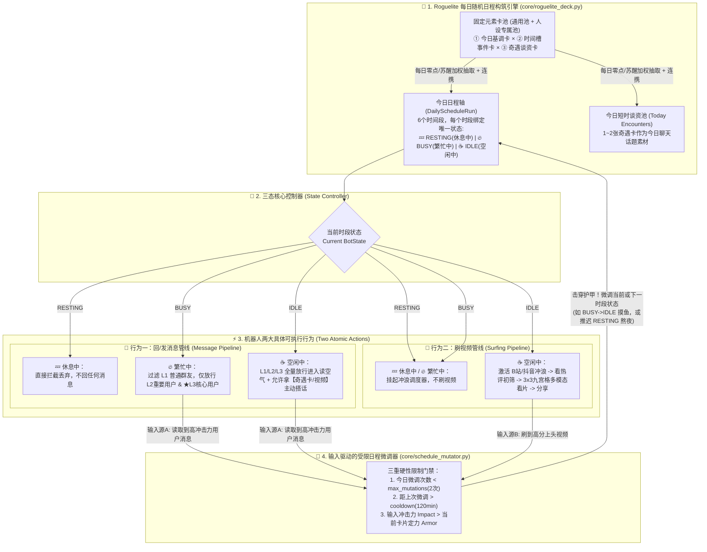
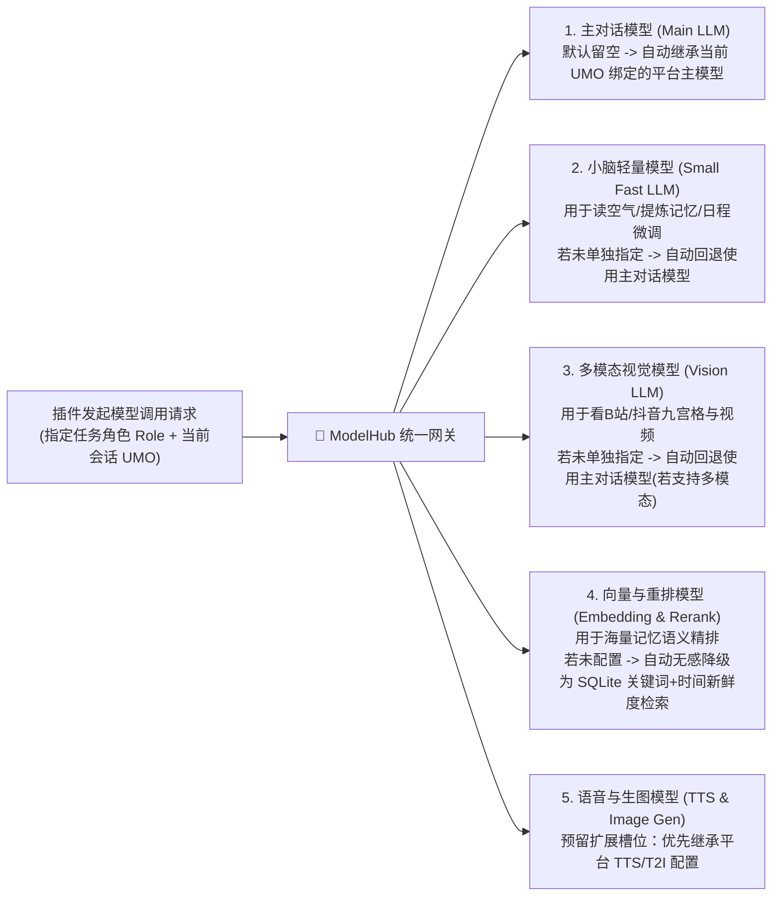

# OnlyYou (只有你) —— 技术架构与 AstrBot 实现方案设计 (v2.3)

> 本文档紧密结合 [AstrBot 插件开发指南 (`Star` 规范)](https://docs.astrbot.app/dev/star/plugin-new.html)，详细定义 `astrbot_plugin_only_you` 的核心工程设计，重点包含：**三态模型（休息中 / 繁忙中 / 空闲中）× 两大原子行为（回发消息 / 刷视频）**、**Roguelite 随机日程引擎与奇遇谈资池**、**基于外部输入的受限状态微调**，以及参考并精简自 `livingmemory` 的 **分级记忆、定时自动遗忘清理 (`Forgetting GC`) 与简易上下文预算管理器 (`Context Budget Manager`)**。

---

## 一、 核心状态与行为控制架构图



---

## 二、 插件标准目录结构

遵循 AstrBot 插件命名规范，仓库与目录命名为 `astrbot_plugin_only_you`：

```text
astrbot_plugin_only_you/
├── metadata.yaml                # 插件元数据声明 (name: astrbot_plugin_only_you)
├── _conf_schema.json            # AstrBot WebUI 可视化配置 Schema
├── requirements.txt             # 依赖库 (httpx, aiosqlite, pillow, imageio-ffmpeg)
├── main.py                      # 插件入口类 OnlyYouPlugin(Star)，负责三态消息门禁与生命周期
├── core/
│   ├── state_machine.py         # 🚦 三态枚举 (RESTING/BUSY/IDLE) 与两大行为 (MESSAGE/SURF) 门禁控制器
│   ├── roguelite_deck.py        # 🎲 Roguelite 每日日程抽卡引擎（基调卡/事件状态卡/奇遇谈资卡/连携）
│   ├── schedule_mutator.py      # 🔄 输入驱动的受限状态微调器（基于消息/视频冲击力的状态跃迁与配额锁）
│   ├── soul_manager.py          # 角色卡(Soul)管理：从 AstrBot 原生 Persona 继承或扩写生成专属卡池
│   ├── user_relation.py         # 三级用户关系管理 (L1普通 / L2重要熟人 / ★L3核心用户) 与跨平台映射
│   ├── memory_manager.py        # 🧠 精简版分级记忆引擎 (Tier1瞬时/Tier2近期/Tier3核心 + 定时遗忘GC)
│   ├── context_budget.py        # 🛡️ 简易上下文与Token预算管理器 (截断冗长历史 + 限制注入记忆字数)
│   ├── model_hub.py             # 🔌 多模型统一调度网关 (Main/Small/Vision/Embedding/Rerank/TTS/T2I 继承与回退)
│   ├── platform_bridge.py       # 🤝 AstrBot 平台配置协同桥 (复用平台白名单、原生分段回复 segmented_reply、流式与TTS)
│   └── atmosphere_reader.py     # 群聊主战场：防抖等待窗口、多人对话“解线团”、五维读空气器
├── surfing/
│   ├── pipeline.py              # 📱 赛博冲浪主控流水线（仅在 IDLE 空闲状态下运行）
│   ├── video_vision.py          # 多模态视频预处理器（短视频流直传 / FFmpeg 3x3 时间戳九宫格抽帧）
│   └── adapters/
│       ├── base.py              # 抽象平台接口 BaseVideoAdapter & VideoItem 模型
│       ├── bilibili.py          # B站适配器（推荐流/热门/UP主动态、热评抓取、CC字幕/流解析）
│       └── douyin.py            # 抖音适配器（热点榜/推荐流、无水印直链解析、热评抓取）
├── storage/
│   └── db.py                    # 基于 aiosqlite 的持久化层
└── prompts/
    └── templates.py             # 集中管理角色卡扩写、日程润色、受限微调、读空气、看片吐槽等 Prompt
```

---

## 三、 主动决策力核心工程设计

### 3.1 三种状态与元素卡牌的数据结构定义 (`core/roguelite_deck.py`)

彻底摒弃繁琐的细碎分类，所有日程事件卡严格归属三态之一：

```python
from enum import Enum
from dataclasses import dataclass, field

class BotState(str, Enum):
    RESTING = "RESTING"   # 💤 休息中：不回任何消息，不刷视频
    BUSY = "BUSY"         # 🔥 繁忙中：只回 L2重要用户 & L3核心用户消息，不主动闲聊，不刷视频
    IDLE = "IDLE"         # ☕ 空闲中：L1/L2/L3 全量读空气回复，可主动搭话，主动刷B站/抖音视频

class UserTier(int, Enum):
    L1_NORMAL = 1         # 普通用户（群友）
    L2_IMPORTANT = 2      # 重要用户（混熟的老水友/熟人）
    L3_CORE = 3           # ★ 核心用户（管理员 / OnlyYou）

@dataclass
class StateEventCard:
    """时间槽事件状态卡"""
    card_id: str
    title: str                        # 表面正在做的事，如 "上早八高数课" / "躺沙发摸鱼" / "钻被窝睡觉"
    state: BotState                   # 绑定的唯一状态: RESTING | BUSY | IDLE
    valid_slots: list[str]            # 允许抽取的时段: ["morning", "forenoon", "noon", "afternoon", "evening", "night"]
    base_weight: int                  # 基础抽取权重
    armor: int                        # 定力护甲 (0~100)，决定该状态多难被外部输入(消息/视频)改变
    synergy_tags: dict[str, float] = field(default_factory=dict) # 连携权重系数，如 {"late_night": 2.5}

@dataclass
class EncounterCard:
    """奇遇谈资卡（不改变状态，仅作为当天短时记忆提供聊天谈资）"""
    encounter_id: str
    content: str                      # 如 "今天中午点外卖老板多送了一根烤肠" / "早上下楼差点踩到流浪猫"
    used: bool = False                # 当天是否已经在聊天中当成话题聊过了
```

---

### 3.2 三态门禁控制器：精确控制【回消息】与【刷视频】 (`core/state_machine.py`)

#### 1. 对行为一【回消息】的拦截与放行逻辑 (`main.py`)
当 AstrBot 收到任何群聊或私聊消息 `event` 时，第一步直接经过三态门禁（零 Token 消耗完成前置过滤）：

```python
@filter.event_message_type(filter.EventMessageType.ALL, priority=999)
async def on_any_message(self, event: AstrMessageEvent):
    if event.message_str.startswith("/"):
        return  # 放行系统指令

    soul = await self.soul_manager.resolve_soul(event.unified_msg_origin)
    user = await self.user_relation.resolve_user(event)
    current_slot = await self.deck_engine.get_current_slot(soul.soul_id)

    # 1. 将消息静默记入群聊/私聊滑动窗口（供后续苏醒或空闲时了解上下文）
    self.atmosphere_reader.record_message(event, user)

    # 2. 检查是否因高冲击力消息触发【受限日程状态微调】（如 L3 核心用户把 Bot 从 BUSY 拉入 IDLE）
    mutated = await self.schedule_mutator.on_message_input(soul, current_slot, event, user)
    if mutated:
        current_slot = await self.deck_engine.get_current_slot(soul.soul_id)  # 刷新突变后的新状态

    # 3. 🚦 三态核心门禁裁决：通过 event.should_call_llm(bool) 协同原生管线（不粗暴破坏原生流程）
    if current_slot.state == BotState.RESTING:
        # 💤 休息中：撤回唤醒，不回任何消息（哪怕被 @ 也不回）
        event.should_call_llm(False)
        return

    elif current_slot.state == BotState.BUSY:
        # 🔥 繁忙中：只回复 L2 重要用户 和 ★L3 核心用户！忽略 L1 普通用户
        if user.tier == UserTier.L1_NORMAL:
            event.should_call_llm(False)
            return
        # 若为 L2 或 L3：进入读空气/回复判定

    # 4. 群聊走读空气裁决 -> 若决定开口，调用 event.should_call_llm(True) 交还给 AstrBot 原生管线生成与分段发送！
    should_reply = await self.atmosphere_reader.evaluate_should_reply(event, soul, user, current_slot)
    event.should_call_llm(should_reply)
```

#### 2. 对行为二【刷视频 & 主动搭话】的调度逻辑
后台异步心跳循环（每 10~15 分钟检查一次当前槽位状态）：
- 若 `current_slot.state in (BotState.RESTING, BotState.BUSY)`：
  - **直接跳过**！在休息中或繁忙中，绝不主动去刷 B站/抖音，也绝不主动找人闲聊。
- 若 `current_slot.state == BotState.IDLE`（**☕ 空闲中**）：
  - **动作分支 A（主动刷视频 `SURF_VIDEO`）**：调用 `CyberSurfingPipeline` 拉取 B站/抖音视频 + 热评，通过多模态模型看片。看完后可直接发给 ★L3 核心用户，或存入待分享池在群聊甩出。
  - **动作分支 B（拿奇遇卡或刚看的视频主动搭话 `PROACTIVE_MESSAGE`）**：检查当日 `DailyScheduleRun.encounters` 中是否还有 `used == False` 的**【奇遇谈资卡】**（如 `[外卖多送了烤肠]`）。若有，结合当前空闲状态主动去私聊 ★L3 核心用户或在活跃熟人群里抛出这个话题，随后将该奇遇卡标记为 `used = True`！

---

### 3.3 🔄 输入驱动的受限日程状态微调器 (`core/schedule_mutator.py`)

机器人如何根据**读取到的用户消息**或**刷到的视频**动态微调自己的日程，同时保证不失控？

#### 1. 触发微调的两类输入与状态跃迁规则
| 输入来源 | 触发条件（输入冲击力 `Impact > 当前卡片护甲 Armor`） | 微调效果（State Transition） |
| :--- | :--- | :--- |
| **输入一：读取到的用户消息** | **场景 1（摸鱼突变）**：当前为 `🔥 BUSY（繁忙中）`，收到 ★L3 核心用户私聊/群聊呼叫，或群内多位 ◆L2 熟人高热度爆发聊大瓜 | 将当前时段剩余部分从 **`BUSY` 微调为 `IDLE（空闲中）`**（放下手头正事，专心水群/陪聊） |
| **输入一：读取到的用户消息** | **场景 2（热聊熬夜）**：当前为 `☕ IDLE（空闲中）` 且即将进入下一时段 `💤 RESTING（休息中）`，但正与 ★L3 核心用户或熟人群热聊 | 将下一时段 `RESTING` 的开始时间**往后推迟 30~60 分钟**，延长当前 `IDLE` 状态 |
| **输入一：读取到的用户消息** | **场景 3（核心唤醒）**：当前为 `💤 RESTING（休息中）`，★L3 核心用户在私聊连续发消息强呼叫（普通/重要用户无法触发） | 短暂将当前状态从 **`RESTING` 微调为 `IDLE`**（迷迷糊糊醒来回复核心用户） |
| **输入二：刚刷到的抖音/B站视频** | **场景 4（刷片上头）**：当前在 `☕ IDLE（空闲中）` 刷到了多模态评分 `>= 88` 的超搞笑/高能神作，且下一时段原本要进入 `BUSY` 或 `RESTING` | 触发“再刷亿会儿”：将下一时段的 `BUSY / RESTING` **推迟 30~45 分钟**，继续保持 `IDLE` 冲浪并立刻把该视频分享出去！ |

#### 2. 三重防失控硬性限制（代码级强约束）
```python
class BoundedScheduleMutator:
    async def can_mutate(self, run: DailyScheduleRun, current_slot: SlotInstance, impact: int) -> bool:
        # 限制 1：每日最大微调次数配额（默认每天最多只允许变卦 2 次）
        if run.mutations_used >= self.config.max_mutations_per_day:
            return False

        # 限制 2：微调冷却时间锁（每次微调后，至少锁定 120 分钟不允许再次改动规划）
        if time.time() - run.last_mutation_ts < self.config.mutation_cooldown_seconds:
            return False

        # 限制 3：定力护甲门槛（输入冲击力必须严格大于当前卡片的定力护甲）
        if impact <= current_slot.armor:
            return False

        return True
```

---

## 四、 精简版分级记忆、定时遗忘与简易上下文管理器设计

参考 [`astrbot_plugin_livingmemory`](https://github.com/lxfight-s-Astrbot-Plugins/astrbot_plugin_livingmemory) 的生命周期思想，本插件**彻底剔除**了复杂的 2D/3D 图谱前端、知识图谱与高延迟的 Agent Tool 函数调用，仅用 **1 张轻量 SQLite 表 + 定时遗忘清理协程 + 上下文预算裁剪器** 实现高性价比记忆管理。

### 4.1 记忆表结构与三级分类模型 (`core/memory_manager.py`)

在 SQLite 中仅维护一张核心表 `memories`（配合 SQLite 原生全文索引或关键词标签匹配）：

```sql
CREATE TABLE IF NOT EXISTS memories (
    id INTEGER PRIMARY KEY AUTOINCREMENT,
    soul_id TEXT NOT NULL,           -- 所属 AI 角色卡 ID (支持跨平台共享同一角色记忆)
    user_id TEXT,                    -- 关联的全局用户 ID (NULL 则代表 Bot 自身的冲浪/奇遇记忆)
    user_tier INTEGER DEFAULT 1,     -- 产生记忆时的用户等级 (1:普通, 2:重要, 3:核心)
    memory_tier INTEGER NOT NULL,    -- 记忆分级: 1=EPHEMERAL(瞬时), 2=RECENT(近期), 3=CORE(核心永久)
    content TEXT NOT NULL,           -- 精炼的一句话记忆内容 (严格控制在 60 字以内)
    keywords TEXT NOT NULL,          -- 逗号分隔的检索关键词标签 (如 "火锅,海鲜过敏,饮食")
    importance INTEGER DEFAULT 5,    -- 初始重要度评分 (1 ~ 10)
    vitality REAL DEFAULT 100.0,     -- 记忆当前活力值 (0.0 ~ 100.0，<=0 时被定时程序物理清理)
    access_count INTEGER DEFAULT 0,  -- 被召回使用的次数 (用于访问强化与晋升)
    created_at INTEGER NOT NULL,     -- 创建时间戳
    last_accessed_at INTEGER         -- 最后一次被召回的时间戳
);
```

#### 记忆写入与自动分级规则：
1. **Tier 1 (`EPHEMERAL = 1`，瞬时记忆)**：
   - 每日抽出的【奇遇谈资卡】、刚看完的 B站/抖音视频、或重要度 `<= 4` 的普通群聊小事。
2. **Tier 2 (`RECENT = 2`，近期记忆)**：
   - 对话累计满 `N` 条（默认 15 条）后，由后台小脑异步提炼出的近期事件（重要度 `5 ~ 7`），初始 `vitality = 100.0`。
3. **Tier 3 (`CORE = 3`，核心长效记忆)**：
   - 重要度 `>= 8`（如 ★L3核心用户 / ◆L2重要用户 的核心偏好、身份设定、重要约定），或由 Tier 2 记忆累计被召回 `access_count >= 4` 次后自动晋升而来。

---

### 4.2 🗑️ 定时遗忘与自动清理程序 (`run_forgetting_gc`)

后台定时任务每 24 小时（每天凌晨）执行一次物理清理，确保数据库绝不无限膨胀：

```python
import math
import time

class MemoryManager:
    async def run_forgetting_gc(self):
        """
        每日定时遗忘清理程序：保留重要记忆与最近记忆，物理删除不重要且衰减殆尽的记忆
        """
        now = int(time.time())
        
        # 1. 清理超过 48 小时的 Tier 1 (瞬时短时记忆)
        await self.db.execute(
            "DELETE FROM memories WHERE memory_tier = 1 AND (? - created_at) > 172800",
            (now,)
        )

        # 2. 结算所有 Tier 2 (近期记忆) 的每日活力衰减
        rows = await self.db.fetchall("SELECT id, importance, user_tier, vitality, access_count FROM memories WHERE memory_tier = 2")
        for row in rows:
            # 用户等级保护系数: L1普通=0.6(忘得快), L2重要=1.2, ★L3核心=2.0(忘得慢)
            tier_factor = {1: 0.6, 2: 1.2, 3: 2.0}.get(row["user_tier"], 1.0)
            reinforce_factor = 1.0 + 0.5 * math.log(1 + row["access_count"])
            
            # 计算当日衰减量 (基础衰减率设为 35.0)
            daily_decay = 35.0 / (max(1, row["importance"]) * tier_factor * reinforce_factor)
            new_vitality = row["vitality"] - daily_decay

            if new_vitality <= 0:
                # 🗑️ 活力归零：彻底遗忘，直接物理删除！
                await self.db.execute("DELETE FROM memories WHERE id = ?", (row["id"],))
            elif row["access_count"] >= 4 and row["importance"] >= 6:
                # 💎 多次被提及强化：从 Tier 2 (近期记忆) 自动晋升为 Tier 3 (核心永久记忆)！
                await self.db.execute("UPDATE memories SET memory_tier = 3, vitality = 100.0 WHERE id = ?", (row["id"],))
            else:
                await self.db.execute("UPDATE memories SET vitality = ? WHERE id = ?", (new_vitality, row["id"]))
```

---

### 4.3 🛡️ 简易上下文与预算管理器 (`core/context_budget.py`)

在 `@filter.on_llm_request()` 钩子中，通过 **`ContextBudgetManager`** 同时管控 **“原生历史对话长度”** 与 **“插入记忆的字数上限”**，防止上下文超载与费用失控：

```python
class ContextBudgetManager:
    async def apply_context_and_memory_budget(self, event: AstrMessageEvent, req, soul_id: str, user: UserProfile):
        # =====================================================================
        # 第一步：完全清空平台原生历史 (req.contexts.clear())，由插件全权接管上下文！
        # =====================================================================
        # 为什么要完全舍弃平台原生 req.contexts？
        # 1. 平台 ConversationManager 不会记录插件通过 context.send_message() 主动发送的视频/搭话消息，用平台上下文会导致 Bot 对自己刚主动发的话“失忆”；
        # 2. 平台群聊历史缺乏[引用回复解线团]与[L1/L2/L3关系等级]标注，且若平台开启了 group_icl_enable 会导致重复注入；
        # 3. 由插件统一维护固定长度滑窗 (滑出窗口即送去提炼分级记忆并销毁)，可形成“滑窗 -> 提炼记忆 -> 定时遗忘”的完美闭环！
        req.contexts.clear()

        # 注入插件自身维护的高信噪比会话滑窗 (含 Bot 主动发出的消息、引用拓扑与关系标记)
        session_window_msgs = self.session_buffer.get_formatted_window(
            umo=event.unified_msg_origin,
            max_turns=self.config.sliding_window_size  # 默认保留最近 15 条
        )
        req.contexts.extend(session_window_msgs)

        # =====================================================================
        # 第二步：按 [关键词匹配 + 时间新鲜度 + 重要度] 检索候选记忆
        # =====================================================================
        query_text = event.message_str
        candidates = await self.memory_manager.retrieve_candidates(soul_id=soul_id, user_id=user.global_uid)
        
        now = time.time()
        scored_memories = []
        for mem in candidates:
            # 1. 关键词命中分 (0.0 ~ 1.0)
            kw_list = [k.strip() for k in mem.keywords.split(",") if k.strip()]
            kw_hits = sum(1 for k in kw_list if k in query_text)
            kw_score = min(1.0, kw_hits * 0.5) if kw_list else 0.0
            
            # 2. 时间新鲜度分 Recency (越近越容易被想起，指数衰减)
            days_old = max(0.0, (now - mem.created_at) / 86400.0)
            recency_score = math.exp(-0.15 * days_old)
            
            # 3. 重要度分 Importance (0.1 ~ 1.0)
            imp_score = mem.importance / 10.0
            
            # 综合得分：保证“重要的(Core)”和“最近的(Recent)”以及“当前聊到的”排在最前
            total_score = 0.40 * kw_score + 0.35 * recency_score + 0.25 * imp_score
            scored_memories.append((total_score, mem))

        scored_memories.sort(key=lambda x: x[0], reverse=True)

        # =====================================================================
        # 第三步：硬性预算裁剪 (Hard Budget Gate：限制最大条数与最大字符数)
        # =====================================================================
        selected_lines = []
        current_chars = 0
        recalled_ids = []

        for score, mem in scored_memories:
            if len(selected_lines) >= self.config.max_injected_memories:  # 默认最多 6 条
                break
            if current_chars + len(mem.content) > self.config.max_memory_chars_budget:  # 默认最多 400 字
                break
            
            tag = "核心记忆" if mem.memory_tier == 3 else "近期记忆"
            selected_lines.append(f"- [{tag}] {mem.content}")
            current_chars += len(mem.content)
            recalled_ids.append(mem.id)

        # 异步更新被选中记忆的访问次数 (触发访问强化，延缓被遗忘)
        if recalled_ids:
            await self.memory_manager.reinforce_memories(recalled_ids)

        # 注入精简后的记忆块到 System Prompt
        if selected_lines:
            req.system_prompt += "\n\n[脑海中的相关记忆 (精简注入)]:\n" + "\n".join(selected_lines)
```

---

## 五、 多模型统一调度接口 (`ModelHub`) 与 AstrBot 平台配置协同设计

> **核心工程原则：绝不重复造轮子，绝不与 AstrBot 平台原生配置打架。**
> 插件只做“大脑决策层（决定什么时候说话、对谁说话、注入什么状态与记忆）”，而将模型管理、会话白名单、流式输出、分段回复（`segmented_reply`）与 TTS 转换 **100% 与 AstrBot 平台原生管线对齐协同**。

### 5.1 🔌 统一多模型调度网关 (`core/model_hub.py`)

随着功能演进，插件涉及 **6 大类模型能力**。插件不要求用户重复填写 API Key，而是通过 `self.context.get_provider_by_id(...)` 对接 AstrBot 的模型提供商注册表，并实现 **“插件按需覆盖 $\rightarrow$ 留空自动继承当前会话平台配置 $\rightarrow$ 缺失优雅降级”** 的三级寻址机制：



```python
class ModelHub:
    """插件统一模型调度网关：支持多类别模型配置与平台配置自动继承"""
    def __init__(self, context: Context, plugin_config: dict):
        self.context = context
        self.cfg = plugin_config.get("model_hub_config", {})

    async def get_chat_provider_id(self, role: Literal["main", "small", "vision"], umo: str = None) -> str:
        # 1. 优先读取插件内显式指定的 Provider ID
        explicit_id = self.cfg.get(f"{role}_llm_provider_id", "")
        if explicit_id:
            return explicit_id
        
        # 2. 若 small / vision 未单独配置，尝试回退到插件配置的 main_llm_provider_id
        if role in ("small", "vision") and self.cfg.get("main_llm_provider_id"):
            return self.cfg["main_llm_provider_id"]

        # 3. 留空则自动继承当前会话 (umo) 在 AstrBot 平台配置文件中选定的默认主模型！
        return await self.context.get_current_chat_provider_id(umo=umo)

    def get_auxiliary_provider(self, capability: Literal["embedding", "rerank", "tts", "t2i"], umo: str = None):
        """获取 Embedding / Rerank / TTS / 生图模型实例（支持插件覆盖 -> 平台配置继承 -> None降级）"""
        explicit_id = self.cfg.get(f"{capability}_provider_id", "")
        if explicit_id:
            return self.context.get_provider_by_id(explicit_id)
        
        # 从当前会话对应的 AstrBot 平台配置文件 (abconf) 中继承
        ab_conf = self.context.get_config(umo=umo)
        platform_prov_id = ab_conf.get("provider_settings", {}).get(f"{capability}_provider_id", "")
        return self.context.get_provider_by_id(platform_prov_id) if platform_prov_id else None
```

---

### 5.2 🤝 插件与 AstrBot 平台原生配置的五大协同法则 (`core/platform_bridge.py`)

为了避免插件功能与 AstrBot 平台自身的配置文件（`cmd_config.json` / `abconf_*.json`）产生冲突或双重执行，制定以下协同边界：

| 平台配置项 | AstrBot 平台原生机制 | ❌ 错误的插件做法（冲突根源） | ✅ **OnlyYou 协同设计方案（平台优先 + 管线复用）** |
| :--- | :--- | :--- | :--- |
| **1. 会话黑白名单与开关**<br/>(`Access Control`) | 平台自带群/私聊黑白名单，且每个配置文件（`abconf`）可独立开关插件 | 插件内部再搞一套群白名单配置，导致用户在两边重复配甚至逻辑冲突 | **插件不设任何黑白名单配置！**<br/>100% 遵循平台访问控制与多配置文件开关：只要消息事件流进插件，即代表平台已放行。 |
| **2. 群聊唤醒与拦截**<br/>(`WakeCheckStage`) | 原生逻辑：群里被 `@` 或命中唤醒词才设置 `should_call_llm=True` | 插件粗暴 `event.stop_event()` 后自己调 `send_message`，导致绕过平台所有后处理管线 | **通过 `event.should_call_llm(bool)` 协同管线！**<br/>• 群友没 `@` Bot，但读空气决定要接话 $\rightarrow$ 调 `event.should_call_llm(True)` 借用原生管线回复！<br/>• 群友 `@` 了 Bot，但处于 `💤休息中` 或 `🔥繁忙中(L1)` 或读空气决定不回 $\rightarrow$ 调 `event.should_call_llm(False)` 静默取消唤醒！ |
| **3. 分段回复**<br/>(`segmented_reply`) | 平台 `RespondStage` 原生支持按标点/正则拆分为多条短气泡并带随机打字延迟发送 | 插件自己切分句子调 `send_message`，或者与平台分段叠加导致一句话被切碎两次 | **全面复用平台 `segmented_reply` 配置！**<br/>• **被动回复**：经由 `should_call_llm(True)` 走原生 `RespondStage`，直接由平台完成分段与打字延迟！<br/>• **后台主动发消息（如刷完视频主动分享）**：无前置 `event` 时，`PlatformBridge` 直接读取 `self.context.get_config(umo)` 中的 `platform_settings.segmented_reply` 正则与间隔参数执行发送，体验与平台 100% 统一！ |
| **4. 流式输出**<br/>(`streaming_response`) | 平台支持边生成边流式推送（与分段回复/TTS 行为互斥或不同） | 插件在 Prompt 里写死要求输出 `<split>` 分段符，结果流式输出把 `<split>` 原样发给用户 | **动态感知自适应**：<br/>在 `@filter.on_llm_request` 中检查 `self.context.get_config(umo)` 的流式开关：若平台开启了流式输出或开启了原生正则分段，插件绝不在 Prompt 中注入自定义分隔符。 |
| **5. 图像理解与文生图**<br/>(`Image Caption / Vision / T2I`) | 1. 平台 `provider_settings.default_image_caption_provider_id` 提供默认识图模型；<br/>2. 原生多模态管线自动将用户发图传给支持视觉的主模型；<br/>3. 文生图通过平台生图插件（LLM Tool）触发 | 插件对群聊图片再调一次识图导致双倍计费；或在插件内重复造文生图轮子 | **视觉继承 + 原生多模态透传**：<br/>• **群聊/私聊用户发图**：走原生多模态/识图管线，插件不二次调接口，直接复用转述结果记入群聊窗口。<br/>• **后台刷 B站/抖音看片**：若插件未单独指定 `vision_llm`，自动优先继承平台的 `default_image_caption_provider_id`（再回退至主模型）。<br/>• **文生图**：直接复用 AstrBot 生态的画图 Tool，插件零侵入。 |
| **6. 语音输入与输出**<br/>(`STT / TTS`) | 1. `provider_stt_settings` 自动将用户语音转文字赋给 `event.message_str`；<br/>2. `provider_tts_settings` 在 `RespondStage` 自动将回复转语音 | 插件自己再配一套 STT/TTS，导致不会处理语音或发出两条重复语音 | **100% 委派给平台 `provider_stt / tts_settings`！**<br/>• **语音输入 (STT)**：平台前置管线已自动转成文字，插件直接读 `event.message_str`。<br/>• **语音输出 (TTS)**：被动回复完全走平台原生 TTS 装饰器；后台主动发消息时，读取 `ab_conf["provider_tts_settings"]` 判断是否需要调用平台 TTS Provider 转语音。 |
| **7. 上下文消息注入与群聊感知**<br/>(`req.contexts` & `group_icl_enable`) | 平台 `ConversationManager` 按 `umo` 维护 `req.contexts`，且有 `group_icl_enable` 注入群聊记录 | 1. **致命缺陷**：插件后台调用 `context.send_message()` 主动发的视频和消息**不会进入平台 `ConversationManager`**，导致用户回复时 Bot 根本不知道自己刚主动发了啥；<br/>2. 平台群聊记录无解线团与等级标记，且与插件滑窗双重注入浪费 Token | **完全舍弃平台 `req.contexts`，由插件 100% 接管上下文管理！**<br/>• 在 `@filter.on_llm_request` 中直接执行 **`req.contexts.clear()`**，彻底丢弃平台塞入的原生历史与 `group_icl` 记录（但保留当前轮次的 `req.prompt` 与 `req.image_urls`）。<br/>• **插件统一滑窗闭环**：无论是用户消息、被动回复、还是 **Bot 后台主动发送的视频/消息**，全部统一写入插件的会话滑窗（`sliding_window_size = 15`）；当消息滑出窗口满 15 条时，触发小脑提炼为分级记忆后直接销毁原始消息！ |

---

## 六、 插件可视化配置架构 (`_conf_schema.json` v2.4)

```json
{
  "roguelite_schedule_config": {
    "description": "🎲 Roguelite 随机日程引擎与三态微调设置",
    "type": "object",
    "items": {
      "enable_roguelite_schedule": {
        "description": "开启每日 Roguelite 随机日程构筑（自动排布 休息中/繁忙中/空闲中 三态与今日奇遇卡）",
        "type": "bool",
        "default": true
      },
      "daily_encounter_count": {
        "description": "每日随机抽取的【奇遇谈资卡】数量（作为当天短时记忆增加主动聊天话题）",
        "type": "int",
        "default": 2
      },
      "max_mutations_per_day": {
        "description": "每日日程最大微调次数上限（根据收到的消息或刷到的视频临时改变状态的次数上限）",
        "type": "int",
        "default": 2
      },
      "mutation_cooldown_minutes": {
        "description": "日程状态微调后的冷却锁定时间（分钟，防止频繁横跳）",
        "type": "int",
        "default": 120
      },
      "allow_l3_wake_from_resting": {
        "description": "允许 ★L3核心用户 在【休息中】状态下通过私聊唤醒 Bot",
        "type": "bool",
        "default": true
      }
    }
  },
  "relationship_config": {
    "description": "💖 三级用户关系设置 (普通L1 / 重要用户L2 / 核心用户L3)",
    "type": "object",
    "items": {
      "core_user_ids": {
        "description": "★ L3 核心用户 (管理员) 账号列表",
        "type": "list",
        "items": { "type": "string" },
        "default": []
      },
      "important_user_ids": {
        "description": "◆ 初始指定的 L2 重要用户列表（繁忙状态下依然会回复的对象）",
        "type": "list",
        "items": { "type": "string" },
        "default": []
      },
      "enable_auto_promotion_l2": {
        "description": "允许普通用户(L1)通过群聊良性互动自动晋升为重要用户(L2)",
        "type": "bool",
        "default": true
      }
    }
  },
  "atmosphere_config": {
    "description": "🌬️ 群聊主战场：解线团与“读空气”引擎设置",
    "type": "object",
    "items": {
      "takeover_group_chat": {
        "description": "全面接管群聊（结合当前三态与读空气决定是否回复）",
        "type": "bool",
        "default": true
      },
      "debounce_seconds": {
        "description": "群聊听话防抖等待窗口（秒）",
        "type": "float",
        "default": 4.0
      }
    }
  },
  "surfing_config": {
    "description": "📱 赛博冲浪：空闲状态下刷 B站 & 抖音设置",
    "type": "object",
    "items": {
      "enable_bili_surfing": {
        "description": "在【空闲中】状态下主动刷哔哩哔哩 (Bilibili)",
        "type": "bool",
        "default": true
      },
      "bili_cookie": {
        "description": "B站 Cookie (选填)",
        "type": "text",
        "secret": true,
        "default": ""
      },
      "enable_douyin_surfing": {
        "description": "在【空闲中】状态下主动刷抖音 (Douyin)",
        "type": "bool",
        "default": true
      },
      "douyin_api_base": {
        "description": "抖音解析 API 服务地址",
        "type": "string",
        "default": "https://api.douyin.wtf"
      },
      "send_raw_video": {
        "description": "优先直发无水印视频文件",
        "type": "bool",
        "default": true
      }
    }
  },
  "memory_and_context_config": {
    "description": "🧠 精简版分级记忆、自动遗忘与上下文预算控制",
    "type": "object",
    "items": {
      "enable_tiered_memory": {
        "description": "开启分级记忆与每日自动遗忘清理 (Forgetting GC)",
        "type": "bool",
        "default": true,
        "hint": "自动提炼核心记忆(永久)与近期记忆(随时间衰减并由定时程序自动清理不重要记忆)。"
      },
      "sliding_window_size": {
        "description": "单会话短期滑动窗口保留消息条数（清空平台 req.contexts 后由插件注入的近期消息上限，滑出窗口即送去提炼记忆）",
        "type": "int",
        "default": 15
      },
      "extract_every_n_messages": {
        "description": "滑出窗口每累计多少条有效消息触发一次后台小脑记忆提炼",
        "type": "int",
        "default": 15
      },
      "max_injected_memories": {
        "description": "单次对话最多允许插入的记忆条数上限",
        "type": "int",
        "default": 6
      },
      "max_memory_chars_budget": {
        "description": "单次对话插入记忆的最大总字数预算（汉字数，防止费用过高）",
        "type": "int",
        "default": 400
      }
    }
  },
  "model_hub_config": {
    "description": "🔌 多模型统一调度网关 (留空则自动继承当前会话所属 AstrBot 配置文件的模型)",
    "type": "object",
    "items": {
      "main_llm_provider_id": {
        "description": "1. 对话主模型 (留空则自动继承平台当前会话模型)",
        "type": "string",
        "default": "",
        "_special": "select_provider"
      },
      "small_llm_provider_id": {
        "description": "2. 小脑轻量文本模型 (用于读空气、日程微调与记忆提炼，建议选 Flash/Mini 模型；留空回退至主模型)",
        "type": "string",
        "default": "",
        "_special": "select_provider"
      },
      "vision_llm_provider_id": {
        "description": "3. 多模态视觉模型 (用于后台看B站/抖音视频九宫格；留空优先继承平台默认识图模型 default_image_caption_provider_id 或主模型)",
        "type": "string",
        "default": "",
        "_special": "select_provider"
      },
      "embedding_provider_id": {
        "description": "4. 向量嵌入模型 Embedding (选填，用于记忆语义召回；留空自动继承平台配置或降级为关键词检索)",
        "type": "string",
        "default": ""
      },
      "rerank_provider_id": {
        "description": "5. 重排模型 Rerank (选填，用于记忆召回精排；留空自动继承平台配置或跳过重排)",
        "type": "string",
        "default": ""
      }
    }
  }
}
```
