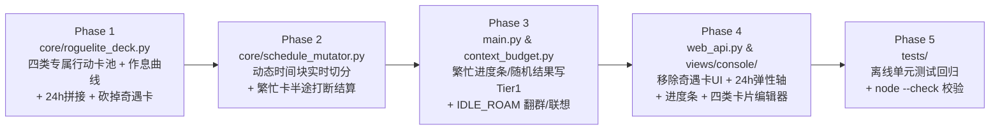

# OnlyYou 24h 动态弹性时间轴 × 四类可执行行动卡 实现计划 (Implementation Plan)

本计划指导将 **OnlyYou (`astrbot_plugin_only_you`)** 的日程引擎从「固定 6 时段 + 静态标题卡片 + 奇遇卡」重构为 **「角色专属四类行动卡池 (`SLEEP` / `SURF` / `IDLE_ROAM` / `BUSY_TASK`) × 基于作息曲线的 24h 动态积木时间轴 × 每日随机繁忙结果短时记忆」**。

---

## 一、 核心设计收敛与五条铁律

> [!IMPORTANT]
> **已对齐确认的核心设计边界**：
> 1. **角色卡绑定专属行动卡池（8~12 张）+ 每日随机抽卡排轴 + 每日随机结算结果**：
>    - 导入/创建角色卡时，生成 8~12 张贴合该角色设定的四类行动卡（可在控制台增删改），卡片标题固定在池中；
>    - 每天排日程时无需调大模型重造卡片，直接从专属卡池按作息曲线随机抽取拼接排满 24h；
>    - **但 `BUSY_TASK`（繁忙卡）每次走完 100%（或中途被打断）时生成的【一句话完成结果记忆】每天随机不同**（哪怕明天又抽到同一张“炼制回春丹”，结算出的结果记忆也是全新的）。
> 2. **彻底砍掉【奇遇卡 (`EncounterCard`)】**：
>    - 既然 `BUSY_TASK` 结束会随机产生【完成结果短时记忆】、`SURF` 会产生【看片短时记忆】、`IDLE_ROAM` 会触发【翻群吃瓜 / 发呆记忆联想】，奇遇卡作用完全重复，直接从产品逻辑与控制台界面中砍掉（底层 JSON 反序列化仅保留空数组忽略兼容，不再抽卡或展示）。
> 3. **`SLEEP`（睡觉卡，绑定 `RESTING`）什么都不做**：后台零任务、不刷视频、不发主动消息，被动消息门禁全拦截（唯 ★L3 私聊强呼叫可触发微调唤醒）。
> 4. **`BUSY_TASK`（角色繁忙卡，绑定 `BUSY`）保持极简三要素**：只包含 **① 当前行为记忆（`title`）**、**② 实时进度条（`0% -> 100%`）**、**③ 每日随机的一句话完成结果（`completion_result`，直接写入 `MemoryManager` 的 `Tier 1` 瞬时记忆）**。
> 5. **向后兼容现有契约**：`DailyScheduleRun.slots` 保留属性名与关键字典键（`slot_key`、`label`、`start_hour`、`end_hour`、`state`、`armor`、`title`），确保现有 27 条 Web API 与 `/onlyyou` 指令平滑过渡。

---

## 二、 分阶段实施路线图



---

### Phase 1：四类专属行动卡池、砍掉奇遇卡与 24h 动态积木时间轴引擎
**涉及文件**：
- [`core/state_machine.py`](file:///Users/mac/Desktop/Project/OnlyYou/core/state_machine.py)
- [`core/roguelite_deck.py`](file:///Users/mac/Desktop/Project/OnlyYou/core/roguelite_deck.py)
- [`core/soul_manager.py`](file:///Users/mac/Desktop/Project/OnlyYou/core/soul_manager.py)

#### 1.1 新增 `ActionType` 枚举与三态映射
在 [`core/state_machine.py`](file:///Users/mac/Desktop/Project/OnlyYou/core/state_machine.py)（并在 [`core/roguelite_deck.py`](file:///Users/mac/Desktop/Project/OnlyYou/core/roguelite_deck.py) 导出）定义四类行动原型：

| `ActionType` 枚举值 | 中文标签 | 强制绑定 `BotState` | 默认时长区间 (`min_hours ~ max_hours`) |
| :--- | :--- | :--- | :--- |
| `ActionType.SLEEP` | `睡觉 / 休眠` | `BotState.RESTING` | 长睡 `4.0 ~ 7.5h` / 小憩 `1.0 ~ 2.0h` |
| `ActionType.SURF` | `冲浪刷片` | `BotState.IDLE` | `0.5 ~ 2.0h` |
| `ActionType.IDLE_ROAM` | `空闲闲逛` | `BotState.IDLE` | `0.5 ~ 2.0h` |
| `ActionType.BUSY_TASK` | `繁忙主业` | `BotState.BUSY` | `1.0 ~ 3.0h` |

#### 1.2 升级 [`StateEventCard`](file:///Users/mac/Desktop/Project/OnlyYou/core/roguelite_deck.py#L43-L73)（行动卡定义）并移除奇遇卡抽取
- **新增字段**：
  - `action_type: ActionType = ActionType.IDLE_ROAM`
  - `min_hours: float = 1.0`（支持 `0.5h` 步长）
  - `max_hours: float = 2.0`
- **旧数据自动迁移（`from_dict` 兼容）**：
  - 若旧卡片无 `action_type`，按以下规则自动推导：
    1. `state == RESTING` $\rightarrow$ `ActionType.SLEEP`；
    2. `state == BUSY` $\rightarrow$ `ActionType.BUSY_TASK`；
    3. `state == IDLE` 且 `title` 含 `("刷", "B站", "b站", "抖音", "视频", "冲浪")` $\rightarrow$ `ActionType.SURF`；
    4. 其余 `state == IDLE` $\rightarrow$ `ActionType.IDLE_ROAM`。
- **移除奇遇卡生成与抽取**：
  - `RogueliteDeckEngine` 每日构筑不再抽取 `EncounterCard`（`run.encounters` 置为空列表 `[]` 仅保留字段防旧反序列化报错）；
  - [`SoulManager`](file:///Users/mac/Desktop/Project/OnlyYou/core/soul_manager.py) 在导入原生 Persona 或 AI 生成角色卡池时，生成 8~12 张涵盖 `BUSY_TASK`、`IDLE_ROAM`、`SURF`、`SLEEP` 的专属行动卡，不再生成奇遇卡。

#### 1.3 升级 [`SlotInstance`](file:///Users/mac/Desktop/Project/OnlyYou/core/roguelite_deck.py#L96-L157)（动态时间块 `ScheduleBlock`）
- `start_hour: float`、`end_hour: float`（支持 `0.5` 小时粒度，从 `0.0` 连续拼接到 `24.0`）。
- **新增字段**：
  - `action_type: ActionType`
  - `busy_settled: bool = False`（标记该 `BUSY_TASK` 块是否已生成当日随机完成结果记忆）
  - `completion_result: str = ""`（当日结算生成的一句话随机完成结果文本）
- **新增方法**：
  - `get_progress_pct(now_dt: Optional[datetime] = None) -> int`：
    $$\text{progress} = \text{clamp}\left(\text{round}\left(100 \times \frac{\text{now\_hour} - \text{start\_hour}}{\text{end\_hour} - \text{start\_hour}}\right), 0, 100\right)$$
  - `format_time_range() -> str`：将浮点数小时（如 `13.5 ~ 15.0`）格式化为 `"13:30-15:00"`。

#### 1.4 基于作息类型 (`chronotype`) 的 24h 权重曲线与动态拼接算法
在 [`RogueliteDeckEngine`](file:///Users/mac/Desktop/Project/OnlyYou/core/roguelite_deck.py#L289-L603) 中实现：
1. **`get_chronotype_weights(chronotype: str, hour_t: float) -> dict[ActionType, float]`**：
   - **`early`（早睡早起）**：`22:00~06:00` 高权重抽 `SLEEP`；`07:00~17:00` 高权重抽 `BUSY_TASK` 与 `IDLE_ROAM`；`17:00~22:00` 抽 `SURF` / `IDLE_ROAM`。
   - **`normal`（规律作息）**：`00:00~07:30` 高权重抽长 `SLEEP`；`12:30~14:00` 适度提升小憩 `SLEEP` 与 `IDLE_ROAM`；`09:00~18:00` 主抽 `BUSY_TASK`；`18:30~23:30` 主抽 `SURF` 与 `IDLE_ROAM`。
   - **`night_owl`（夜猫子）**：`00:00~03:30` 高权重抽 `SURF` / `IDLE_ROAM` / 深夜 `BUSY_TASK`；`03:30~11:30` 高权重抽长 `SLEEP`；下午与晚间交替抽取 `BUSY_TASK` 与 `IDLE`。
2. **`_build_dynamic_slots(chronotype, vigor, pool, rng) -> list[SlotInstance]`**：
   - 游标 `t = 0.0` 循环推进至 `24.0`（步长 `0.5h`），从角色专属卡池（若为空则回退默认四类卡池）加权抽取并掷出 `[min_hours, max_hours]` 随机时长，首尾无缝对齐 `0.0 ~ 24.0`。

---

### Phase 2：受限日程微调器的动态切分与繁忙半途结算
**涉及文件**：
- [`core/schedule_mutator.py`](file:///Users/mac/Desktop/Project/OnlyYou/core/schedule_mutator.py)

#### 2.1 三重门禁保持不变
- 保留 [`BoundedScheduleMutator.can_mutate`](file:///Users/mac/Desktop/Project/OnlyYou/core/schedule_mutator.py#L56-L73) 的每日配额（`max_mutations_per_day=2`）、冷却锁（`120 分钟`）与定力门槛（`Impact > Armor`）。

#### 2.2 动态时间块切分与繁忙打断结算 (`_execute_mutation`)
- **场景 A：当前处于 `BUSY_TASK` 被高冲击力消息击穿转为 `IDLE_ROAM`**：
  1. 计算被打断时的进度 `interrupted_pct = current_slot.get_progress_pct(now_dt)`；
  2. 若当前块已开始超过 `0.5h` 且剩余时长 `>= 0.5h`，在当前半点时刻 `split_h` 将 `current_slot` 一分为二：
     - **前半块（已完成部分 `start_hour ~ split_hour`）**：保留原 `BUSY_TASK`，立即触发**半途打断结果结算**（生成如*“本来在忙{title}刚做到{interrupted_pct}%，被拉去聊天就先放下了”*并写入 Tier 1 记忆，`busy_settled = True`）；
     - **后半块（当前生效块 `split_hour ~ end_hour`）**：状态设为 `BotState.IDLE`、`action_type = ActionType.IDLE_ROAM`、`title = new_title`、`mutated = True`。
  3. 若当前块刚开头或剩余极短，则直接原地将该块转为 `IDLE_ROAM`，并同样记录一条被打断的 Tier 1 瞬时记忆。
- **场景 B：当前处于 `SURF / IDLE_ROAM` 刷片上头或热聊推迟下一块 `SLEEP / BUSY_TASK`**：
  - 将 `current_slot.end_hour` 延长 `0.5h`（或 `delay_minutes = 30~45`），并将 `next_slot.start_hour` 同步后移 `0.5h`。

---

### Phase 3：繁忙卡极简三要素闭环（每日随机结果） & 空闲游荡卡执行管线
**涉及文件**：
- [`prompts/templates.py`](file:///Users/mac/Desktop/Project/OnlyYou/prompts/templates.py)
- [`core/context_budget.py`](file:///Users/mac/Desktop/Project/OnlyYou/core/context_budget.py)
- [`main.py`](file:///Users/mac/Desktop/Project/OnlyYou/main.py)

#### 3.1 Prompt 模板升级 ([`prompts/templates.py`](file:///Users/mac/Desktop/Project/OnlyYou/prompts/templates.py))
1. 更新 `CARD_AND_DECK_SEED_PROMPT`：生成 8~12 张带 `action_type` (`SLEEP / SURF / IDLE_ROAM / BUSY_TASK`) 与 `min_hours / max_hours` 的专属行动卡，去掉 `encounter_talk_cards`。
2. 更新 `BUSY_STATE_INJECTION_PROMPT`：加入 `{progress_pct}%` 进度描述。
3. 新增 `BUSY_TASK_COMPLETION_PROMPT`：输入角色设定、事项名、今日日期与最终进度百分比，要求生成**当天专属、带有随机小细节或小插曲的一句话完成结果**（JSON `{"completion_memory": "...", "keywords": "..."}`），每次结算都不重样。
4. 新增 `IDLE_ROAM_PROACTIVE_PROMPT`：支持 `GROUP_LURK`（翻群记录吃瓜）与 `MEMORY_MUSE`（发呆记忆联想）两种模式的口语生成。

#### 3.2 `BUSY_TASK` 极简三要素实现
1. **要素 1 & 2（当前行为记忆 + 实时进度条）**：
   - 在 [`ContextBudgetManager.apply_context_and_memory_budget`](file:///Users/mac/Desktop/Project/OnlyYou/core/context_budget.py#L313-L454) 中，当 `current_slot.state == BotState.BUSY` 时，调用 `current_slot.get_progress_pct()` 获取 `0~100` 进度值，注入 `BUSY_STATE_INJECTION_PROMPT`。
2. **要素 3（每日随机完成结果写入 Tier 1 短时记忆）**：
   - 在 [`OnlyYouPlugin`](file:///Users/mac/Desktop/Project/OnlyYou/main.py) 中提供 `settle_busy_block(soul, run, block, progress_pct=100, interrupted_by="")`：
     - 若 `block.busy_settled` 为 `True` 则跳过；
     - 调用决策模型 `BUSY_TASK_COMPLETION_PROMPT` 生成当天的随机结果（若模型未配或调用失败，使用多套随机结果模板兜底）；
     - 将结果写入 `block.completion_result`，设置 `block.busy_settled = True`，持久化 `run`；
     - 调用 `memory_manager.add_memory(soul_id=soul.soul_id, content=block.completion_result, keywords=..., importance=4, memory_tier=1)` 存入 **Tier 1 瞬时记忆**！

#### 3.3 四类行动卡在后台心跳 `_heartbeat_loop` 中的分发 ([`main.py`](file:///Users/mac/Desktop/Project/OnlyYou/main.py#L267-L330))
1. 先执行 `await self._settle_finished_busy_blocks(soul, run)` 结算已走完 100% 的繁忙块；
2. 按 `current_slot.action_type` 严格分支：
   - **`ActionType.SLEEP` (`RESTING`)**：`continue`（什么都不做）。
   - **`ActionType.BUSY_TASK` (`BUSY`)**：`continue`（专心推进进度条，不主动冲浪或闲聊）。
   - **`ActionType.SURF` (`IDLE`)**：调用 `self.surfing_pipeline.surf_once(...)`，刷到好片可主动分享给 ★L3 或群聊。
   - **`ActionType.IDLE_ROAM` (`IDLE`)**：调用 `await self._run_idle_roam_action(soul, run, current_slot)`：
     - **优先检查分支 A（翻群记录吃瓜 `GROUP_LURK`）**：遍历 `session_buffer` 中非私聊的群会话窗口，若存在最近一条消息是用户发言（且未超 2 小时），读取最近窗口对话调用 `IDLE_ROAM_PROACTIVE_PROMPT (mode="GROUP_LURK")`，在群里冒泡插话或转头私聊 ★L3 吐槽；
     - **否则执行分支 B（发呆记忆联想 `MEMORY_MUSE`）**：从 `memory_manager.list_memories(soul_id, limit=10)` 中随机抽取 1~2 条记忆（优先含今日刚结算的 `BUSY_TASK` 完成结果短时记忆），调用 `IDLE_ROAM_PROACTIVE_PROMPT (mode="MEMORY_MUSE")` 生成一句“突然想起某事”的搭话发给 ★L3。

---

### Phase 4：Web API 与 Plugin Pages 控制台适配（移除奇遇卡 UI）
**涉及文件**：
- [`core/web_api.py`](file:///Users/mac/Desktop/Project/OnlyYou/core/web_api.py)
- [`views/console/charts.js`](file:///Users/mac/Desktop/Project/OnlyYou/views/console/charts.js)
- [`views/console/page-overview.js`](file:///Users/mac/Desktop/Project/OnlyYou/views/console/page-overview.js)
- [`views/console/page-schedule.js`](file:///Users/mac/Desktop/Project/OnlyYou/views/console/page-schedule.js)
- [`views/console/mock.js`](file:///Users/mac/Desktop/Project/OnlyYou/views/console/mock.js)

1. **后端 [`core/web_api.py`](file:///Users/mac/Desktop/Project/OnlyYou/core/web_api.py)**：
   - `_slot_remaining_and_progress` 支持浮点小时（`start_hour: float`, `end_hour: float`）。
   - `api_dashboard_overview` 与 `_build_schedule_payload` 在返回前自动调用一次惰性繁忙块结算，在 `state` 对象中附带 `action_type`、`progress_pct`、`completion_result`，在 `vigor` 中附带当前角色的 `chronotype`，并返回今日已结算的 `busy_results`。
   - `api_cards_save` 与 `api_cards_ai_generate` 支持 `action_type`、`min_hours`、`max_hours` 字段保存与生成。
2. **前端图表 [`views/console/charts.js`](file:///Users/mac/Desktop/Project/OnlyYou/views/console/charts.js)**：
   - `fmtHour(h)` 支持半点显示（如 `13.5` $\rightarrow$ `"13:30"`）。
   - `scheduleAxis` 按每个动态块的 `(end_hour - start_hour) / 24 * 100%` 渲染弹性宽度色块；悬浮 `data-tip` 显示行动类型、进度百分比及繁忙卡已结算的 `completion_result`。
3. **概览页与日程页 ([`page-overview.js`](file:///Users/mac/Desktop/Project/OnlyYou/views/console/page-overview.js) / [`page-schedule.js`](file:///Users/mac/Desktop/Project/OnlyYou/views/console/page-schedule.js) / [`mock.js`](file:///Users/mac/Desktop/Project/OnlyYou/views/console/mock.js))**：
   - 概览页主卡显示当前行动卡类型徽章（如 `繁忙主业 · 65%`）与实时进度条；原“奇遇谈资卡”小卡替换为 **“今日繁忙成果（Tier 1 短时记忆）”** 小卡；
   - 日程页移除“奇遇谈资卡”区域，行动卡网格展示 `action_type` 徽章与 `min_hours ~ max_hours` 时长胶囊（替代固定 6 时段圆点），新建/编辑卡片弹窗支持选择四类行动类型与起止时长范围。

---

### Phase 5：离线单元测试与语法验证
**涉及文件**：
- [`tests/_helpers.py`](file:///Users/mac/Desktop/Project/OnlyYou/tests/_helpers.py)
- [`tests/test_regressions.py`](file:///Users/mac/Desktop/Project/OnlyYou/tests/test_regressions.py)
- [`tests/test_web_api.py`](file:///Users/mac/Desktop/Project/OnlyYou/tests/test_web_api.py)

1. **更新并扩充 `TestRogueliteDeck`**：
   - 验证动态生成的 `run.slots` 覆盖完整 `0.0 ~ 24.0` 小时且首尾无缝衔接（`slots[0].start_hour == 0.0`、`slots[-1].end_hour == 24.0`、相邻块 `end_hour == next.start_hour`）；
   - 验证不同 `chronotype`（`early` vs `night_owl`）在凌晨 `01:00` 与上午 `09:00` 的睡眠/活跃分布差异；
   - 验证角色专属卡池抽取与旧格式卡片字典（无 `action_type` / `min_hours`）通过 `StateEventCard.from_dict` 自动平滑迁移。
2. **新增 `BUSY_TASK` 极简三要素与 `IDLE_ROAM` 回归测试**：
   - 验证 `slot.get_progress_pct(now_dt)` 在块首、块中、块尾准确返回 `0 -> 50 -> 100`；
   - 验证 `BUSY_TASK` 块完成后自动生成一句话随机 `completion_result` 并写入 `MemoryManager` 的 `Tier 1 (EPHEMERAL)` 记忆表，且不重复结算；
   - 验证 `BoundedScheduleMutator` 在击穿 `BUSY_TASK` 护甲时，结算半途被打断的 Tier 1 记忆并将当前状态切为 `IDLE_ROAM`。
3. **执行全套验证命令**：
   ```bash
   python3 -m unittest discover -s tests -v
   python3 -m compileall -q core storage surfing prompts main.py
   ```
