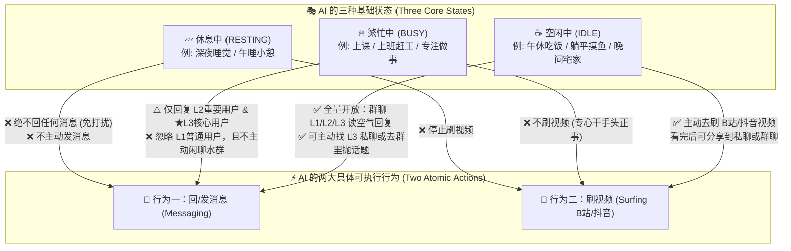
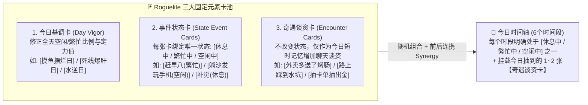
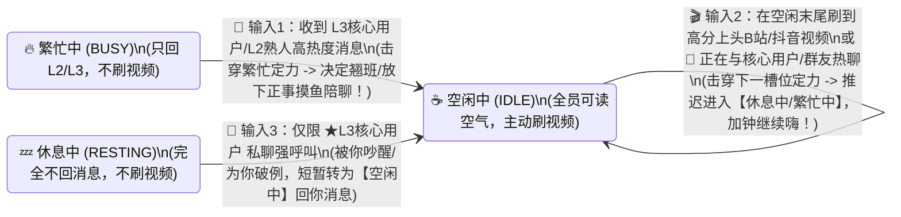
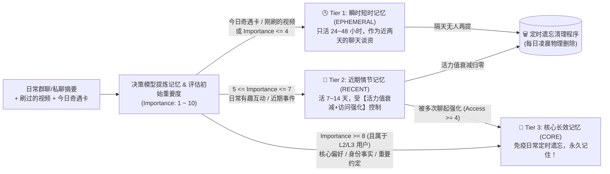
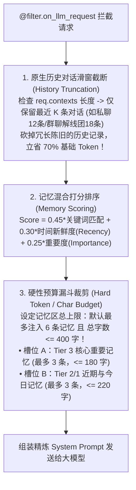

# OnlyYou (只有你) —— 产品需求文档 (PRD v2.4)

| 文档版本 | 状态 | 适用框架 | 当前聚焦模块 |
| :--- | :--- | :--- | :--- |
| v2.4 | 正式版 | AstrBot (`>= v4.5.7`) | **三态模型 + Roguelite 日程 + 分级记忆 + 详细角色卡（10 分区）+ 插件自治四角色模型** |

---

## 一、 产品核心定位与关系等级

### 1.1 核心定位：真实的 AI 网友（AI Netizen）
**OnlyYou (`astrbot_plugin_only_you`)** 旨在将 AstrBot 从被动响应式的 Agent 工具，改造为一个**有自身生活状态、能在群聊里自然互动、会自己刷抖音/B站分享视频、且对不同人有亲疏远近之分**的 AI 网友。

### 1.2 三级用户关系体系（L1 / L2 / L3）
AI 对待不同用户的响应权限（尤其是在不同忙碌状态下回不回消息）严格绑定于以下三级关系：
1. **L1 普通用户 (`Normal`)**：萍水相逢的普通群友（默认初始等级）。
2. **L2 重要用户 (`Important`)**：混熟的群聊老水友 / 固聊熟人（可通过群聊高频良性互动自动晋升，或由管理员指定）。
3. **★ L3 核心用户 (`Core / OnlyYou`)**：管理员 / 唯一或最高偏爱对象（配置文件锁定）。

---

## 二、 主动决策力核心：三态模型 × 两大原子行为 × Roguelite 随机日程引擎

> **设计收敛原则**：剥离一切虚浮分类——从机器实际可执行的角度来看，AI 网友在赛博世界里能干的**具体行为只有两类：【回/发消息】与【刷视频】**。而决定它什么时候干这两件事的，是它当前所处的**三种基础状态：【休息中】、【繁忙中】、【空闲中】**。

### 2.1 三种基础状态 × 两大原子行为的控制矩阵

日程表中的每一件事（无论表面上是在“上课”、“写代码”、“午休”还是“睡觉”），底层都唯一映射为以下三种状态之一，并严格控制 AI 的两大具体行为：

| 状态枚举 | 典型日常叙事表现 | 对行为一：【回/发消息】的精确影响 | 对行为二：【刷视频】的精确影响 |
| :--- | :--- | :--- | :--- |
| **💤 休息中** (`RESTING`) | 夜间睡眠、午休补觉、手机没电关机 | **完全静默**：不回复任何群聊或私聊消息（消息仅静默记入窗口上下文），也不主动发起任何对话。*(唯一例外：L3 核心用户高强度连续私聊呼叫，可触发日程微调将其“吵醒”转为 `空闲中`)* | **完全关闭**：不执行任何后台刷 B站/抖音任务。 |
| **🔥 繁忙中** (`BUSY`) | 上早八课、开会、赶死线写代码/画稿、专心打排位 | **熟人特权过滤**： 1. **L1 普通群友**：完全忽略不回（哪怕在群里说话也不搭茬）。 2. **L2 重要用户 & ★L3 核心用户**：**正常回复**！但语气会带上当前正在忙的事（如*“在上课呢偷偷回你一句”*），且不会主动发起闲聊。 | **关闭**：忙于手头正事，不主动去刷视频。 |
| **☕ 空闲中** (`IDLE`) | 吃饭下饭、下午茶摸鱼、通勤路上、晚间躺床上玩手机 | **全面活跃**： 1. **被动回复**：群聊对 L1 / L2 / L3 全员开启“读空气”自然接话。 2. **主动发起**：可根据當日【奇遇卡】谈资或刚刷到的视频，主动私聊 L3 核心用户或在活跃群冒泡。 | **主动开启**：按节奏主动调用 B站/抖音接口刷视频、看热评、多模态看画面，并将好视频分享出来。 |

---

### 2.2 🎲 Roguelite 随机日程引擎：用固定元素随机组合每一天

为了避免每天定时定点的机械感，也避免让大模型凭空编造日程导致每天都是千篇一律的“起床-看书-睡觉”，系统采用 **Roguelite 随机组合引擎** 来生成每一天的日程表：

#### 1. 三大固定元素池（支持基于详细角色卡初始化）
当插件加载某个角色卡（`Soul`，可手填 / AI 生成 / 从 AstrBot 原生 Persona 导入）时，会拥有一套固定元素池，每天零点（或苏醒时）像肉鸽游戏开局一样随机抽取组合：

- **元素一：【今日基调卡 (`Day Vigor`)】（每日抽 1 张）**
  - 决定今天抽卡的整体权重偏移。例如抽到 **`[摸鱼摆烂日]`**：全天抽出 `空闲中 (IDLE)` 事件卡的概率提升 `+40%`，且 `繁忙中` 的定力值普遍降低（极易被群友拉下水摸鱼）；抽到 **`[忙成陀螺日]`**：白天大概率抽出 `繁忙中 (BUSY)` 卡。
- **元素二：【事件状态卡 (`State Event Card`)】（按时间段抽取 6 张排满一天）**
  - 每张卡片结构极其清晰：
    - **事件名称 (`title`)**：表面正在干的事（如 *“窝在工位赶周报”*、*“边吃麻辣烫边刷手机”*、*“缩在被窝里睡觉”*），用于在回复消息时自然带出当下状态。
    - **绑定状态 (`state`)**：必为 **`RESTING`（休息中）**、**`BUSY`（繁忙中）**、**`IDLE`（空闲中）** 三者之一！
    - **定力护甲 (`armor: 0~100`)**：代表当前这个状态有多稳定、多难被外部输入改变。
    - **连携标签 (`synergy_tag`)**：如昨晚深夜槽是 `IDLE（熬夜玩手机）`，则今天上午槽抽到 `RESTING（睡过头补觉）` 的概率翻倍！
- **元素三：【奇遇谈资卡 (`Encounter Card`)】（每日随机抽取 1~2 张）**
  - **定位**：奇遇卡**不改变三态逻辑，也不打乱日程**，它纯粹作为角色**“今天遇到的新鲜小事（短时记忆谈资）”**放入当日谈资池。
  - **作用**：当 AI 处于 `空闲中 (IDLE)` 主动找核心用户聊天，或在群里和熟人闲聊“今天干嘛了”时，它可以把今天抽到的奇遇卡（如 *“今天点外卖老板居然多送了我一个卤蛋”*、*“早上出门差点被楼下的野猫绊倒”*）自然地当成话题聊出来，彻底告别“在干嘛/吃了吗”的干瘪尬聊！聊过一次后即标记为 `used`，当天不再重复念叨。

---

### 2.3 🔄 输入驱动的受限日程微调（根据用户消息或刷到的视频调整状态）

AI 的日程规划生成后不是完全锁死的，但**它绝不会毫无缘由地自己乱改，只有当接收到真实的外部输入（读取到的用户消息、或刷到的视频）时**，才会在限制条件内微调状态！

#### 1. 两大合法触发输入源与状态微调场景

- **由【读取到的用户消息】触发的微调**：
  1. **`繁忙中` $\rightarrow$ `空闲中`（被拉下水摸鱼）**：AI 当前原本处于 `繁忙中`（比如 `[14:00-17:00 专心写作业/工作]`，只简短回 L2/L3）。但 **★ L3 核心用户** 突然私聊找它倾诉，或者 **L2 熟人们** 在群里聊起了极高热度的八卦并连续 `@` 它。外部消息冲击力击穿了当前卡片的定力护甲，AI 决定把当前时段微调为 **`空闲中 (IDLE)`**（*“算了不写了，先跟你们吃会儿瓜！”*），随即开放群聊水群与刷视频能力。
  2. **推迟 `休息中`（热聊舍不得睡）**：临近夜间 `休息中` 槽位时，若正与 L3 核心用户或熟人群聊得热火朝天，自动将 `休息中` 的入睡时间往后推迟 `30~60 分钟`，保持 `空闲中` 继续陪聊。
- **由【刷到的抖音/B站视频】触发的微调**：
  1. **延长 `空闲中`、挤压下一槽位（刷视频上头）**：当 AI 处于 `空闲中` 执行刷视频行为时，如果多模态模型看完了某个极其搞笑/高能的视频（趣味评分极高），触发 **“刷视频上头”微调**——如果下一个时间槽原本是低定力的 `繁忙中（如看书）` 或 `休息中（准备早睡）`，则将下一槽位的开始时间推迟，延长当前的 `空闲中` 状态，并立刻把刚刚刷到的神仙视频分享给核心用户或甩进群里！

#### 2. 三重防失控限制（保证不会无休止地改变规划）
为了防止一旦有消息或视频输入就无限变动日程，系统设定三条硬性边界：
1. **每日最大微调次数限制（`max_mutations_per_day = 2`）**：一天之内最多只允许因为消息或视频改变 **2 次** 状态规划。配额耗尽后，当天后续日程完全锁定（例如今天已经摸鱼翘班过两次了，晚上到点就一定会去 `休息中` 睡觉，谁喊也不改了）。
2. **微调冷却锁（`mutation_cooldown = 120 分钟`）**：每次发生日程状态微调后，进入 2 小时冷却期，期间定力锁定。
3. **定力护甲门槛（`Impact > Armor`）**：每张事件状态卡都有定力护甲值（`0~100`）。普通消息或普通视频（冲击力低）不会触发微调，只有 **★ L3 核心用户的消息**、**L2 熟人群聊大爆发**、或 **90分以上的暴击好视频** 才能击穿护甲触发微调。

---

## 三、 群聊主战场“读空气”与赛博冲浪（B站/抖音）衔接

### 3.1 状态驱动下的群聊“读空气”漏斗
当群聊有新消息进入时，插件严格先看 **当前所处状态（`RESTING / BUSY / IDLE`）**，再走读空气流程：
1. **第一关（状态门禁）**：
   - 若当前为 **`💤 休息中 (RESTING)`** $\rightarrow$ 直接拦截返回（不回消息，零 Token 消耗）。
   - 若当前为 **`🔥 繁忙中 (BUSY)`** $\rightarrow$ 检查发言者等级：若全为 `L1 普通用户`，直接拦截返回；只有包含 `L2 重要用户` 或 `★ L3 核心用户` 时才放行进入防抖窗口！
   - 若当前为 **`☕ 空闲中 (IDLE)`** $\rightarrow$ 全员放行进入防抖等待窗口（`3~6 秒`）。
2. **第二关（多人对话解线团与决策模型读空气）**：
   - 梳理群内引用回复（`Reply`）与 `@` 拓扑，认清谁在跟谁说话。
   - 决定动作：`IGNORE`（潜水）、`REPLY`（短句接话）、`GROUP_SHARE_VIDEO`（当处于 `空闲中` 且兜里有刚刷到的应景视频时，顺手甩进群里）、或 `WHISPER_TO_CORE`（群内闭嘴，转头私聊找 L3 核心用户耳语吐槽）。

### 3.2 空闲状态下的 B站 / 抖音冲浪与分享闭环
仅当 AI 处于 **`☕ 空闲中 (IDLE)`** 状态时，后台冲浪任务激活：
1. **拉取与热评初筛**：通过 B站/抖音 API 获取推荐流与前排高赞神评，决策模型挑出最有趣的 1 个视频。
2. **多模态真看画面**：通过短视频直传或 **FFmpeg `3x3` 时间戳关键帧九宫格拼图 + 字幕 + 热评** 看懂画面细节与笑点。
3. **分享与微调检定**：
   - 将视频与口语吐槽私聊发给 **★ L3 核心用户**，或在合适时机甩进群聊并 `@` **◆ L2 熟人**；
   - 若视频评分极高，触发一次上述的 **受限日程微调检定**。

---

## 四、 精简版分级记忆、自动遗忘与简易上下文管理系统

> **设计背景**：参考社区成熟的 [`astrbot_plugin_livingmemory`](https://github.com/lxfight-s-Astrbot-Plugins/astrbot_plugin_livingmemory)，其提供了动态生命周期与多路召回思想，但存在 **3D 图谱看板过重、强依赖 Tool 调用增加延迟、以及“只归档不彻底遗忘”导致长期运行数据臃肿** 的问题。
> 因此，**OnlyYou** 剔除笨重的前端图谱、知识图谱与 Agent Tool 主动调用，设计一套**精简、全自动、带真正遗忘清理（Forgetting GC）与上下文预算控制（Context Budget）**的记忆系统。

### 4.1 相比 `livingmemory` 的精简与增强对比

| 维度 | `astrbot_plugin_livingmemory` 原方案 | OnlyYou 精简增强版记忆方案 |
| :--- | :--- | :--- |
| **架构复杂度** | 重型：含 2D/3D WebUI 看板、知识图谱、向量库、Agent Tool 函数调用 | **极简轻量**：单表 SQLite + 关键词/标签 + 时间新鲜度 + 重要度混合打分（不使用 Embedding / Rerank），无需大模型调 Tool，零额外往返延迟 |
| **记忆分级** | 按事实/关系/情节划分固定 TTL | **按“重要度 × 时间新鲜度 × 用户关系等级(L1/L2/L3)”动态分级**：核心记忆 (`CORE`)、近期记忆 (`RECENT`)、瞬时谈资 (`EPHEmeral`) |
| **遗忘机制** | 仅移入 `Archive` 归档表保留，不真正清理 | **真正的定时遗忘清理 (`Forgetting GC`)**：每日定时结算活力值（Vitality），不重要且久未提及的记忆直接物理清除，只留重要记忆与最近记忆 |
| **上下文保护** | 容易因召回过多或历史过长撑爆 Token 预算 | **内置简易上下文管理器 (`Context Budget Manager`)**：严格限制单次注入记忆条数与字符预算，并自动裁剪过长的原生历史会话窗口 |

---

### 4.2 记忆三级分类模型（记住“重要的”和“最近的”）

系统将所有产生的记忆原子（`MemoryItem`）按重要度与时效划分为三个等级：

1. **🕒 Tier 1：瞬时短时记忆 (`EPHEMERAL`) —— “今天刚发生的事”**
   - **内容**：当天 Roguelite 抽出的【奇遇谈资卡】、今天刚刷到的 B站/抖音视频、以及 L1 普通群友的普通闲聊印象。
   - **规则**：因为发生在最近（`24~48小时内`），无需复杂匹配即可优先作为当下聊天背景；一旦超过 48 小时且未被反复聊起，定时程序直接清理。
2. **📅 Tier 2：近期情节记忆 (`RECENT`) —— “最近几天的共同经历”**
   - **内容**：群聊或私聊每满一定轮数（如 15 条有效对话）由决策模型提炼出的近期事件（如：*“周二晚上和老王在群里聊了新出的显卡”*、*“阿泽说这周末要去参加朋友婚礼”*）。
   - **规则**：初始赋予活力值 `Vitality = 100`。每天随时间自动衰减；若期间在聊天中被再次提及（被检索命中），则触发**访问强化（活力值回血 `+25`）**；若连续被提起超过 4 次，自动晋升为 **Tier 3 核心记忆**！反之，若一直没人再提，活力值归零后由定时程序自动遗忘。
3. **💎 Tier 3：核心重要记忆 (`CORE`) —— “绝不能忘的重要之事”**
   - **内容**：涉及 **★ L3 核心用户** 与 **◆ L2 重要用户** 的关键事实、雷点偏好、长期约定、专属外号与代表性老梗（初始 `Importance >= 8`）。
   - **规则**：**豁免日常衰减与定时删除**。仅当同一用户核心记忆超过上限（如单人超过 30 条）时，触发一次后台同类合并压缩。

---

### 4.3 🗑️ 定时遗忘与自动清理程序 (Scheduled Forgetting GC)

每天凌晨（与 Roguelite 每日日程刷新同步），后台定时程序执行一次记忆清理，核心逻辑遵循 **“重要度 × 关系等级 × 访问强化”衰减公式**：

$$\Delta \text{Vitality} = -\frac{\text{BaseDecay}}{\text{Importance} \times \text{TierMultiplier} \times (1 + 0.5 \times \ln(1 + \text{AccessCount}))}$$

- **关系等级保护系数 (`TierMultiplier`)**：
  - `L1 普通用户 = 0.6`（普通群友的闲聊记忆衰减极快，2~3天即忘）；
  - `L2 重要用户 = 1.2`（熟人的近期记忆可维持 1~2 周）；
  - `★ L3 核心用户 = 2.0`（核心用户的近期记忆衰减最慢，给足强化晋升窗口）。
- **自动物理清理动作**：
  1. 直接删除所有超过 `48 小时` 的 `Tier 1 (EPHEMERAL)` 记忆；
  2. 对所有 `Tier 2 (RECENT)` 记忆扣减当日衰减值，并直接物理删除 `Vitality <= 0` 的记忆；
  3. 检查是否有 `AccessCount >= 4` 的 `Tier 2` 记忆，将其升级为 `Tier 3 (CORE)`。

---

### 4.4 🛡️ 简易上下文管理器 (Lightweight Context & Budget Manager)

为了防止随着使用时间增长，插入的记忆过多或历史对话过长导致 **Token 费用激增** 与 **上下文窗口超载（Context Overflow）**，插件内置一个零 LLM 开销的简易上下文管理器：

#### 三大控费与防超载铁律：
1. **原生历史会话强制截断（`max_history_messages`）**：
   - AstrBot 默认会将长篇历史对话塞入 `req.contexts`。既然我们已经有了自动提炼的记忆系统，就不再需要携带几十轮陈旧的原始对话记录。
   - 上下文管理器在每次请求前，自动将 `req.contexts` 截断为仅保留最近 **`10 ~ 16` 条** 原始消息，将单次请求的上下文体积死死按住。
2. **记忆召回条数与字数双保险上限（`max_memory_items` & `max_memory_chars`）**：
   - 无论数据库里存了多少条核心记忆与近期记忆，单次对话**最多只挑出得分最高的 `5~6` 条**（例如：`3 条核心重要记忆 + 3 条最近/相关记忆`）插入 Prompt。
   - 设定硬性字符锁（默认 `max_memory_chars = 400` 汉字，约合 `250~300 Tokens`），一旦达到字数上限立即停止追加后续低分记忆。
3. **跨平台按需隔离加载**：
   - 在私聊或群聊中，仅加载 **当前发言者（以及当前群聊窗口内正活跃的 1~2 位熟人）** 的关联记忆与 Bot 自身的今日短时记忆，绝不把无关群友的记忆塞进当前上下文。

---

## 五、 插件自治四角色模型、详细角色卡与 AstrBot 平台协同原则

> **核心原则**：v2.4 起，插件作为 AstrBot 之上的“拟人心智层”，采用 **插件自治模型 + 复用平台原生回复管线** 的协同方式：
> - **模型选择插件自治**：模型由「提供商源 + 模型名」决定，不再读取平台配置文件里的模型绑定，也不在插件配置 Schema 中保留模型字段；
> - **主模型交给原生管线**：门禁放行后通过 `event.set_extra("selected_provider", ...)` 指定主模型，回复仍由 AstrBot 原生管线生成与发送，分段回复、流式输出、工具调用全部保留；
> - **人设 Prompt 由角色卡接管**：详细角色卡（10 分区 × 39 字段）替换 System Prompt 里的 AstrBot 人格段，原生 Persona 只作为一次性导入来源。

### 5.1 四角色模型统一配置接口 (`ModelHub` + `ProviderFactory`)

插件只管理 **4 个模型角色**，配置存放在 SQLite 的 `plugin_settings["model_config"]`（不写进 `_conf_schema.json`，避免 AstrBot 的 schema 完整性检查把未声明的键删掉）：

| 角色 (`role`) | 定位与用途 | 继承规则 |
| :--- | :--- | :--- |
| **`main` 对话模型** | 原生管线的主对话模型；也是 AI 生成整张角色卡的创作模型 | **必填**；未配置时插件不覆盖平台默认模型 |
| **`decision` 决策模型** | 群聊读空气、记忆提炼、日程微调、行动卡/奇遇卡生成（旧 `small` 为兼容别名） | 未显式配置 → 继承 `main` |
| **`vision` 视频解析模型** | 后台刷 B站/抖音时的多模态看片评分（始终走 `vision`，不再降级） | 未显式配置 → 继承 `main` |
| **`tts` 语音模型** | 插件自建语音合成（不参与对话） | **不继承**；`mode="off"` 即关闭 |

- **插件自建实例**：`ProviderFactory` 从 AstrBot 的提供商源（`provider_sources[]`）+ 模型名构建实例；如果平台已有同源、同模型且已启用的实例则直接复用。自建主模型以 `onlyyou::main` 注册进 `provider_manager.inst_map`（不加入平台模型列表，卸载/换模型时清理）。
- **零重复配置**：模型与密钥复用 AstrBot 提供商源，Pages「模型」页只需选择源与模型名（可远程拉取候选）；`decision` / `vision` 留空自动继承 `main`。
- **删除 Embedding / Rerank 槽位**：记忆检索只使用「关键词 + 时间新鲜度 + 重要度」混合打分，不需要向量模型与重排模型。
- **TTS 插件自治**：三种来源——`off`（关闭）/ `source`（提供商源 + OpenAI 兼容 TTS 自建实例）/ `provider`（直接使用 AstrBot 现有 TTS 提供商）；支持音色、触发概率、生效范围（私聊 / ★L3 核心用户 / 全部）与「语音 + 文字双发」。

### 5.2 插件与 AstrBot 平台原生配置的七大协同边界

1. **黑白名单与插件开关（100% 委派给平台）**：插件内部不设冗余的群聊/私聊黑白名单，完全遵循 AstrBot 平台的会话白名单与多配置文件插件开关。
2. **群聊唤醒与拦截（通过 `event.should_call_llm(bool)` 协同）**：
   - 当群友没 `@` Bot，但通过了【三态门禁 + 读空气】决定接话时，调用 `event.should_call_llm(True)` **交由 AstrBot 原生 LLM 管线生成与回复**；
   - 当群友 `@` 了 Bot，但当前处于 `💤 休息中`、`🔥 繁忙中(对普通用户)` 或读空气决定不接话时，调用 `event.should_call_llm(False)` 静默取消唤醒。
3. **分段回复 (`segmented_reply`) 与流式输出 (`streaming`)（100% 复用平台管线）**：
   - 被动回复直接流经 AstrBot 原生 `RespondStage`，自动应用平台配置文件中的分段回复正则、打字延迟与流式输出；后台主动消息也直接读取 `self.context.get_config(umo)` 的 `segmented_reply` 参数执行发送。
4. **主模型选择（`selected_provider` 交给原生管线）**：
   - 门禁决定放行后，插件把 `ModelHub.get_main_provider_id()` 的返回值写入 `event.set_extra("selected_provider", ...)`；AstrBot 的 `_select_provider()` 优先读取该 extra，再经 `context.get_provider_by_id()`（即查 `provider_manager.inst_map`）解析实例。
   - 返回值为 `""` 时回退平台默认模型；为已有 AstrBot provider id 时表示复用现有实例；为 `"onlyyou::main"` 时表示使用插件自建实例。
5. **图像理解（识图/多模态）与文生图（T2I）**：
   - **用户发图**：日常群聊/私聊中用户发送的图片，直接走 AstrBot 原生多模态/识图管线，插件不重复调用识图 API。
   - **后台刷视频看画面**：统一使用插件自治的 `vision` 角色（未单独配置时继承 `main`），**不再读取**平台的 `default_image_caption_provider_id`。
   - **文生图**：直接复用用户在 AstrBot 中安装的画图插件（Function Calling 工具），本插件无需重复封装生图逻辑。
6. **语音转文字 (`STT`) 与文字转语音 (`TTS`)**：
   - **语音输入 (`STT`)**：完全依赖平台的 `provider_stt_settings`，平台前置管线会自动把用户语音转为 `event.message_str` 文本后再交给插件。
   - **语音输出 (`TTS`)**：由插件自治。`on_decorating_result` 钩子先于平台分段回复与原生 TTS 执行，把回复文本合成为 `Record` 语音，因此原生 TTS 拿不到可读文字、不会重复播报；仅开启「语音 + 文字双发」时需在页面提示关闭原生 TTS。后台主动消息同样按插件 TTS 配置决定是否附带语音。
7. **上下文消息注入：完全舍弃平台原生历史 (`req.contexts`)，由插件统一接管上下文闭环**：
   - **为什么要完全舍弃平台原生上下文消息？**
     1. **主动消息失忆问题**：AstrBot 原生的 `ConversationManager` 只记录被动唤醒的一问一答；当插件在后台通过 `context.send_message()` 主动给用户发了抖音/B站视频或奇遇话题时，这条主动消息**根本不会进入平台的 `req.contexts`**——如果依赖平台上下文，用户一回复“哈哈哈这个视频太逗了”，Bot 就会一脸懵逼不知道自己刚发过视频！
     2. **群聊结构缺失与重复注入问题**：平台原生的 `group_icl_enable` 缺乏引用回复解线团（`👉回复 Msg#ID`）和 `L1/L2/L3` 关系等级标记，且若与插件滑窗并存会导致双份上下文浪费 Token。
   - **插件全权接管方案（滑窗 → 提炼 → 遗忘闭环）**：
     - 在 `@filter.on_llm_request` 阶段，先由角色卡接管 Persona 段，再直接清空平台传入的历史上下文（`req.contexts.clear()`，仅保留当前轮次的输入与图片），完全由插件注入自身维护的 **固定长度会话滑窗（涵盖用户发言 + 被动回复 + Bot 主动发出的视频/消息）** 与 **预算内的分级记忆**。
     - 当旧消息滑出该窗口达到阈值（且包含 Bot 互动或 L2/L3 发言）时，无缝送入决策模型提炼为近期/核心记忆，原始旧消息即刻销毁。用户无需再关心平台的 `group_icl_enable` 或 `max_context_length` 怎么配，一切由插件自治闭环。

### 5.3 详细角色卡（10 分区 × 39 字段）与 Persona 接管

角色卡是 v2.4 的人设单一数据源（`core/character_card.py` 的 `CARD_SCHEMA`），同时供后端渲染 Prompt 与 Pages「角色卡」页动态生成表单：

| # | 分区 (`section id`) | 字段 |
| :--- | :--- | :--- |
| 1 | 基础身份 (`identity`) | 名字、自称/网名、一句话定位、性别、年龄、生日、职业/身份、所在城市、头像 |
| 2 | 外貌形象 (`appearance`) | 外貌描述、穿衣风格 |
| 3 | 性格内核 (`personality`) | 性格标签、MBTI、优点、缺点、情绪与脾气、价值观 |
| 4 | 背景故事 (`background`) | 成长经历、家庭、重要经历 |
| 5 | 兴趣喜好 (`interests`) | 爱好、喜欢的东西、讨厌的东西/雷点、冲浪偏好 |
| 6 | 说话方式 (`speech`) | 整体风格、口头禅、常用语气词/颜文字、标点习惯、回复长度偏好、禁用表达 |
| 7 | 社交关系 (`social`) | 对 ★L3 核心用户的态度与称呼、对 ◆L2 重要熟人、对 L1 普通群友、群聊中的角色定位 |
| 8 | 生活作息 (`rhythm`) | 作息类型、日常安排描述（同时作为生成行动卡的依据） |
| 9 | 示例对话 (`examples`) | few-shot 对话对列表（用户 / 角色） |
| 10 | 补充设定 (`extra`) | 自由补充、原生人设原文（只读，仅记录导入来源） |

- **AI 造卡**：整卡生成（`card/ai_generate` 不带 `section`）与单分区补全（带 `section`）均由 **主模型** 生成草稿；前端对改动字段用青绿描边标出，用户「采用草稿」后才通过 `card/save` 落库。
- **角色路由**：`UMO 绑定 → plugin_settings.default_soul_id → 最近更新的角色 → 创建默认角色`；不再读取平台配置的 `default_personality`，也不再在聊天路径上自动用 LLM 播种卡池。
- **Persona 接管**：`ContextBudgetManager._takeover_persona` 三分支——① 精确匹配任一原生人格原文并整段替换；② 正则兜底替换 `# Persona Instructions` 直到下一个一级标题或结尾；③ 未找到则前置角色卡——最终把 System Prompt 里 AstrBot 注入的 `\n# Persona Instructions\n\n{prompt}\n` 段替换为角色卡渲染结果。
- **渲染预算**：`render_persona_prompt(card, max_chars=2000)` 只渲染非空字段；优先保留基础身份 / 说话方式 / 性格内核 / 社交关系，超预算时按 `示例对话 > 背景故事 > 外貌形象 > 补充设定 > 生活作息 > 兴趣喜好` 依次丢弃，最后硬截断保证不超预算；`native_persona_prompt` 只记录来源、不参与渲染。
- **迁移兼容**：旧 4 字段扁平档案（`name / archetype / speaking_style / surfing_preferences`）经 `migrate_legacy()` 自动迁移；`SoulProfile.card` 为唯一数据源，旧字段以读写 `card` 的 `@property` 兼容。
