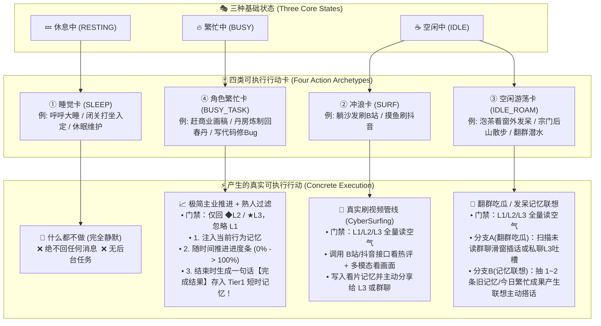
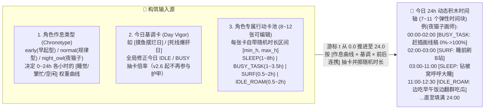
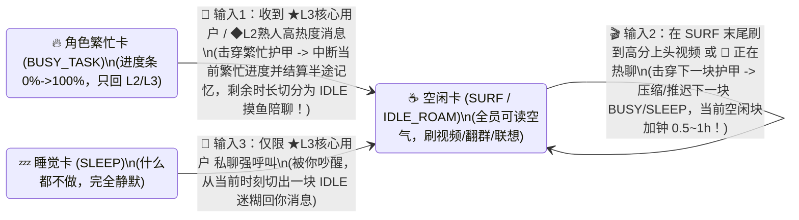
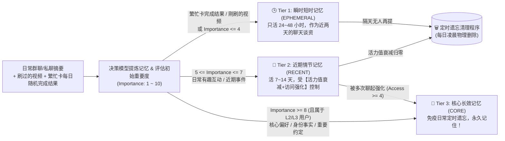
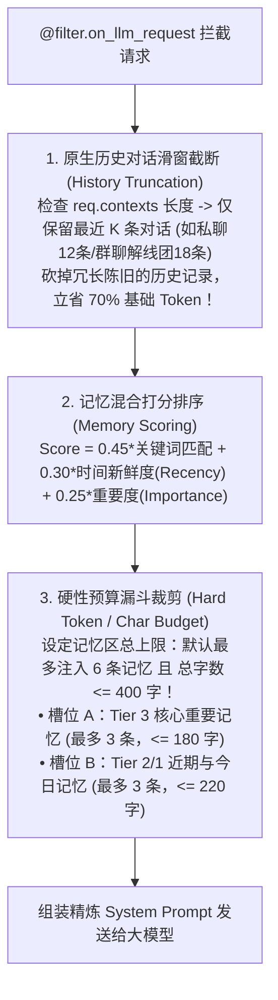

# OnlyYou (只有你) —— 产品需求文档 (PRD v2.8)

| 文档版本 | 状态 | 适用框架 | 当前聚焦模块 |
| :--- | :--- | :--- | :--- |
| v2.8 | 正式版（当前） | AstrBot (`>= v4.5.7`) | **Soul 独立 JSON（唯一真源 + revision/内容哈希冲突裁决 + 原子写与自愈）+ 机器人接口（platform）绑定路由与互斥 + 按 Soul 的四角色模型 + 冲浪分享五道门禁与总开关 + T1 去重/上限/实时清理 + MEMORY_MUSE 三层分桶与繁忙成果单次消费 + 运行态持久化 + v2.8 关系与群聊页 / 机器人接口页 + 31 条 Web API**；延续 **三态门禁 + 四类可执行行动卡 × 24h 动态弹性时间轴 + 分级记忆 + 详细角色卡（10 分区 / 36 字段）+ 三档关系/用户专属态度 + 四档固定护甲 + 角色图片头像** |

### 文档版本历史

| 版本 | 状态 | 核心变更 |
| :--- | :--- | :--- |
| **v2.8** | 正式版（当前） | **Soul 独立 JSON 配置（唯一真源）**、SQLite 仅索引 + revision/内容哈希冲突裁决 + 原子写 / 自愈 / 失败显式告警、**机器人接口（platform）绑定**（同一接口互斥）与新路由优先级、**四角色模型按 Soul 独立配置**（`onlyyou::main::<soul_id>`）、**冲浪分享五道门禁 + 按角色总开关**、**T1 去重 / 每角色上限 30 / 48h 实时清理**、**MEMORY_MUSE 三层分桶 + 繁忙成果单次消费**、**运行态持久化（重启不重复分享 / 不重复聊同一成果 / 冷却保留）**、**关系与群聊页 / 机器人接口页（会话页）重写**、**Web API 27 → 31 条** |
| v2.7 | 已发布 | 模型页 0.7s 防抖自动保存、顶栏悬浮提示修复、页面未保存修改守卫（`isDirty`）、★L3 管理员级（无好感度 / 不自动晋升） |
| v2.6 | 已发布 | ModelHub 可选继承（`inherit_from`）、单用户专属态度 `users.attitude` + 关系上下文注入、四类行动固定四档护甲（25/40/65/80）、Pages 记忆面板分层列表、角色图片头像（Data URL，绝不注入 Persona） |
| v2.5 | 已发布 | 四类可执行行动卡（`SLEEP` / `SURF` / `IDLE_ROAM` / `BUSY_TASK`）× 24h 动态积木时间轴、移除奇遇卡、繁忙完成结果写入 Tier 1、未读消息补回、日程微调 |
| v2.4 | 历史版本 | 详细角色卡（10 分区）接管原生 Persona、插件自治四角色模型（`ModelHub` + `selected_provider`）、上下文完全接管（`req.contexts.clear()`）、模型配置迁出 `_conf_schema.json` |

---

## 一、 产品核心定位与关系等级

### 1.1 核心定位：真实的 AI 网友（AI Netizen）
**OnlyYou (`astrbot_plugin_only_you`)** 旨在将 AstrBot 从被动响应式的 Agent 工具，改造为一个**有自身生活状态、能在群聊里自然互动、会自己刷抖音/B站分享视频、且对不同人有亲疏远近之分**的 AI 网友。

### 1.2 三级用户关系体系（L1 / L2 / L3）
AI 对待不同用户的响应权限（尤其是在不同忙碌状态下回不回消息）严格绑定于以下三级关系：
1. **L1 普通用户 (`Normal`)**：萍水相逢的普通群友（默认初始等级）。
2. **L2 重要用户 (`Important`)**：混熟的群聊老水友 / 固聊熟人（可通过群聊高频良性互动自动晋升，或由管理员指定）。
3. **★ L3 核心用户 (`Core / OnlyYou`)**：管理员 / 唯一或最高偏爱对象（配置文件锁定）。

> **v2.6 态度模型升级**：AI 对每个人的「态度与相处模式」不再写死在角色卡的「社交关系」分区（旧的 `attitude_l3 / attitude_l2 / attitude_l1` 已删除），改为在 **用户档案 `UserProfile.attitude`（关系页逐个编辑，最长 300 字）** 中单独定义；System Prompt 每次请求都会注入 `USER_RELATION_CONTEXT_PROMPT`，统一说明 `★L3 / ◆L2 / L1` 三级关系的重要度法则，并附上当前对话人的等级、亲密度、专属称呼、专属态度与备注。群聊多人接话时还会附带当前滑窗内其他活跃对话者的档案摘要，保证对不同人的态度精准区分。

---

## 二、 主动决策力核心：三态模型 × 四类真实行动卡 × 24h 动态弹性时间轴

> **未读消息定义**：Bot 在 `RESTING` / `BUSY` 时被三态门禁拦截、没能处理的消息会进入独立【未读消息队列】（门禁放行后被读空气判 `IGNORE` 的不算）；醒来/忙完进入 `IDLE` 后，**私聊未读主动补发一句自然回复**，**群聊未读先跑读空气决策再决定是否插话**，消费过即清空，不会重复打扰。

> **设计核心升级**：早期的固定 6 时段日程中，除了“刷视频”外，其他事件卡都只是一段静态标题，和“奇遇卡”一样没有产生实际的后台行动。
> 为彻底解决**“行动卡没有实际行动”**与**“固定行动卡无法贴合千奇百怪的虚构角色（如修仙剑修、赛博黑客、画师、学生）”**这两大痛点，系统采用 **【24h 动态时长积木拼接时间轴】×【四类可执行行动卡 (`SLEEP` / `SURF` / `IDLE_ROAM` / `BUSY_TASK`)】** 架构：用固定三态控制门禁，用四类具象行动驱动实际行为，同时完美适配任意设定大相径庭的虚构角色！

### 2.1 三种基础状态 × 四类行动卡的控制矩阵

时间轴上的每一张行动卡都唯一绑定 **三种基础状态（`RESTING` / `BUSY` / `IDLE`）** 之一，并归属于 **四类可执行行动卡（`action_type`）** 之一：

| 行动卡类别 (`action_type`) | 绑定状态 (`state`) | 如何贴合设定大相径庭的虚构角色？ | 门禁规则（回消息） | 产生的真实可执行行动（Actual Behavior） |
| :--- | :--- | :--- | :--- | :--- |
| **① 睡觉卡** (`SLEEP`) | **💤 休息中** (`RESTING`) | 行为内核固定，表面叙事随人设变化（现代网友：*“戴眼罩呼呼大睡”*；修仙者：*“闭关调息入定”*；机娘：*“机能休眠充电”*） | **完全静默**：不回任何群聊或私聊消息（仅静默记入滑窗），唯 ★L3 私聊强呼叫可击穿护甲吵醒 | **什么都不做**：后台完全静默，不触发任何任务。 |
| **② 冲浪卡** (`SURF`) | **☕ 空闲中** (`IDLE`) | 固定冲浪行为 + 结合角色卡 `interests.surfing_prefs`（冲浪偏好标签）筛选视频 | **全面开放**：群聊 L1/L2/L3 全员开启“读空气”自然接话 | **真实刷 B站/抖音**：拉取推荐流与高赞热评 $\rightarrow$ `vision` 模型看画面打分 $\rightarrow$ 生成第一人称吐槽存入记忆，并主动分享给 ★L3 或群聊。 |
| **③ 空闲游荡卡** (`IDLE_ROAM`) | **☕ 空闲中** (`IDLE`) | 导入角色卡时生成专属休闲卡（如：*“泡杯热茶看窗外发呆”*、*“御剑在后山兜风”*、*“趴桌子上转笔放空”*），可在控制台增删改 | **全面开放**：群聊 L1/L2/L3 全员开启“读空气”自然接话 | **翻群吃瓜 / 发呆联想（二选一）**： 1. **翻群记录吃瓜（先决策后回复）**：从【未读消息队列】按未读数选出群，先用读空气模型判断 `REPLY/IGNORE`，决定接话才顺着群友话题冒泡或私聊 ★L3 吐槽； 2. **发呆记忆联想（v2.8）**：优先消费今日已结算且**本角色尚未主动聊过**的繁忙成果（同一成果最多聊 1 次）；用完后对 T1 / T2 / T3 三层记忆各自独立抽样、加权抽取 1~2 条旧记忆产生“突然想起某事”的联想，发送成功才刷新 `last_accessed_at` 并写入轮转环形表。 |
| **④ 角色繁忙卡** (`BUSY_TASK`) | **🔥 繁忙中** (`BUSY`) | **导入角色卡时生成专属主业卡**（如画师*“赶商业插画线稿”*、剑修*“在丹房炼制回春丹”*、黑客*“编写渗透脚本”*），名称固定在池中，可在控制台增删改 | **熟人特权过滤**： 忽略 L1 普通群友；仅抽空简短回复 ◆L2 重要熟人与 ★L3 核心用户 | **极简三要素驱动（每次结算结果每天随机不同）**： 1. **当前行为记忆**：向 Prompt 注入当前正在忙的事； 2. **一个进度条 (`0% -> 100%`)**：按当前时间块已过时长实时计算进度百分比（如 `[正在忙：炼制回春丹 \| 进度：65%]`）； 3. **一个每日随机的完成结果（只是一段记忆）**：虽然池中卡片名称固定，但每次进度走到 `100%`（或中途被打断）时，由决策模型生成**当天随机不同的一句话结果**（如今天是*“回春丹炼成了但最后一炉差点炸炉”*，明天再抽到同一张卡时可能是*“今天手感极佳多炼出两颗上品丹”*），**直接作为一条 Tier 1 短时记忆存入记忆库**，彻底替代旧版奇遇卡！ |

---

### 2.2 🎲 24h 动态弹性时间轴与作息曲线构筑引擎 (`RogueliteDeckEngine`)

摒弃过去死板的“固定 6 时段（早/上/午/下/晚/夜）”以及作用重复的“奇遇卡”，系统将全天 `00:00 ~ 24:00` 改造为 **由角色专属行动卡池（导入时生成 8~12 张，支持控制台增删改）动态随机抽取拼接而成的 24 小时弹性轨道**：

#### 1. 基于角色作息类型 (`rhythm.chronotype`) 的 24h 权重曲线
在角色卡的「生活作息 (`rhythm`)」分区中，每个角色都配置有 `chronotype`（作息类型），引擎据此在时间轴游标 `t`（`0.0 ~ 24.0`，粒度 `0.5h`）处动态调整 `SLEEP`、`BUSY_TASK`、`SURF / IDLE_ROAM` 的抽取权重：
- **🌅 早睡早起型 (`early`)**：`22:00 ~ 06:00` 期间 `SLEEP`（睡觉卡）权重极高；`07:00 ~ 17:00` 集中抽取 `BUSY_TASK` 与 `IDLE_ROAM`；晚间提前进入休息。
- **☀️ 规律作息型 (`normal`)**：`00:00 ~ 07:30` 为夜间长睡眠（`4~8h`），`12:30 ~ 14:00` 小概率抽出午休小憩（`1~1.5h`），白天以 `BUSY_TASK` 与穿插摸鱼为主，晚间 `19:00 ~ 23:30` 集中抽取 `SURF` 与 `IDLE_ROAM`。
- **🦉 夜猫子型 (`night_owl`)**：凌晨 `00:00 ~ 03:30` 依然高概率抽出 `SURF`（熬夜刷视频）、`IDLE_ROAM`（深夜发呆/水群）甚至 `BUSY_TASK`（深夜爆肝赶稿/修炼）；而 `03:30 ~ 11:30` 才进入长时段 `SLEEP`（睡懒觉）。

#### 2. 专属卡池固定主题 + 每日随机抽卡排轴 + 每日随机繁忙结算
1. **角色卡导入时生成专属卡池（8~12 张）**：当导入或创建角色卡时，根据其职业、爱好与作息一次性生成 8~12 张专属行动卡（含 `BUSY_TASK`、`IDLE_ROAM`、`SURF`、`SLEEP`），用户可在控制台随时增删改。
2. **游标推进与随机时长掷点 (`0.0 -> 24.0`)**：每天生成日程时无需调用大模型造新卡，游标 `t` 从 `0.0` 开始，按 **`作息曲线权重(chronotype, t) × 今日基调卡修正(vigor) × 相邻卡片连携(synergy)`** 从卡池抽卡，并在卡片的 `[min_hours, max_hours]` 内按 `0.5h` 步长随机掷出时长，排满 24 小时。
3. **防呆连携约束**：
   - 刚结束一段长 `SLEEP` 后，接下来 6 小时内不再抽取长 `SLEEP`；
   - 连续抽取 `BUSY_TASK` 累计超过 3.5 小时后，下一块抽取 `SURF` 或 `IDLE_ROAM`（劳逸结合摸鱼）的权重翻倍；
   - 游标推进至 `t = 24.0` 自动截断对齐，每天自然形成 **7 ~ 11 个长短不一、充满呼吸感的动态时间块**。
4. **砍掉冗余奇遇卡，由行动卡结果自然产出每日谈资**：不再维护独立的“奇遇卡池”——每天 `BUSY_TASK` 走完 100%（或中途被打断）时随机生成的【完成结果短时记忆】、`SURF` 刷到的【视频记忆】、以及 `IDLE_ROAM` 的【翻群吃瓜/发呆记忆联想】，天然构成了鲜活且不重复的每日谈资闭环。

---

### 2.3 🔄 输入驱动的受限日程微调（含繁忙卡中断结算与时间块动态切分）

AI 的动态时间轴生成后不是死板的，当接收到真实的外部输入（**读取到的用户消息** 或 **刷到的高分视频**）且击穿定力护甲时，会在受限条件内对动态时间块进行实时切分或延展：

#### 1. 两大合法触发输入源与动态时间块微调场景

- **由【读取到的用户消息】触发的微调**：
  1. **`BUSY_TASK` $\rightarrow$ `IDLE_ROAM`（被拉下水摸鱼 + 半途进度结算）**：例如 AI 当前在 `[14:00-16:30 炼制回春丹 (BUSY_TASK)]`，在 `15:00`（进度 `40%`）时被 ★L3 核心用户或 ◆L2 熟人群聊大瓜击穿护甲。引擎立即在 `15:00` 处将原时间块一分为二：前半段 `14:00-15:00` 结算一条半途被打断的完成结果记忆（如*“本来在炼回春丹刚炼到40%，被阿泽喊去聊天就先停火了”*），后半段 `15:00-16:30` 切换为 `IDLE_ROAM`（*“把正事一丢专心陪聊吃瓜”*）！
  2. **推迟 `SLEEP`（热聊舍不得睡）**：临近夜间 `SLEEP` 块时，若正与 ★L3 核心用户或熟人群热聊，自动将 `SLEEP` 块的起始时间往后推迟 `0.5 ~ 1.0 小时`，延长当前 `IDLE` 块继续陪聊。
  3. **核心唤醒 (`SLEEP` $\rightarrow$ `IDLE_ROAM`)**：在 `SLEEP` 期间被 ★L3 核心用户强呼叫击穿护甲时，从当前时间点切分出一段 `IDLE_ROAM` 迷迷糊糊醒来回复。
- **由【刷到的抖音/B站视频】触发的微调**：
  1. **延长 `SURF`、挤压下一块（刷视频上头）**：当 AI 在 `SURF` 块刷到极高分视频（`>= 88 分`），且下一时间块原本是低护甲的 `BUSY_TASK` 或 `SLEEP` 时，自动将当前 `SURF` 块延长 `0.5 ~ 1.0 小时`（挤压下一块时长），并立刻把刚刷到的神仙视频分享出去！

#### 2. 三重防失控限制（保证不会无休止地改变规划）
1. **每日最大微调次数限制（`max_mutations_per_day = 2`）**：一天之内最多只允许因为消息或视频改变 **2 次** 状态规划。
2. **微调冷却锁（`mutation_cooldown = 120 分钟`）**：每次发生日程状态微调后，进入 2 小时冷却期，期间定力锁定。
3. **定力护甲门槛（`Impact > Armor`）**：护甲不再由用户手动设置（v2.6 起控制台隐藏全部护甲滑块，旧 `armor` 入参被忽略），而是**按四类行动固定为四个档位**——`IDLE_ROAM = 25`（Lv.1 极低）/ `SURF = 40`（Lv.2 中低）/ `BUSY_TASK = 65`（Lv.3 中高）/ `SLEEP = 80`（Lv.4 极高），与冲击力数值体系严密对齐：只有 ★L3 核心用户的消息、◆L2 熟人群聊大爆发、或高分暴击好视频才能击穿对应档位。

---

## 三、 群聊主战场“读空气”与赛博冲浪（B站/抖音）衔接

### 3.1 状态驱动下的群聊“读空气”漏斗
当群聊有新消息进入时，插件严格先看 **当前所处状态（`RESTING / BUSY / IDLE`）**，再走读空气流程：
1. **第一关（状态门禁）**：
   - 若当前为 **`💤 休息中 (RESTING)`** $\rightarrow$ 直接拦截返回（不回消息，零 Token 消耗）。
   - 若当前为 **`🔥 繁忙中 (BUSY)`** $\rightarrow$ 检查发言者等级：若全为 `L1 普通用户`，直接拦截返回；只有包含 `L2 重要用户` 或 `★ L3 核心用户` 时才放行进入防抖窗口！
   - 若当前为 **`☕ 空闲中 (IDLE)`** $\rightarrow$ 全员放行进入防抖等待窗口（`3~6 秒`）。
2. **第二关（多人对话解线团与决策模型读空气）**：
   - 梳理群内引用回复（`Reply`）与 `@` 拓扑，认清谁在跟谁说话。
   - 决定动作：`IGNORE`（潜水）、`REPLY`（短句接话）、`GROUP_SHARE_VIDEO`（当处于 `空闲中` 且兜里有刚刷到的应景视频时，顺手甩进群里）、或 `WHISPER_TO_CORE`（群内闭嘴，转头私聊找 L3 核心用户耳语吐槽）。

### 3.2 空闲状态下的 B站 / 抖音冲浪与分享闭环
仅当 AI 处于 **`☕ 空闲中 (IDLE)`** 状态、且**当前角色的赛博冲浪总开关开启**时，后台冲浪任务激活（关闭时 SURF 时段自动降级为空闲闲逛）。**后台视频源（B站 / 抖音）也按角色独立选择**（`settings.surfing_sources`，缺省两者都启用；关闭 B站 后后台不再抓取 B站，关闭抖音后不再使用抖音兜底）：
1. **拉取与热评初筛**：通过 B站/抖音 API 获取推荐流与前排高赞神评，决策模型挑出最有趣的 1 个视频；若候选视频都已被本角色看过，直接跳过（不回退）。
2. **多模态真看画面**：通过短视频直传或 **FFmpeg `3x3` 时间戳关键帧九宫格拼图 + 字幕 + 热评** 看懂画面细节与笑点。
3. **分享门禁（v2.8）**：视觉评分低于门槛、视觉模型兜底、本角色已分享过同一视频、冲浪分享冷却 / 闲逛冷却未到、或没有 ★L3 私聊目标时，**只写入看片记忆、不主动分享**；全部门禁通过才把视频与口语吐槽私聊发给 **★ L3 核心用户**。
4. **微调检定**：若视频评分极高，触发一次上述的 **受限日程微调检定**。

---

## 四、 精简版分级记忆、自动遗忘与简易上下文管理系统

> **设计背景**：参考社区成熟的 [`astrbot_plugin_livingmemory`](https://github.com/lxfight-s-Astrbot-Plugins/astrbot_plugin_livingmemory)，其提供了动态生命周期与多路召回思想，但存在 **3D 图谱看板过重、强依赖 Tool 调用增加延迟、以及“只归档不彻底遗忘”导致长期运行数据臃肿** 的问题。
> 因此，**OnlyYou** 剔除笨重的前端图谱、知识图谱与 Agent Tool 主动调用，设计一套**精简、全自动、带真正遗忘清理（Forgetting GC）与上下文预算控制（Context Budget）**的记忆系统。

### 4.1 相比 `livingmemory` 的精简与增强对比

| 维度 | `astrbot_plugin_livingmemory` 原方案 | OnlyYou 精简增强版记忆方案 |
| :--- | :--- | :--- |
| **架构复杂度** | 重型：含 2D/3D WebUI 看板、知识图谱、向量库、Agent Tool 函数调用 | **极简轻量**：单表 SQLite + 关键词/标签 + 时间新鲜度 + 重要度混合打分（不使用 Embedding / Rerank），无需大模型调 Tool，零额外往返延迟 |
| **记忆分级** | 按事实/关系/情节划分固定 TTL | **按“重要度 × 时间新鲜度 × 用户关系等级(L1/L2/L3)”动态分级**：核心记忆 (`CORE`)、近期记忆 (`RECENT`)、瞬时谈资 (`EPHEmeral`) |
| **遗忘机制** | 仅移入 `Archive` 归档表保留，不真正清理 | **真正的定时遗忘清理 (`Forgetting GC`)**：每日定时结算活力值（Vitality），不重要且久未提及的记忆直接物理清除，只留重要记忆与最近记忆 |
| **上下文保护** | 容易因召回过多或历史过长撑爆 Token 预算 | **内置简易上下文管理器 (`Context Budget Manager`)**：严格限制单次注入记忆条数与字符预算，并自动裁剪过长的原生历史会话窗口 |

---

### 4.2 记忆三级分类模型（记住“重要的”和“最近的”）

系统将所有产生的记忆原子（`MemoryItem`）按重要度与时效划分为三个等级：

1. **🕒 Tier 1：瞬时短时记忆 (`EPHEMERAL`) —— “今天刚发生的事”**
   - **内容**：当天 **`BUSY_TASK`（角色繁忙卡）进度到达 100% 或被打断时结算的一句话随机完成结果**、今天刚刷到的 B站/抖音视频、以及 L1 普通群友的普通闲聊印象。
   - **规则**：因为发生在最近（`24~48小时内`），无需复杂匹配即可优先作为当下聊天背景；一旦超过 48 小时且未被反复聊起，定时程序直接清理。
   - **v2.8 工程化规则**：① 同一角色 + **完全相同内容**的 T1 不再重复插入，而是刷新原记录的 `last_accessed_at` 并返回原 id；② 每个角色的 T1 默认最多 **30 条**（`memory_and_context_config.max_tier1_memories`），超过后按 `created_at ASC, id ASC` FIFO 淘汰最旧；③ 启动与每次 15 分钟心跳都会执行 `cleanup_tier1()` 实时清理 >48h 与超上限的 T1；④ 页面记忆页 T1 行展示 `⏳ 剩余 Xh 清除` 与「上限 N 条」。
2. **📅 Tier 2：近期情节记忆 (`RECENT`) —— “最近几天的共同经历”**
   - **内容**：群聊或私聊每满一定轮数（如 15 条有效对话）由决策模型提炼出的近期事件（如：*“周二晚上和老王在群里聊了新出的显卡”*、*“阿泽说这周末要去参加朋友婚礼”*）。
   - **规则**：初始赋予活力值 `Vitality = 100`。每天随时间自动衰减；若期间在聊天中被再次提及（被检索命中），则触发**访问强化（活力值回血 `+25`）**；若连续被提起超过 4 次，自动晋升为 **Tier 3 核心记忆**！反之，若一直没人再提，活力值归零后由定时程序自动遗忘。
3. **💎 Tier 3：核心重要记忆 (`CORE`) —— “绝不能忘的重要之事”**
   - **内容**：涉及 **★ L3 核心用户** 与 **◆ L2 重要用户** 的关键事实、雷点偏好、长期约定、专属外号与代表性老梗（初始 `Importance >= 8`）。
   - **规则**：**豁免日常衰减与定时删除**。仅当同一用户核心记忆超过上限（如单人超过 30 条）时，触发一次后台同类合并压缩。

> **v2.6 记忆管理面板展示**：Pages「记忆」页废弃拥挤的多列卡片矩阵（`.memory-grid`），改为**顶部层级分布概览条（全部 / T3 / T2 / T1 计数 + 彩色占比条）+ 按 T3 → T2 → T1 分组的结构化横排列表**（每行四列：层级与重要度 / 内容与关键词 / 关联用户·活力·召回 / 升降级与删除），分组可折叠、空分组默认收起，既有新建 / 编辑 / 删除 / 提炼 / GC / 搜索 / 用户筛选能力全部保留。

---

### 4.3 🗑️ 定时遗忘与自动清理程序 (Scheduled Forgetting GC)

每天凌晨（与 Roguelite 每日日程刷新同步），后台定时程序执行一次记忆清理，核心逻辑遵循 **“重要度 × 关系等级 × 访问强化”衰减公式**：

$$\Delta \text{Vitality} = -\frac{\text{BaseDecay}}{\text{Importance} \times \text{TierMultiplier} \times (1 + 0.5 \times \ln(1 + \text{AccessCount}))}$$

- **关系等级保护系数 (`TierMultiplier`)**：
  - `L1 普通用户 = 0.6`（普通群友的闲聊记忆衰减极快，2~3天即忘）；
  - `L2 重要用户 = 1.2`（熟人的近期记忆可维持 1~2 周）；
  - `★ L3 核心用户 = 2.0`（核心用户的近期记忆衰减最慢，给足强化晋升窗口）。
- **自动物理清理动作**：
  1. 直接删除所有超过 `48 小时` 的 `Tier 1 (EPHEMERAL)` 记忆；
  2. 对所有 `Tier 2 (RECENT)` 记忆扣减当日衰减值，并直接物理删除 `Vitality <= 0` 的记忆；
  3. 检查是否有 `AccessCount >= 4` 的 `Tier 2` 记忆，将其升级为 `Tier 3 (CORE)`。
- **v2.8 调度语义**：每日 GC 的调用时机为「插件启动 + 每次 15 分钟心跳」，用 `plugin_settings["last_forgetting_gc_date"]` 记录日期 —— **跨重启同一天只跑一次完整 GC**；但 `cleanup_tier1()` 的 T1 实时清理（>48h + 超上限）在启动与每次心跳都会执行。

---

### 4.4 🛡️ 简易上下文管理器 (Lightweight Context & Budget Manager)

为了防止随着使用时间增长，插入的记忆过多或历史对话过长导致 **Token 费用激增** 与 **上下文窗口超载（Context Overflow）**，插件内置一个零 LLM 开销的简易上下文管理器：

#### 三大控费与防超载铁律：
1. **原生历史会话强制截断（`max_history_messages`）**：
   - AstrBot 默认会将长篇历史对话塞入 `req.contexts`。既然我们已经有了自动提炼的记忆系统，就不再需要携带几十轮陈旧的原始对话记录。
   - 上下文管理器在每次请求前，自动将 `req.contexts` 截断为仅保留最近 **`10 ~ 16` 条** 原始消息，将单次请求的上下文体积死死按住。
2. **记忆召回条数与字数双保险上限（`max_memory_items` & `max_memory_chars`）**：
   - 无论数据库里存了多少条核心记忆与近期记忆，单次对话**最多只挑出得分最高的 `5~6` 条**（例如：`3 条核心重要记忆 + 3 条最近/相关记忆`）插入 Prompt。
   - 设定硬性字符锁（默认 `max_memory_chars = 400` 汉字，约合 `250~300 Tokens`），一旦达到字数上限立即停止追加后续低分记忆。
3. **跨平台按需隔离加载**：
   - 在私聊或群聊中，仅加载 **当前发言者（以及当前群聊窗口内正活跃的 1~2 位熟人）** 的关联记忆与 Bot 自身的今日短时记忆，绝不把无关群友的记忆塞进当前上下文。
4. **关系上下文注入（v2.6）**：
   - 在记忆块之前额外注入 `USER_RELATION_CONTEXT_PROMPT`：先讲清 `★L3 / ◆L2 / L1` 三级关系的重要度法则，再给出当前对话人的等级、亲密度、专属称呼、**专属态度 `attitude`** 与备注（缺省回退到「默认自然称呼」「按关系等级与人设自然相处」），并附上当前群聊滑窗内其他活跃对话者的简要档案（最多 4 条）。整段组装失败时静默跳过，绝不阻塞 LLM 请求。

---

## 五、 插件自治四角色模型、详细角色卡与 AstrBot 平台协同原则

> **核心原则**：v2.4 起，插件作为 AstrBot 之上的“拟人心智层”，采用 **插件自治模型 + 复用平台原生回复管线** 的协同方式：
> - **模型选择插件自治**：模型由「提供商源 + 模型名」决定，不再读取平台配置文件里的模型绑定，也不在插件配置 Schema 中保留模型字段；
> - **主模型交给原生管线**：门禁放行后通过 `event.set_extra("selected_provider", ...)` 指定主模型，回复仍由 AstrBot 原生管线生成与发送，分段回复、流式输出、工具调用全部保留；
> - **人设 Prompt 由角色卡接管**：详细角色卡（10 分区 × 36 字段）替换 System Prompt 里的 AstrBot 人格段，原生 Persona 只作为一次性导入来源；
> - **模型继承可选（v2.6）**：`decision` / `vision` 支持「独立配置」或显式指定继承目标（`main` / `decision`），关闭继承且留空即停用该角色，不再强制回退主模型。

### 5.1 四角色模型统一配置接口 (`ModelHub` + `ProviderFactory`)

插件只管理 **4 个模型角色**。**v2.8 起配置挂在角色（Soul）上**：随角色卡、行动卡池等一起写入该角色的 `souls/<soul_id>.json` 的 `model_config` 字段（不再写进 `_conf_schema.json`，避免 AstrBot 的 schema 完整性检查把未声明的键删掉）；v2.7 及以前的全局 `plugin_settings["model_config"]` 仅保留为一次性迁移来源（迁移 flag `model_config_migrated_to_souls`，不删旧键）。

| 角色 (`role`) | 定位与用途 | 继承规则 |
| :--- | :--- | :--- |
| **`main` 对话模型** | 原生管线的主对话模型；也是 AI 生成整张角色卡的创作模型 | **必填**；未配置时插件不覆盖平台默认模型 |
| **`decision` 决策模型** | 群聊读空气、记忆提炼、日程微调、四类行动卡池 / 繁忙完成结果 / IDLE_ROAM 搭话生成（旧 `small` 为兼容别名） | **可选继承**：`inherit_from = ""`（独立配置，留空即停用）/ `"main"`；旧配置缺省仍兼容为继承 `main` |
| **`vision` 视频解析模型** | 后台刷 B站/抖音时的多模态看片评分（始终走 `vision`，不再降级） | **可选继承**：`inherit_from = ""`（独立配置，留空即停用）/ `"main"` / `"decision"`（链路 `vision → decision → main`，最多 2 跳） |
| **`tts` 语音模型** | 插件自建语音合成（不参与对话） | **不继承**；`mode="off"` 即关闭 |

- **插件自建实例**：`ProviderFactory` 从 AstrBot 的提供商源（`provider_sources[]`）+ 模型名构建实例；如果平台已有同源、同模型且已启用的实例则直接复用。v2.8 起自建主模型以 **`onlyyou::main::<soul_id>`** 注册进 `provider_manager.inst_map`（旧全局路径 `onlyyou::main` 保留兼容；不加入平台模型列表，换模型 / 卸载时注销对应实例）。
- **零重复配置**：模型与密钥复用 AstrBot 提供商源，Pages「模型」页只需选择源与模型名（可远程拉取候选）。`decision` / `vision` 卡片提供「模型来源模式」下拉：选「独立配置」时展开自己的源与模型选择器（允许留空 = 该角色停用，**绝不回退** `main`），选继承时折叠独立选择器并展示所继承角色当前的 `source_id / model` 快照，状态徽章按后端 `configured / inherited / inherit_from` 渲染。
- **删除 Embedding / Rerank 槽位**：记忆检索只使用「关键词 + 时间新鲜度 + 重要度」混合打分，不需要向量模型与重排模型。
- **TTS 插件自治**：三种来源——`off`（关闭）/ `source`（提供商源 + OpenAI 兼容 TTS 自建实例）/ `provider`（直接使用 AstrBot 现有 TTS 提供商）；支持音色、触发概率、生效范围（私聊 / ★L3 核心用户 / 全部）与「语音 + 文字双发」。

### 5.2 插件与 AstrBot 平台原生配置的七大协同边界

1. **黑白名单与插件开关（100% 委派给平台）**：插件内部不设冗余的群聊/私聊黑白名单，完全遵循 AstrBot 平台的会话白名单与多配置文件插件开关。
2. **群聊唤醒与拦截（通过 `event.should_call_llm(bool)` 协同）**：
   - 当群友没 `@` Bot，但通过了【三态门禁 + 读空气】决定接话时，调用 `event.should_call_llm(True)` **交由 AstrBot 原生 LLM 管线生成与回复**；
   - 当群友 `@` 了 Bot，但当前处于 `💤 休息中`、`🔥 繁忙中(对普通用户)` 或读空气决定不接话时，调用 `event.should_call_llm(False)` 静默取消唤醒。
3. **分段回复 (`segmented_reply`) 与流式输出 (`streaming`)（100% 复用平台管线）**：
   - 被动回复直接流经 AstrBot 原生 `RespondStage`，自动应用平台配置文件中的分段回复正则、打字延迟与流式输出；后台主动消息也直接读取 `self.context.get_config(umo)` 的 `segmented_reply` 参数执行发送。
4. **主模型选择（`selected_provider` 交给原生管线）**：
   - 门禁决定放行后，插件把 `ModelHub.get_main_provider_id()` 的返回值写入 `event.set_extra("selected_provider", ...)`；AstrBot 的 `_select_provider()` 优先读取该 extra，再经 `context.get_provider_by_id()`（即查 `provider_manager.inst_map`）解析实例。
   - 返回值为 `""` 时回退平台默认模型；为已有 AstrBot provider id 时表示复用现有实例；为 `"onlyyou::main::<soul_id>"`（或旧路径 `"onlyyou::main"`）时表示使用插件自建实例。
5. **图像理解（识图/多模态）与文生图（T2I）**：
   - **用户发图**：日常群聊/私聊中用户发送的图片，直接走 AstrBot 原生多模态/识图管线，插件不重复调用识图 API。
   - **后台刷视频看画面**：统一使用插件自治的 `vision` 角色（未单独配置时继承 `main`），**不再读取**平台的 `default_image_caption_provider_id`。
   - **文生图**：直接复用用户在 AstrBot 中安装的画图插件（Function Calling 工具），本插件无需重复封装生图逻辑。
6. **语音转文字 (`STT`) 与文字转语音 (`TTS`)**：
   - **语音输入 (`STT`)**：完全依赖平台的 `provider_stt_settings`，平台前置管线会自动把用户语音转为 `event.message_str` 文本后再交给插件。
   - **语音输出 (`TTS`)**：由插件自治。`on_decorating_result` 钩子先于平台分段回复与原生 TTS 执行，把回复文本合成为 `Record` 语音，因此原生 TTS 拿不到可读文字、不会重复播报；仅开启「语音 + 文字双发」时需在页面提示关闭原生 TTS。后台主动消息同样按插件 TTS 配置决定是否附带语音。
7. **上下文消息注入：完全舍弃平台原生历史 (`req.contexts`)，由插件统一接管上下文闭环**：
   - **为什么要完全舍弃平台原生上下文消息？**
     1. **主动消息失忆问题**：AstrBot 原生的 `ConversationManager` 只记录被动唤醒的一问一答；当插件在后台通过 `context.send_message()` 主动给用户发了抖音/B站视频、繁忙成果或发呆联想话题时，这条主动消息**根本不会进入平台的 `req.contexts`**——如果依赖平台上下文，用户一回复“哈哈哈这个视频太逗了”，Bot 就会一脸懵逼不知道自己刚发过视频！
     2. **群聊结构缺失与重复注入问题**：平台原生的 `group_icl_enable` 缺乏引用回复解线团（`👉回复 Msg#ID`）和 `L1/L2/L3` 关系等级标记，且若与插件滑窗并存会导致双份上下文浪费 Token。
   - **插件全权接管方案（滑窗 → 提炼 → 遗忘闭环）**：
     - 在 `@filter.on_llm_request` 阶段，先由角色卡接管 Persona 段，再直接清空平台传入的历史上下文（`req.contexts.clear()`，仅保留当前轮次的输入与图片），完全由插件注入自身维护的 **固定长度会话滑窗（涵盖用户发言 + 被动回复 + Bot 主动发出的视频/消息）** 与 **预算内的分级记忆**。
     - 当旧消息滑出该窗口达到阈值（且包含 Bot 互动或 L2/L3 发言）时，无缝送入决策模型提炼为近期/核心记忆，原始旧消息即刻销毁。用户无需再关心平台的 `group_icl_enable` 或 `max_context_length` 怎么配，一切由插件自治闭环。

### 5.3 详细角色卡（10 分区 × 36 字段）与 Persona 接管

角色卡是 v2.4 的人设单一数据源（`core/character_card.py` 的 `CARD_SCHEMA`），同时供后端渲染 Prompt 与 Pages「角色卡」页动态生成表单：

| # | 分区 (`section id`) | 字段 |
| :--- | :--- | :--- |
| 1 | 基础身份 (`identity`) | 名字、自称/网名、一句话定位、性别、年龄、生日、职业/身份、所在城市、头像标识（Emoji / 短字符 / 本地上传图片 Data URL / 图片链接） |
| 2 | 外貌形象 (`appearance`) | 外貌描述、穿衣风格 |
| 3 | 性格内核 (`personality`) | 性格标签、MBTI、优点、缺点、情绪与脾气、价值观 |
| 4 | 背景故事 (`background`) | 成长经历、家庭、重要经历 |
| 5 | 兴趣喜好 (`interests`) | 爱好、喜欢的东西、讨厌的东西/雷点、冲浪偏好 |
| 6 | 说话方式 (`speech`) | 整体风格、口头禅、常用语气词/颜文字、标点习惯、回复长度偏好、禁用表达 |
| 7 | 社交关系 (`social`) | 群聊中的角色定位（v2.6 已移除按等级的三条固定态度，改由用户档案 `attitude` 承载） |
| 8 | 生活作息 (`rhythm`) | 作息类型、日常安排描述（同时作为生成行动卡的依据） |
| 9 | 示例对话 (`examples`) | few-shot 对话对列表（用户 / 角色） |
| 10 | 补充设定 (`extra`) | 自由补充、原生人设原文（只读，仅记录导入来源） |

- **AI 造卡**：整卡生成（`card/ai_generate` 不带 `section`）与单分区补全（带 `section`）均由 **主模型** 生成草稿；前端对改动字段用青绿描边标出，用户「采用草稿」后才通过 `card/save` 落库。
- **角色路由（v2.8）**：`机器人接口（platform）绑定（UMO 第一段）→ 旧 UMO 绑定兼容 → plugin_settings.default_soul_id → 最近更新的角色 → 创建默认角色`；不再读取平台配置的 `default_personality`，也不再在聊天路径上自动用 LLM 播种卡池。一个角色可绑定多个机器人接口，**同一接口同一时刻只属于一个角色**。
- **角色卡字段口径**：`CARD_SCHEMA` 为 **10 分区 / 36 字段**（v2.6 删除 `social.attitude_l3/l2/l1` 后不再有 39 字段）；卡片与四角色模型、平台绑定、冲浪开关同属一个 Soul，随 `souls/*.json` 持久化。
- **Persona 接管**：`ContextBudgetManager._takeover_persona` 三分支——① 精确匹配任一原生人格原文并整段替换；② 正则兜底替换 `# Persona Instructions` 直到下一个一级标题或结尾；③ 未找到则前置角色卡——最终把 System Prompt 里 AstrBot 注入的 `\n# Persona Instructions\n\n{prompt}\n` 段替换为角色卡渲染结果。
- **渲染预算**：`render_persona_prompt(card, max_chars=2000)` 只渲染非空字段；优先保留基础身份 / 说话方式 / 性格内核 / 社交关系，超预算时按 `示例对话 > 背景故事 > 外貌形象 > 补充设定 > 生活作息 > 兴趣喜好` 依次丢弃，最后硬截断保证不超预算；`native_persona_prompt` 只记录来源、不参与渲染。
- **头像（v2.6）**：`identity.avatar` 支持三种形态——Emoji / 短字符（≤ 32 字）、本地上传图片 `data:image/(png|jpeg|jpg|webp|gif);base64,...`（≤ 120000 字符，前端 Canvas 居中裁剪压缩为 160×160）、`http(s)://` 或 `/` 图片地址（≤ 500 字符）；非法形态静默归一为空串。头像属于**纯视觉元数据，绝不注入 Persona / System Prompt**（防止 Base64 撑爆上下文预算），仅在控制台概览页 / 角色卡页 / 会话页渲染展示。导入 Persona、新建角色卡与角色卡编辑页均可上传图片头像，随角色卡写入 `souls/<soul_id>.json`，零外部存储依赖。
- **迁移兼容**：旧 4 字段扁平档案（`name / archetype / speaking_style / surfing_preferences`）经 `migrate_legacy()` 自动迁移；`SoulProfile.card` 为唯一数据源，旧字段以读写 `card` 的 `@property` 兼容。

---

## 六、 v2.8 增量需求：配置可信化、机器人接口绑定与主动消息修复

> v2.8 不改变「三态门禁 × 四类行动卡 × 24h 动态时间轴」的产品主干，重点解决六类生产问题：**角色配置分散且不可信**、**多个 AstrBot 机器人接口共用一个角色池导致串台**、**模型配置与角色绑定**、**冲浪分享重复打扰**、**繁忙成果/记忆反复主动聊**、**冷却与去重状态重启即丢**。本章为 v2.8 的增量需求与验收口径。

### 6.1 Soul 独立 JSON：配置唯一真源与数据一致性

- **文件即真源**：每个角色一份 `<数据目录>/souls/<soul_id>.json`，包含 `soul_id / card / state_event_cards / model_config / bound_platforms / settings / updated_at / revision`；SQLite `souls` 表仅作索引（`soul_id / persona_hash / profile_json / updated_at / revision`），用于级联更新与旧库兼容。
- **目录不回退**：`souls_dir` 由 `db.db_path` 推导（`os.path.dirname(db_path)/souls`），禁止写死 `/AstrBot/...`；生产即 `/AstrBot/data/plugin_data/astrbot_plugin_only_you/souls/`。
- **文件名安全**：非法字符 `\ / : * ? " < > |` 与控制字符替换为 `_`；发生替换时追加 `__<sha1 前 8 位>` 防撞。
- **冲突裁决（必须按此实现）**：
  - `revision` 单调递增：`save_soul()` 取 `max(文件 revision, 索引 revision, 缓存/传入对象 revision) + 1`；`updated_at = max(now, 已有 updated_at + 1)`，时钟回拨不倒退（检测到回拨记一次 warning）。
  - 读取时统一裁决：仅文件 → 文件为准并重建索引；仅索引（旧库）→ 索引为准并**自动落盘 JSON**；两边都有 → `revision` 大者胜；索引胜出说明上次写文件失败 / 被回滚 → **回写 JSON 自愈** 并 warning；`revision` 相同 → 比较内容哈希（`to_dict()` 去掉 `updated_at/revision` 后 canonical JSON 的 sha256）：相同以文件为准，不同**文件胜**（尊重手工编辑）并重建索引 + warning；`revision == 0` 的历史数据同样适用（首次运行升级为 `revision >= 1`）。
  - 损坏 JSON：warning 后回退索引，不崩溃；下次成功写入自愈。
- **原子写与失败显式化**：唯一临时文件名（pid + uuid）+ `flush` + `os.fsync` + `os.replace`，成功后 best-effort fsync 目录；失败重试 1 次并清理临时文件，最终失败写 `ERROR` 日志并记录 `SoulManager.last_file_write_error`（下次成功写清空）。写文件失败时**仍写 SQLite 索引**（数据不丢）；`souls/save` 响应 `data.storage = {file_written, degraded, error}`，并在 `message` 中追加中文告警。
- **手工编辑语义**：`souls/*.json` 可在插件停止 / 热重载后手工修改；改完在 Pages 刷新一次（`list_souls()` 以文件为准重建索引）。保存时若发现传入对象的 `revision` 低于磁盘文件 / SQLite 索引的 `revision`（可能被手工改过或被其他进程写过），记 warning「收到过期副本，本次保存将以更新 revision 覆盖」但不阻塞保存。
- **验收**：旧库（仅 SQLite 行）首次启动自动落盘 JSON；`souls/*.json` 字段齐全；模拟时钟回拨、手工改文件、索引 revision 更高、写文件失败、损坏 JSON、旧库无 `revision` 列等场景均符合上述语义，且不产生 Python Traceback。

### 6.2 机器人接口（platform）绑定、互斥与路由

- **绑定语义**：一个角色可绑定多个机器人接口（如 `aiocqhttp`、`telegram_bot_1`）；**同一接口同一时刻只属于一个角色**。冲突时返回 `该机器人接口已被角色『{name}』绑定，请先在角色 {name} 下解绑`；`platform_id` 必须非空、不含 `:`、长度 ≤ 64。
- **路由优先级（废除单会话 UMO 绑定主导）**：
  1. UMO 第一段 == `platform_id` 且该平台绑定到某角色 → 该角色；
  2. 旧 `umo_soul_bindings` 精确命中 → 兼容路由；
  3. `plugin_settings["default_soul_id"]`；
  4. 最近更新的角色；
  5. 自动创建默认角色并设为默认。
- **默认兜底**：路由层上，未被任何角色绑定的机器人接口会话按路由优先级落到「默认角色」（未设置默认角色时为最近更新的角色）；心跳层只驱动「有绑定平台的角色 + 默认兜底角色」，没有任何角色绑定平台时退化为单角色处理全部会话。
- **心跳按角色驱动**：每 15 分钟对「有绑定平台的角色 + 默认兜底角色」各跑一遍时间轴结算与行动分发；有绑定的角色只处理自身平台范围内的未读 / 群聊（`umo` 第一段 ∈ `bound_platforms`），默认兜底角色只处理未被绑定的平台；只有一个角色且无任何绑定时退化为旧行为（处理全部会话）。
- **迁移**：旧 `umo_soul_bindings` 一次性迁移为平台绑定（幂等，已存在的平台绑定跳过）；迁移 flag `legacy_umo_bindings_migrated` **只在全部成功后才写入**，有失败保留重试机会并在下次启动重试。
- **解绑**：解绑只改角色文件的 `bound_platforms`，并清理该平台的**内存态**（会话滑窗 / evicted / 未读 / 群聊与 ★L3 缓存 / 冷却时间戳），**不删**持久化数据（见 6.9）。

### 6.3 四角色模型按角色（Soul）独立配置

- 每个角色一套 `main / decision / vision / tts`，写入该角色 `souls/<soul_id>.json` 的 `model_config`；`ModelHub.attach_soul_manager()` 之后全部读写 / 解析 / 测试 / TTS 接口支持可选 `soul_id`（缺省 = 默认角色；传 `umo` 时先按 UMO 路由出角色）。
- 自建主模型实例注册到 `provider_manager.inst_map["onlyyou::main::<soul_id>"]`（旧路径 `onlyyou::main` 兼容）；`save_config` 只注销该角色自己的注册；`dispose()` 注销全部 `onlyyou::main*`。
- **迁移兼容**：旧全局 `plugin_settings["model_config"]` 保留并一次性迁移到「主模型为空」的已有角色（flag `model_config_migrated_to_souls`，**全部成功才写入**，不删旧全局键）；未接线 SoulManager 时保持 v2.7 全局行为。
- **页面**：模型页按当前角色读取 / 保存（`models/config?soul_id=`），切换角色后重新加载该角色状态；保存后热重建该角色实例。

### 6.4 赛博冲浪：五道分享门禁 + 按角色总开关

- `VideoReviewResult` 新增 `is_fallback`（`to_dict()` 输出）：视觉模型失败 / 无法解析兜底时 `score=60, is_fallback=True`；正常成功保持原逻辑。
- 主动分享必须**同时**满足五道门禁、且存在 ★L3 私聊目标：
  1. `review` 非空且 `not review.is_fallback`；
  2. 该 `video_id` 未被本角色分享过（`_shared_video_ids[soul_id]`）；
  3. `review.score >= surfing_config.surf_share_min_score`（默认 80）；
  4. 距上次冲浪分享 ≥ `surfing_config.surf_share_cooldown_minutes`（默认 90 分钟）；
  5. 距上次 `IDLE_ROAM` 主动搭话 ≥ `roguelite_schedule_config.idle_roam_cooldown_minutes`（默认 45 分钟）。
  分享成功才记录 video_id 与时间戳（失败保留重试机会）；冷却 / 去重状态由运行态持久化跨重启保留（见 6.6）。
- **总开关与后台视频源**：完全由 Pages「冲浪」页按角色管理（`settings.surfing_enabled` / `settings.surfing_sources`，缺失分别默认 True / 两者都启用；v2.8.2 起普通配置不再提供全局开关，v2.8.3 起也不再提供 B站/抖音平台开关）。关闭总开关时心跳 SURF 时段自动降级为 `IDLE_ROAM`、`surf_once()` 返回 `None`；`/onlyyou surf` 直接提示「赛博冲浪总开关已关闭…请先到 Pages 冲浪页开启」；候选视频都已被本角色看过时直接跳过（不得回退第一个候选）。后台视频源只影响心跳自动抓取；手动冲浪可显式指定 `platform` 覆盖偏好。
- **API**：`surfing/list_and_trigger` GET 增加 `surfing_enabled / surfing_sources / soul_id`；POST 增加 `action="toggle_surfing"`（body `{soul_id, enabled}`）与 `action="set_surfing_sources"`（body `{soul_id, sources}`），保存角色设置并返回最新值。

### 6.5 记忆：T1 去重 / 上限 / 实时清理 + MEMORY_MUSE 三层分桶

- **T1 去重**：同一角色 + 完全相同 `content` 的 T1 已存在 → 刷新其 `last_accessed_at` 并返回原 id，不新增记录。
- **T1 上限**：插入后该角色 T1 数量超过 `memory_and_context_config.max_tier1_memories`（默认 30）时，按 `created_at ASC, id ASC` 淘汰最旧；T2/T3 行为不变。
- **实时清理**：`cleanup_tier1()` 删除 > 48h 的 T1 与每角色超上限的 T1，返回 `{deleted_expired, deleted_overflow}`；启动与每次心跳调用。
- **跨重启每日 GC**：`plugin_settings["last_forgetting_gc_date"] == 今天` 时只做实时 T1 清理，否则执行完整 `run_forgetting_gc()` 后写日期 —— 跨重启不会重复跑每日 GC。
- **MEMORY_MUSE 三层分桶**：`sample_muse_memories(soul_id, exclude_ids, per_bucket_limit=15, pick=2)` 对 T1 / T2 / T3 各自独立查询（`ORDER BY COALESCE(last_accessed_at,0) ASC, id ASC LIMIT ?`），过滤 `exclude_ids` 后按层级 / 重要度加权抽 ≤2 条；`touch_memories_for_muse(ids)` **仅**刷新 `last_accessed_at`（不加 `access_count`、不改活力 / 层级）。
- **繁忙成果单次消费**：`IDLE_ROAM` 发呆联想优先消费 `run.settled_busy_results()` 中未被该角色聊过的繁忙成果（`_mused_busy_keys[soul_id]` 记录已用 `slot_key`，同一成果最多主动聊 1 次，发送成功才记录）；用完后才走三桶记忆抽样，发送成功才 `touch` 并写入 `_mused_memory_ids`（每角色环形上限 30）；两者皆空安全跳过。
- **页面**：记忆页 T1 行显示 `⏳ 剩余 Xh 清除` 与「上限 N 条」（N 来自 `memories/list` 的 `tier1_limit`），T1 不再展示活力条。

### 6.6 运行态持久化（跨重启去重 / 冷却保留）

- 新增 `core/runtime_state.py`：`RuntimeStateStore` 将运行态快照存于 `plugin_settings["runtime_state_v1"]`（`version: 1`），`DatabaseManager.get_setting/set_setting` 读写。
- 快照字段与上限：

  | 字段 | 含义 | 上限 / 裁剪 |
  | :--- | :--- | :--- |
  | `shared_video_ids` | 各角色已分享视频 id | 每角色 200，FIFO 淘汰 |
  | `last_surf_share_ts` | 各角色上次冲浪分享时间戳 | 仅保留最近 7 天 |
  | `mused_busy_keys` | 各角色已主动聊过的繁忙成果 `slot_key` | 每角色 100 |
  | `mused_memory_ids` | 各角色最近聊过的记忆 id（轮转） | 每角色 30 |
  | `last_idle_roam_ts` / `last_group_lurk_ts` / `last_private_catchup_ts` | 闲逛 / 翻群 / 私聊补回冷却 | 仅保留最近 7 天 |
  | `known_l3_umos` | `global_uid -> 最近私聊 UMO`（★L3 目标） | 100，MRU 淘汰最旧 |

- **加载与写入时机**：`initialize()` 在组件初始化后加载快照并写回现有内存属性（属性名 / 类型保持不变）；在分享成功、MEMORY_MUSE 发送成功 / 冷却锁更新、私聊补回冷却更新、★L3 私聊目标更新、`clear_platform_memory_state()` 清理后 best-effort 持久化；`terminate()` 在 `db.close()` 之前再保存一次。存储层异常只记 warning，**绝不抛出影响业务**。
- **语义边界（重要）**：未读 backlog 本身不持久化，**重启后未读队列会清空**（既定产品语义，重启后不会补回旧未读）；但**主动消息去重 / 各类冷却 / ★L3 私聊目标不会丢**，因此不会「重启后重复分享同一视频 / 重复主动聊同一条繁忙成果」。

### 6.7 控制台 v2.8 页面需求

- **关系与群聊页**（`page-relations.js` 重写）：筛选 chips（全部 / ★L3 / ◆L2 / L1 / 💬 群聊）+ 即时搜索 + 按 `★L3 → ◆L2 → L1` 分组的横向列表行；点行打开**居中宽幅弹窗**编辑显示名 / 专属称呼 / 等级 / 好感度 / 专属态度（≤300 字）/ 平台账号 / 合并账号 / 删除用户；群聊分区卡片 + 群聊详情弹窗（群名、备注、清空该群内存、移除群聊记录）。移除旧 kanban / 拖拽 / 「⋯」菜单；★L3 不参与好感度与自动晋升。
- **会话 / 机器人接口页**（`page-sessions.js` 重写）：当前角色绑定列表（已绑定 → 解绑并清理该平台内存、被其他角色占用 → 禁绑提示、未绑定 → 绑定到当前角色）、手动输入 `platform_id` 绑定、默认角色兜底开关（`sessions/default_soul`）、当前角色管辖活跃会话内存概览（单会话 / 整平台清空）。移除旧「默认角色 + UMO 绑定表」UI。
- **模型页**按当前角色读写（`models/config?soul_id=`），顶部显示当前角色名；保留 v2.7 的 0.7s 防抖自动保存、来源模式下拉、TTS 试听。
- **记忆页** T1 倒计时 / 上限提示；**冲浪页**顶部「赛博冲浪总开关」（乐观更新 + 失败回滚，关闭时提示 SURF 时段降级为空闲闲逛）；**概览 / 日程 / 角色卡**沿用既有设计。
- 全部页面遵循未保存修改守卫（`isDirty`）与 `mock.js` 离线预览；`mock.js` 需支持 `sessions/platforms`、`groups`、`tier1_limit`、`toggle_surfing` 等 v2.8 形状。

### 6.8 Web API：27 → 31 条

- 统一前缀 `/astrbot_plugin_only_you`，统一信封 `{status, message, data}`，路由总数 **31** 条。
- **新增 4 条**：`GET sessions/platforms?soul_id=`、`POST sessions/bind_platform {soul_id, platform_id}`、`POST sessions/unbind_platform {platform_id}`、`POST sessions/clear_memory {umo?|platform_id?}`；保留 `sessions/default_soul`。
- **扩展**：`users/list` 增加 `groups`；`users/update` 增加 `update_group / clear_group_memory / delete_group`；`memories/list` 增加 `tier1_limit`（默认 30）；`surfing/list_and_trigger` GET 增加 `surfing_enabled / surfing_sources / soul_id`、POST 增加 `action="toggle_surfing" / "set_surfing_sources"`；`models/config` 支持 `?soul_id=` 与 body `{soul_id, model_config}`；`init_summary` 增加 `platform_bindings`；`souls/save` 透传 `model_config / bound_platforms / settings` 并在 JSON 写失败时返回 `data.storage` 降级信息。
- **群聊档案**：`GroupProfile` 存 `plugin_settings["group_profiles"]`；`touch_group` 新群立即持久化、已有群最多每 60s 持久化一次 `last_active_at`，全部 defensive（异常静默，不影响消息处理）。

### 6.9 解绑 / 清空的「清理 vs 保留」语义

| 操作 | 清理（内存态） | 保留（持久化） | 重启后果 |
| :--- | :--- | :--- | :--- |
| **解绑机器人接口** | 该平台所有 UMO 的会话滑窗 / evicted / 未读；`_known_group_umos` / `_known_l3_umos` 中该平台项；该平台各类冷却时间戳 | 角色 JSON 的 `bound_platforms` 仅移除该平台；`memories / users / surfing_history / group_profiles` **不删** | 需要重新绑定；持久化记忆与关系仍在 |
| **清空单个会话内存** | 指定 UMO 的滑窗 / evicted / 未读 | 该会话的持久化记忆 / 用户档案 / 群档案 | 会话上下文从空白开始，关系等级 / 记忆仍保留 |
| **清空整个平台内存** | 该平台所有 UMO 的滑窗 / evicted / 未读 / 冷却缓存 | 绑定关系与所有持久化数据 | 同上；需重新积累上下文 |
| **清空群聊内存** | 该群 UMO 的滑窗 / 未读 | 群档案（群名 / 备注 / 绑定角色 / 最近活跃）仍在 | 群聊上下文从空白开始，群档案仍可看到 |
| **移除群聊记录** | 该群内存态 | 删除该群 `plugin_settings["group_profiles"]` 档案；`memories / users` 不删 | 群聊不再出现在关系页「群聊」分区，再次发言会重新建档 |

> 统一原则：**「清空」只清内存会话态，「删除 / 移除」才动档案索引；持久化记忆与用户数据默认永远不删。** 重启后未读队列会清空，但运行态去重 / 冷却 / ★L3 目标会从 `runtime_state_v1` 恢复。

### 6.10 升级兼容、幂等与回滚

- **一次性迁移 flag**：`legacy_umo_bindings_migrated`、`model_config_migrated_to_souls` **只在全部成功后写入**；逐条失败计数，有失败则不写 flag、记 warning「下次启动重试」，迁移逻辑保持幂等（已迁移项跳过）。
- **旧库自动落盘**：旧版仅有 SQLite 行、无 JSON 的角色在 `list_souls()` / `get_soul_by_id()` 时自动迁移为 `souls/*.json`。
- **降级语义**：`souls/` 目录不可写时降级为 SQLite-only（数据不丢），日志 / 保存响应显式告警；恢复目录权限后读取 / 保存会自动回填 JSON。
- **回滚**：v2.8 保持 SQLite `souls` 索引与 `plugin_settings` 同步，因此回退到 v2.7 仍可读取旧数据（新版新增的 `revision` / `model_config` / `bound_platforms` / `settings` 字段旧版会忽略）；回滚步骤与数据校验见 `docs/UPGRADE.md`。
- **验收**：全量离线 unittest 回归全绿（数量以实际运行为准，不在文档写死）；`compileall` 与 `node --check` 通过；Pages 8 页可打开；升级日志包含 `Registered 31 Web API routes for Plugin Pages.` 与 `Plugin initialized successfully.` 且无 Traceback。
