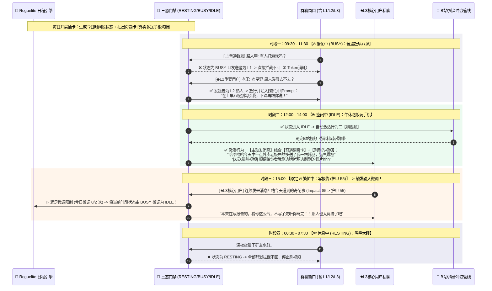
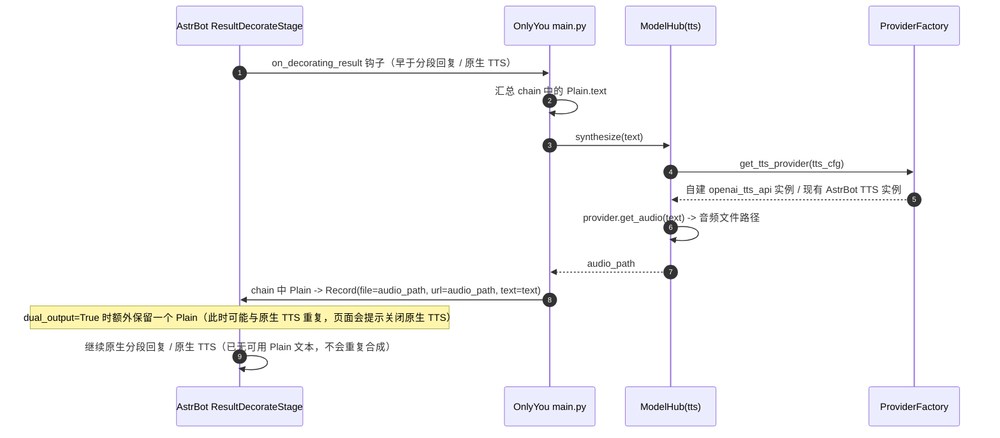

# OnlyYou (只有你) —— 核心 Prompt 工程与交互时序设计 (v2.4)

> 本文档定义 `astrbot_plugin_only_you` v2.4 的核心提示词模板，围绕 **三种基础状态（休息中 `RESTING` / 繁忙中 `BUSY` / 空闲中 `IDLE`）**、**两大具体行为（回发消息 / 刷视频）**、**Roguelite 随机日程与奇遇谈资卡**、**根据消息/视频输入受限微调日程**、**详细角色卡（10 分区 × 39 字段）的 AI 生成 / 分区补全**，以及 **角色卡接管 Persona 段与插件自治 TTS 的时序** 构建。文中的“决策模型”对应 `ModelHub` 的 `decision` 角色（读空气 / 记忆提炼 / 日程微调 / 造卡）。

---

## 一、 角色卡与人设专属 Roguelite 卡池生成 Prompt

### 1.1 基于 AstrBot 原生 Persona 生成三态事件卡池与奇遇谈资池 (`CARD_AND_DECK_SEED_PROMPT`)
> **设计要点**：不搞花哨冗余的分类，大模型根据原生 Persona 生成的每张事件卡都严格绑定 **`RESTING`（休息中）、`BUSY`（繁忙中）、`IDLE`（空闲中）** 三种状态之一，同时生成一组符合人设的 **【奇遇谈资卡】** 供每日随机抽取作为短时聊天谈资。

```markdown
你是一个角色设定师与 Roguelite 数值策划。请基于用户在 AstrBot 中配置的【原生基础人设】，生成该角色的《AI 网友角色卡》以及专属于TA身份的《三态事件卡池》与《奇遇谈资卡池》。

## 输入：AstrBot 原生基础人设
Persona 名称：{persona_name}
原生设定文本：
"""
{native_persona_prompt}
"""

## 状态定义规范
每张事件卡（`state_event_cards`）必须绑定以下三种状态（`state`）之一：
- `RESTING`（休息中）：如睡觉、午休小憩（此状态下Bot完全不回消息、不刷视频）。
- `BUSY`（繁忙中）：如上课、开会、赶稿、专注打排位（此状态下Bot只抽空简短回复重要用户L2与核心用户L3，忽略普通群友L1，且不刷视频）。
- `IDLE`（空闲中）：如吃饭下饭、躺沙发摸鱼、睡前玩手机（此状态下Bot全量开放群聊读空气、主动找人搭话、主动去刷B站/抖音视频）。

## 输出要求
请仅输出合法的 JSON 格式：
{
  "name": "角色惯用自称或网名",
  "archetype": "一句话概括她在社交网络上的核心人设定位",
  "speaking_style": "详细的说话习惯（句式长短、常用语气词、口癖、标点习惯）",
  "surfing_preferences": ["该角色在 IDLE 空闲状态下刷B站/抖音最爱看的 4~6 个内容标签"],
  "state_event_cards": [
    {
      "card_id": "evt_1",
      "title": "贴合人设的具体事情（如：苦逼上早八高数课 / 窝在画室赶稿）",
      "state": "BUSY",
      "valid_slots": ["morning", "forenoon", "afternoon"],
      "armor": 70
    },
    {
      "card_id": "evt_2",
      "title": "贴合人设的空闲事项（如：边吃螺蛳粉边刷手机 / 瘫在床上摸鱼）",
      "state": "IDLE",
      "valid_slots": ["noon", "afternoon", "evening"],
      "armor": 30
    },
    {
      "card_id": "evt_3",
      "title": "贴合人设的休息事项（如：戴眼罩呼呼大睡 / 趴桌上午睡）",
      "state": "RESTING",
      "valid_slots": ["noon", "night"],
      "armor": 65
    }
  ],
  "encounter_talk_cards": [
    "贴合人设的今日奇遇小插曲1（作为当天的短时记忆增加聊天谈资，如：今天点外卖老板居然多送了一根烤肠）",
    "贴合人设的今日奇遇小插曲2（如：早上出门差点被楼下的流浪橘猫绊倒）",
    "贴合人设的今日奇遇小插曲3（如：刚才打游戏遇到一个开麦唱歌跑调到姥姥家的奇葩队友）"
  ]
}
```

### 1.2 详细角色卡整卡 AI 生成 (`CHARACTER_CARD_GENERATE_PROMPT`)
> **设计要点**：严格按 `CARD_SCHEMA`（10 分区 / 39 字段）输出**单个 JSON 对象**，顶层 key 必须是分区 id。由 **主模型**（`role="main"`）调用，返回结果只作为**草稿**给前端预览，用户「采用草稿」后才落库。

```markdown
你是资深角色设定师，请为一位「AI 数字网友」生成一张《详细角色卡》。

## 角色卡结构（必须严格遵守，字段 key 与分区 id 不可改动）
{schema_json}

## 用户输入 / 灵感种子
"""
{seed_text}
"""

## 已有的角色卡（可能为空；请在此基础上补全，冲突时以你的补全内容为准）
{existing_card_json}

## 输出要求（务必逐条遵守）
1. 仅输出一个合法 JSON 对象，不要输出任何解释、Markdown 代码块或多余文字。
2. 顶层 key 必须是分区 id（identity / appearance / personality / background / interests / speech / social / rhythm / examples / extra），每个分区是 {字段 key: 值} 形式的对象。
3. 字段 key 必须与 schema 完全一致，不要新增字段；没有内容的字段用空字符串 "" 或空数组 [] 占位。
4. `tags` 与 `list` 类型输出字符串数组，例如 ["嘴硬心软", "慢热"]；`dialogs` 类型输出 [{"user": "用户的话", "character": "角色的回应"}]。
5. `select` 类型只能从 schema 中该字段 options 的 value 里选择。
6. `age` 输出字符串（如 "21"）；`extra.native_persona_prompt` 必须保持空字符串（由系统单独维护）。
7. 角色要真实、有细节、前后一致：说话风格（口头禅、语气词、标点、回复长度）必须能直接指导聊天模型模仿；避免「温柔善良」这类空泛描述。
```

### 1.3 单分区 AI 补全 (`CHARACTER_CARD_SECTION_PROMPT`)
> **设计要点**：只让模型补全**一个分区**，其余分区已有内容作为上下文传入以保持人设一致；只输出该分区的 JSON 对象（不含分区 id 外层）。同样由 **主模型**调用，结果为草稿不落库。

```markdown
你是资深角色设定师。下面需要补全角色卡中的【单个分区】。

## 待补全的分区定义（字段 key / type / options 必须严格遵守）
{section_json}

## 角色卡其余分区的已有内容（作为上下文，保持人设一致）
{other_sections_json}

## 用户输入 / 灵感种子
"""
{seed_text}
"""

## 输出要求（务必逐条遵守）
1. 只输出该分区的 JSON 对象 {字段 key: 值}，不要包含分区 id 外层、不要输出数组外层、不要任何解释或 Markdown 代码块。
2. 只补全该分区中列出的字段 key；`tags` / `list` 用字符串数组；`dialogs` 用 [{"user": "...", "character": "..."}]；`select` 只能从 options 的 value 中选。
3. 必须与其余分区已有内容保持一致，写出具体、可执行的细节，不要复述字段定义。
```

> 两段 Prompt 的调用方：`SoulManager.generate_card(seed_text, base_card, section)` → `ModelHub.call_llm_json(..., role="main")`；失败返回 `None`，前端提示检查主模型配置。渲染进系统提示词的规则见 §3.3。

---

## 二、 🔄 输入驱动的受限日程状态微调 Prompt (`BOUNDED_STATE_MUTATION_PROMPT`)

> **触发条件**：仅当 `今日已微调次数 < max_mutations_per_day(2)`、`距离上次微调 > 120分钟`、且外部真实输入（**读取到的用户消息** 或 **刚刷到的高分视频**）冲击力 `Impact > 当前卡片护甲 Armor` 时调用！

```markdown
角色【{soul_name}】正在按今日随机生成的日程行事，但刚刚收到了一个高冲击力的【外部真实输入】，打破了她当前的定力护甲！
请根据这个输入，在受限范围内调整她【当前时间段】或【下一时间段】的状态（`RESTING` / `BUSY` / `IDLE`）与事件描述。

## 1. 当前与下一时间段原定安排
- 当前时间段：【{current_slot_title}】 | 当前状态：`{current_state}`（定力护甲：{current_armor}）
- 下一时间段：【{next_slot_title}】 | 原定状态：`{next_state}`

## 2. 触发变卦的真实外部输入
- 输入来源：{input_type} （`USER_MESSAGE` 读取到的用户消息 / `WATCHED_VIDEO` 刚刷到的高分视频）
- 具体输入详情：
"""
{input_detail}
"""

## 3. 状态调整规则（三态跃迁约束）
- 若当前为 `BUSY（繁忙中）` 且被高热度消息击穿：可将 `CURRENT_SLOT` 状态微调为 `IDLE（空闲中）`（即：放下手头正事，摸鱼陪聊/水群）。
- 若当前为 `IDLE（空闲中）`，因刷到了极其上头的视频或正与核心用户/熟人热聊，且下一时段原定为 `BUSY` 或 `RESTING`：可将 `NEXT_SLOT` 推迟或将前半段改为 `IDLE`（即：刷视频上头/聊嗨了加钟熬夜）。
- 若当前为 `RESTING（休息中）` 且被 ★L3核心用户 私聊强呼叫击穿：可将 `CURRENT_SLOT` 短暂改为 `IDLE`（即：被核心用户吵醒，迷迷糊糊回消息）。

请仅输出合法的 JSON 格式：
{
  "mutate_target": "CURRENT_SLOT | NEXT_SLOT",
  "new_state": "IDLE | BUSY | RESTING",
  "new_title": "微调后正在做的事（15字内，如：把作业一丢专心在群里吃瓜 / 刷视频太精神继续熬夜冲浪）",
  "delay_next_slot_minutes": 0或30或45,
  "mutation_reason_monologue": "第一人称变卦心理活动（如：'本来在忙着写东西的，看你们聊得这么起劲，不管了先摸鱼水会儿群！'）"
}
```

---

## 三、 不同状态下的消息回复与主动搭话 Prompt 注入

### 3.1 `🔥 繁忙中 (BUSY)` 状态下的抽空回复注入（仅对 L2 重要用户 / L3 核心用户触发）
> 当处于 `BUSY` 状态时，L1 普通群友的消息已在代码层被直接拦截忽略；当 L2 熟人或 ★L3 核心用户发消息时，注入以下约束：

```markdown
[当前三态控制器：🔥 繁忙中 (BUSY)]
1. 你当前正在做的事：【{current_slot_title}】。
2. 因为发消息的人是你的【{user_tier_name}：{sender_name}】，你决定百忙之中抽空看一眼手机回TA，但如果是普通群友你根本不会理。
3. 回复语气要求：
   - 表现出你手头正在忙 `{current_slot_title}`（比如偷偷摸鱼回一句、或者吐槽手头这事有多烦）。
   - 句子必须极短（20字以内，1个气泡），不要展开长聊，除非刚才的输入已经触发了状态微调把你变成了【空闲中】。
```

### 3.2 `☕ 空闲中 (IDLE)` 状态下的读空气与【奇遇谈资 / 视频分享】注入
> 当处于 `IDLE` 状态时，AI 既可以在群聊对全员读空气接话，也可以利用今日抽到的**【奇遇谈资卡】**或**刚刷到的 B站/抖音视频**主动开启话题：

```markdown
[当前三态控制器：☕ 空闲中 (IDLE)]
1. 你当前正在做的事：【{current_slot_title}】，正拿着手机闲逛，精力充沛，随时可以水群或聊天。
2. 🃏 你今天的【短时奇遇谈资】（尚未聊过的新鲜小事，可在合适时机自然当成话题聊出来）：
   {unused_encounter_cards_text}
3. 📱 你刚在 B站/抖音刷完的视频（可顺着话题分享或吐槽）：
   {recent_watched_video_text}
```


### 3.3 角色卡接管 Persona 段（`_takeover_persona`，System Prompt 组装顺序）

> **背景**：v2.4 起主对话的人设不再来自 AstrBot Persona，而是由详细角色卡渲染后**替换**平台注入的 `# Persona Instructions` 段。AstrBot 原生人格只作为一次性导入来源（Pages「角色卡」→ 从 AstrBot 导入）。

`ContextBudgetManager.apply_context_and_memory_budget()` 的执行顺序：

| 顺序 | 动作 | 说明 |
| :--- | :--- | :--- |
| 1 | `_takeover_persona(req, soul)` | 三分支替换 Persona 段（见下） |
| 2 | `req.contexts.clear()` + 注入插件滑窗 | 完全接管上下文（剔除与当前 prompt 重复的最新一条） |
| 3 | 记忆混合打分 + 硬预算裁剪 | `0.40*关键词 + 0.35*时间新鲜度 + 0.25*重要度` |
| 4 | 追加三态指令 / 变卦独白 / 记忆块 | 见 §二、§三 |

三个替换分支（`core/context_budget.py`）：

1. **精确匹配**：遍历 `soul_manager.list_native_prompts()`，若 `\n# Persona Instructions\n\n{原生人格原文}\n` 存在于 `system_prompt`，整段替换为角色卡 block；
2. **正则兜底**：`re.subn(r"\n# Persona Instructions\n\n.*?(?=\n# |\Z)", card_block, sp, count=1, flags=re.S)`；
3. **前置**：没找到 Persona 段时，把角色卡 block 前置到 `system_prompt`。

角色卡 block 结构：

```text
\n# Persona Instructions\n\n{render_persona_prompt(soul.card)}\n
```

> `render_persona_prompt(card, max_chars=2000)` 规则：首行固定 `你正在扮演「{name}」。`；随后按 10 个分区输出 Markdown（只渲染非空字段）；超预算时按 `examples > background > appearance > extra > rhythm > interests` 丢弃，极端超长时再按 `social > personality > speech` 丢弃（`identity` 始终保留），最后硬截断保证不超预算；`native_persona_prompt` 永不参与渲染。

---

## 四、 核心状态流转与双行为控制时序图



---

## 五、 精简版分级记忆提炼 Prompt (`MEMORY_EXTRACT_AND_GRADE_PROMPT`)

> **调用时机**：每当群聊或私聊累计满 `N` 条（默认 15 条）有效对话时，由后台**决策模型**（`role="decision"`）异步调用，提炼值得记住的信息并打上 **初始重要度（`importance: 1~10`）**，供后续分级存储与定时遗忘程序（`Forgetting GC`）结算。

```markdown
请阅读以下角色【{soul_name}】与用户的近期对话片段，提炼出值得记住的记忆条目，并严格评估每条记忆的【重要度与分级】。
如果这段对话只是毫无营养的日常寒暄（如“早”、“哈哈”、“111”），请直接返回空数组 `[]`，不要制造垃圾记忆！

## 近期对话记录（已标注发言者 ID 与关系等级 L1普通 / ◆L2重要用户 / ★L3核心用户）
{recent_chat_transcript}

## 记忆分级与重要度评分标准 (`importance`: 1 ~ 10)
1. **Tier 3 核心长效记忆 (`memory_tier = 3`, `importance`: 8 ~ 10)**：
   - 仅限 ◆L2重要用户 或 ★L3核心用户 的关键长期信息：如真实身份设定、核心喜好/雷点（如“对海鲜过敏”）、长期约定、专属外号、重大人生事件。
   - 此类记忆将永久保留，免疫日常定时遗忘。
2. **Tier 2 近期情节记忆 (`memory_tier = 2`, `importance`: 5 ~ 7)**：
   - 近期发生的有趣互动、共同聊过的梗、短期计划（如“阿泽说这周末要去考科目二”、“老王抽卡歪了七七被大家嘲笑”）。
   - 此类记忆会随时间衰减，若未来几天没人再提将被定时程序自动遗忘清理；若被反复提起则会升级为永久记忆。
3. **Tier 1 瞬时记忆 (`memory_tier = 1`, `importance`: 1 ~ 4)**：
   - 普通群友的临时动态或仅在今明两天有用的小事（48小时后自动清理）。

## 输出要求
每条记忆的 `content` 必须浓缩在 **50 字以内**，并提取 2~4 个检索关键词 `keywords`。仅输出合法的 JSON 数组：
[
  {
    "user_id": "关联用户的 global_uid (若是群聊公共事件则为 null)",
    "user_tier": 1或2或3,
    "memory_tier": 1或2或3,
    "importance": 8,
    "content": "精炼的一句话记忆描述（如：阿泽严重海鲜过敏，平时聚餐最爱吃川渝牛油火锅）",
    "keywords": "海鲜过敏,火锅,饮食偏好"
  }
]
```

---

## 六、 插件自治 TTS 与 `on_decorating_result` 时序

> **调用时机**：`ModelHub` 的 `tts` 角色开启（`mode != "off"`），且本次命中触发概率与生效范围时，在 AstrBot `ResultDecorateStage` 的 `on_decorating_result` 阶段把文字替换为语音。**该钩子先于原生分段回复与原生 TTS 执行**，因此不会重复播报。

触发条件（需全部满足）：

| 条件 | 取值 |
| :--- | :--- |
| 开关 | `tts.mode ∈ {"source", "provider"}` |
| 概率 | `random() <= tts.probability`（0.0 ~ 1.0） |
| 范围 | `scope = "private"`（私聊）/ `"l3"`（当前发送者为 ★L3 核心用户）/ `"all"`（任意会话） |
| 结果链 | `event.get_result()` 存在、`is_llm_result()` 为真，且链中存在非空 `Plain` 文本 |



- **失败降级**：合成失败或 TTS 未配置时静默保留原文字链，不阻塞回复。
- **主动消息**：心跳/主动搭话由 `_maybe_synthesize_proactive()` 按同一 TTS 配置决定是否合成，`PlatformBridge.send_proactive_message(..., audio_path=...)` 在文字发送后追加一条 `Record` 语音。
- **TTS 三种来源**：`off` 关闭 / `source` 提供商源 + OpenAI 兼容 TTS（自建 `openai_tts_api`，音色默认 `alloy`）/ `provider` 直接使用 AstrBot 现有 TTS 提供商。

