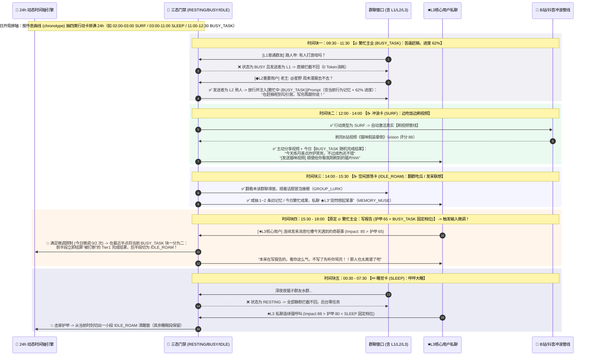
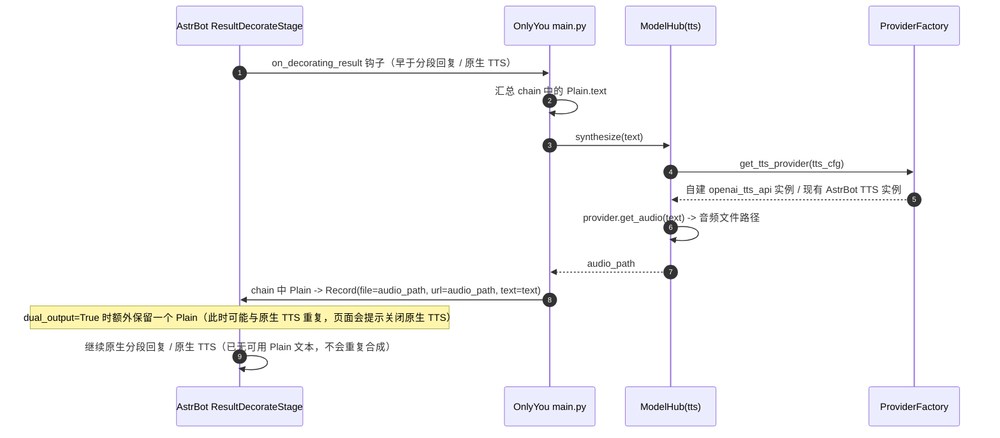
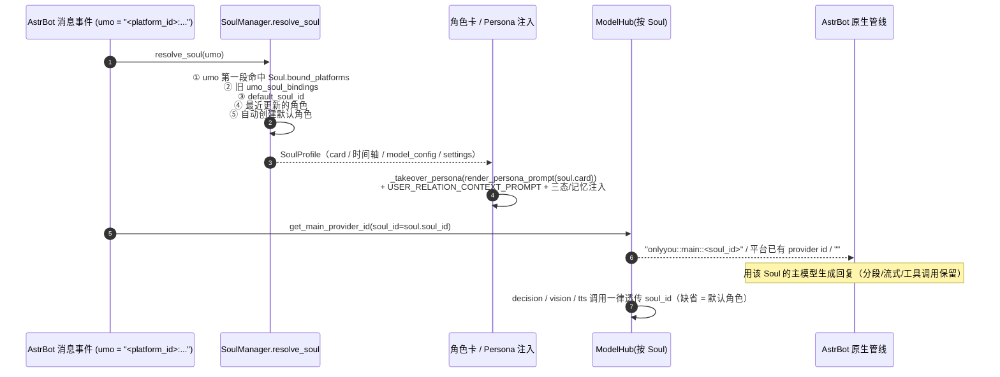
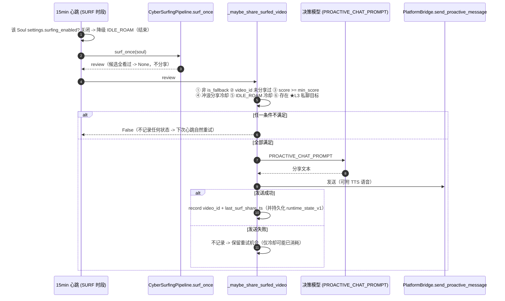
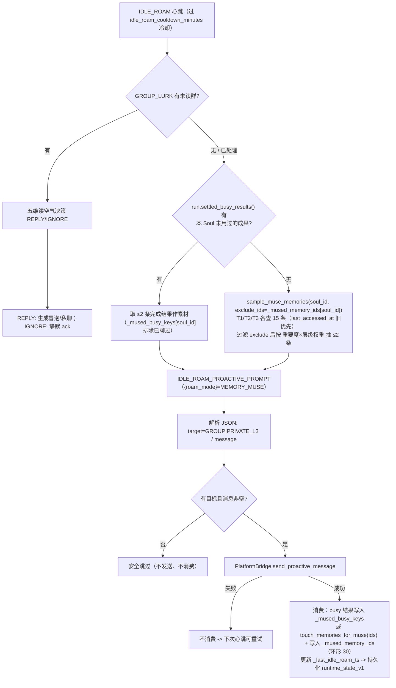
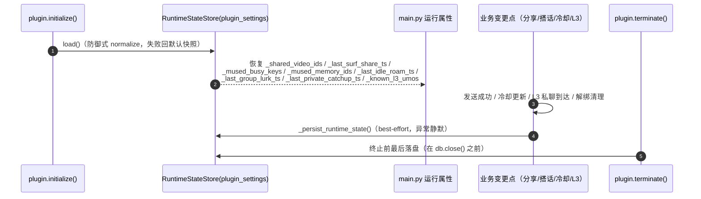

# OnlyYou (只有你) —— 核心 Prompt 工程与交互时序设计 (v2.8)

> 本文档定义 `astrbot_plugin_only_you` v2.8 的核心提示词模板，围绕 **三种基础状态（休息中 `RESTING` / 繁忙中 `BUSY` / 空闲中 `IDLE`）× 四类可执行行动卡（`SLEEP` / `SURF` / `IDLE_ROAM` / `BUSY_TASK`）**、**24h 动态弹性时间轴与繁忙完成结果短时记忆**、**根据消息/视频输入的时间块切分 / 延展微调**、**详细角色卡（10 分区 × 36 字段）的 AI 生成 / 分区补全**、**角色卡接管 Persona 段与插件自治 TTS 的时序**、v2.6 的 **用户关系等级重要度与专属态度注入（`USER_RELATION_CONTEXT_PROMPT`）** 构建；v2.8 进一步补充 **按 Soul 的模型解析与机器人接口绑定路由对 LLM 请求的影响、SURF 分享五条件门禁与失败保留重试、IDLE_ROAM MEMORY_MUSE 三层分桶、主动消息去重/冷却跨重启（`runtime_state_v1`）、T1 去重/上限/清理对记忆注入的影响**（见 §七）。文中的“决策模型”对应 `ModelHub` 的 `decision` 角色（读空气 / 记忆提炼 / 日程微调 / 造卡 / 繁忙结果与 IDLE_ROAM 搭话）。

**文档版本历史（append-only）**

| 文档版本 | 适用产品版本 | 主要变化 |
| :--- | :--- | :--- |
| v2.8（当前） | 插件 v2.8 | 新增 §七：按 Soul 模型解析与平台绑定路由、SURF 分享五条件门禁、MEMORY_MUSE 三层分桶 + 繁忙成果单次消费、主动消息去重/冷却跨重启、T1 去重/上限/清理对注入的影响；§3.2 空闲卡语义更新 |
| v2.7 | 插件 v2.7 | 模型页即时生效、页面 isDirty 守卫、★L3 管理员级（Prompt 不变） |
| v2.6 | 插件 v2.6 | 用户关系等级与专属态度注入（`USER_RELATION_CONTEXT_PROMPT`）、可选模型继承、固定护甲 |
| v2.5 | 插件 v2.5 | 四类行动卡、繁忙完成结果、IDLE_ROAM 主动搭话、未读补回 |

---

## 一、 角色卡与人设专属 Roguelite 卡池生成 Prompt

### 1.1 基于角色卡/原生 Persona 生成角色专属四类行动卡池 (`CARD_AND_DECK_SEED_PROMPT`)
> **设计要点**：导入或创建角色卡时，大模型一次性生成 8~12 张专属于该角色身份的《24h 四类行动卡池》（每张卡绑定 `state`、`action_type` 与 `min_hours ~ max_hours`），卡片名称固定在池中（可在控制台增删改），每天从中按作息曲线随机抽取排满 24 小时；每次 `BUSY_TASK` 走完 100% 时再动态生成当天随机不同的【完成结果短时记忆】，彻底砍掉作用重复的旧版奇遇卡！

```markdown
你是一个角色设定师与 Roguelite 数值策划。请基于以下角色设定，生成专属于TA身份的《24h 四类行动卡池》（共 8~12 张）。

## 输入：角色设定
Persona 名称：{persona_name}
设定文本：
"""
{native_persona_prompt}
"""

## 四类行动卡 (`action_type`) 与三态 (`state`) 规范
1. `SLEEP`（绑定 `state: "RESTING"`）：睡觉/休眠/入定卡（后台完全静默，什么都不做）。时长通常为长睡眠 `4.0~8.0h` 或小憩 `1.0~2.0h`。
2. `SURF`（绑定 `state: "IDLE"`）：冲浪刷视频卡（后台触发 B站/抖音真实看片与分享）。时长通常为 `0.5~2.0h`。
3. `IDLE_ROAM`（绑定 `state: "IDLE"`）：贴合人设的日常消遣/发呆/闲逛卡（后台触发翻群记录吃瓜或发呆记忆联想）。时长通常为 `0.5~2.0h`。
4. `BUSY_TASK`（绑定 `state: "BUSY"`）：100% 贴合角色职业/主业/世界观的正事卡（后台带 0%~100% 进度条，每次完成或被打断时都会随机生成当天不同的一句话结果记入短时记忆）。时长通常为 `1.0~3.5h`。

## 输出要求
请仅输出合法的 JSON 格式：
{
  "name": "角色惯用自称或网名",
  "archetype": "一句话概括她在社交网络上的核心人设定位",
  "speaking_style": "详细的说话习惯（句式长短、常用语气词、口癖、标点习惯）",
  "surfing_preferences": ["该角色在 SURF 冲浪时最爱看的 4~6 个内容标签"],
  "state_event_cards": [
    {
      "card_id": "evt_busy_1",
      "title": "贴合人设的繁忙正事（如：在丹房炼制回春丹 / 窝在画室赶商业插画线稿）",
      "state": "BUSY",
      "action_type": "BUSY_TASK",
      "min_hours": 1.5,
      "max_hours": 3.0
    },
    {
      "card_id": "evt_roam_1",
      "title": "贴合人设的空闲消遣（如：御剑在后山吹风发呆 / 泡杯冻顶乌龙看窗外发呆）",
      "state": "IDLE",
      "action_type": "IDLE_ROAM",
      "min_hours": 0.5,
      "max_hours": 1.5
    },
    {
      "card_id": "evt_surf_1",
      "title": "贴合人设的冲浪表现（如：瘫在懒人沙发上刷B站 / 用玉简偷看凡间短视频）",
      "state": "IDLE",
      "action_type": "SURF",
      "min_hours": 0.5,
      "max_hours": 2.0
    },
    {
      "card_id": "evt_sleep_1",
      "title": "贴合人设的休息表现（如：闭关打坐入定 / 戴上蒸汽眼罩呼呼大睡）",
      "state": "RESTING",
      "action_type": "SLEEP",
      "min_hours": 4.0,
      "max_hours": 7.5
    }
  ]
}
```

> **v2.6**：卡池生成 Prompt 不再要求模型输出 `armor`（示例 JSON 已删除该字段），落库时由 `action_type.fixed_armor` 自动写入固定档位（`SLEEP=80 / BUSY_TASK=65 / SURF=40 / IDLE_ROAM=25`），用户也无法在控制台手调护甲。

### 1.2 详细角色卡整卡 AI 生成 (`CHARACTER_CARD_GENERATE_PROMPT`)
> **设计要点**：严格按 `CARD_SCHEMA`（10 分区 / 36 字段；v2.6 已删除 `social.attitude_l3/l2/l1`，仅保留 `group_role`）输出**单个 JSON 对象**，顶层 key 必须是分区 id。由 **主模型**（`role="main"`）调用，返回结果只作为**草稿**给前端预览，用户「采用草稿」后才落库。

```markdown
你是资深角色设定师，请为一位「AI 数字网友」生成一张《详细角色卡》。

## 角色卡结构（必须严格遵守，字段 key 与分区 id 不可改动）
{schema_json}

## 用户输入 / 灵感种子
"""
{seed_text}
"""

## 已有的角色卡（可能为空；请在此基础上补全，冲突时以你的补全内容为准）
{existing_card_json}

## 输出要求（务必逐条遵守）
1. 仅输出一个合法 JSON 对象，不要输出任何解释、Markdown 代码块或多余文字。
2. 顶层 key 必须是分区 id（identity / appearance / personality / background / interests / speech / social / rhythm / examples / extra），每个分区是 {字段 key: 值} 形式的对象。
3. 字段 key 必须与 schema 完全一致，不要新增字段；没有内容的字段用空字符串 "" 或空数组 [] 占位。
4. `tags` 与 `list` 类型输出字符串数组，例如 ["嘴硬心软", "慢热"]；`dialogs` 类型输出 [{"user": "用户的话", "character": "角色的回应"}]。
5. `select` 类型只能从 schema 中该字段 options 的 value 里选择。
6. `age` 输出字符串（如 "21"）；`extra.native_persona_prompt` 必须保持空字符串（由系统单独维护）。
7. 角色要真实、有细节、前后一致：说话风格（口头禅、语气词、标点、回复长度）必须能直接指导聊天模型模仿；避免「温柔善良」这类空泛描述。
```

### 1.3 单分区 AI 补全 (`CHARACTER_CARD_SECTION_PROMPT`)
> **设计要点**：只让模型补全**一个分区**，其余分区已有内容作为上下文传入以保持人设一致；只输出该分区的 JSON 对象（不含分区 id 外层）。同样由 **主模型**调用，结果为草稿不落库。

```markdown
你是资深角色设定师。下面需要补全角色卡中的【单个分区】。

## 待补全的分区定义（字段 key / type / options 必须严格遵守）
{section_json}

## 角色卡其余分区的已有内容（作为上下文，保持人设一致）
{other_sections_json}

## 用户输入 / 灵感种子
"""
{seed_text}
"""

## 输出要求（务必逐条遵守）
1. 只输出该分区的 JSON 对象 {字段 key: 值}，不要包含分区 id 外层、不要输出数组外层、不要任何解释或 Markdown 代码块。
2. 只补全该分区中列出的字段 key；`tags` / `list` 用字符串数组；`dialogs` 用 [{"user": "...", "character": "..."}]；`select` 只能从 options 的 value 中选。
3. 必须与其余分区已有内容保持一致，写出具体、可执行的细节，不要复述字段定义。
```

> 两段 Prompt 的调用方：`SoulManager.generate_card(seed_text, base_card, section)` → `ModelHub.call_llm_json(..., role="main")`；失败返回 `None`，前端提示检查主模型配置。渲染进系统提示词的规则见 §3.3。

---

## 二、 🔄 输入驱动的受限日程状态微调 Prompt (`BOUNDED_STATE_MUTATION_PROMPT`)

> **触发条件**：仅当 `今日已微调次数 < max_mutations_per_day(2)`、`距离上次微调 > 120分钟`、且外部真实输入（**读取到的用户消息** 或 **刚刷到的高分视频**）冲击力 `Impact > 当前卡片护甲 Armor` 时调用！其中 `Armor` 在 v2.6 为**行动类型固定档位**（`SLEEP=80 / BUSY_TASK=65 / SURF=40 / IDLE_ROAM=25`，用户不可手动设置），模板中的 `{current_armor}` 仅作为内部提示词数值传入。

```markdown
角色【{soul_name}】正在按今日随机生成的 24h 动态时间轴行事，但刚刚收到了一个高冲击力的【外部真实输入】，打破了她当前的定力护甲！
请根据这个输入，在受限范围内调整她【当前时间块】或【下一时间块】的状态（`RESTING` / `BUSY` / `IDLE`）、行动类型（`SLEEP` / `SURF` / `IDLE_ROAM` / `BUSY_TASK`）与事件描述。

## 1. 当前与下一时间块原定安排
- 当前时间块：【{current_slot_title}】 | 当前状态：`{current_state}` | 当前行动类型：`{current_action_type}`（定力护甲：{current_armor}）
- 下一时间块：【{next_slot_title}】 | 原定状态：`{next_state}` | 原定行动类型：`{next_action_type}`

## 2. 触发变卦的真实外部输入
- 输入来源：{input_type} （`USER_MESSAGE` 读取到的用户消息 / `WATCHED_VIDEO` 刚刷到的高分视频）
- 具体输入详情：
"""
{input_detail}
"""

## 3. 状态调整规则（动态时间块切分 / 延展语义）
- 当前为 `BUSY_TASK`（繁忙主业）且被高热度消息击穿：系统会把当前繁忙块在最近半点处一分为二——前半段保留 `BUSY_TASK` 并立即结算“被中途打断”的一句话完成结果，后半段从切分点起转为 `IDLE_ROAM`（即：放下手头正事，摸鱼陪聊 / 水群）。你只需给出切分后的新标题与心理独白。
- 当前为 `SLEEP`（睡觉 / 休眠）且被 ★L3核心用户 私聊强呼叫击穿：系统会在当前睡眠块中切出一小段（约 0.5~1.0h）的 `IDLE_ROAM`（即：被核心用户吵醒，迷迷糊糊看手机回消息），其余睡眠块保持不变。你只需给出这段清醒时间的标题与心理独白。
- 当前为 `SURF` / `IDLE_ROAM`（空闲）且刷到了极其上头的视频或正与核心用户/熟人热聊：系统会把当前时间块向后延长 0.5h，并同步压缩/后移下一时间块（即：刷视频上头 / 聊嗨了加钟熬夜）。你只需给出延长后的新标题与心理独白。
- 三态与行动类型绑定约束：`SLEEP` 必定对应 `RESTING`、`BUSY_TASK` 必定对应 `BUSY`、`SURF` / `IDLE_ROAM` 必定对应 `IDLE`，禁止输出不匹配的组合。

请仅输出合法的 JSON 格式：
{
  "mutate_target": "CURRENT_SLOT | NEXT_SLOT",
  "new_state": "IDLE | BUSY | RESTING",
  "new_title": "微调后正在做的事（15字内，如：把作业一丢专心在群里吃瓜 / 刷视频太精神继续熬夜冲浪）",
  "delay_next_slot_minutes": 0,
  "mutation_reason_monologue": "第一人称变卦心理活动（如：'本来在忙着写东西的，看你们聊得这么起劲，不管了先摸鱼水会儿群！'）"
}
```

---

## 三、 四类行动卡的状态注入、繁忙结果结算与空闲游荡 Prompt

### 3.1 `🔥 角色繁忙卡 (BUSY_TASK)`：当前行为记忆 + 进度条注入 + 完成结果结算
> **极简三要素设计**：繁忙卡不做花哨的子系统，仅包含 **① 当前行为记忆**、**② 进度条 (`0% -> 100%`)**、**③ 一句话完成结果（存入 Tier 1 短时记忆）**。

#### 1. 繁忙期间被动回复 ◆L2 / ★L3 时的 Prompt 注入（含实时进度条）
```markdown
[当前三态控制器：🔥 繁忙中 (BUSY_TASK)]
1. 你的【当前行为记忆】：正在专心做【{current_slot_title}】（时段：{start_time}-{end_time}）。
2. 当前完成进度：{progress_pct}%（请据此自然表现进度感：刚开工 / 正卡在关键处 / 快搞定了）。
3. 因为发消息的人是你的【{user_tier_name}：{sender_name}】，你决定百忙之中抽空看一眼手机回TA（普通群友 L1 已在代码层被直接忽略）。
4. 回复语气要求：
   - 自然带出你手头正在忙 `{current_slot_title}` 以及当前进度感，像真实网友忙里偷闲回一句。
   - 句子必须极短（20字以内，1个气泡），不要展开长聊，除非刚才的输入已经击穿护甲、把当前时间块切成了【空闲中】。
```

#### 2. 繁忙块结束（100%）或中途打断时的一句话结果生成 (`BUSY_TASK_COMPLETION_PROMPT`)
> 当 `BUSY_TASK` 时间块走完 `100%`（或中途被微调打断停在 `X%`）时，调用决策模型生成**一句话完成结果**，直接作为 **Tier 1 瞬时记忆 (`memory_tier=1`)** 存入 `memories` 表：

```markdown
角色【{soul_name}】（设定：{archetype}）刚刚结束了一段繁忙事项：
- 繁忙事项：【{task_title}】
- 最终进度：{progress_pct}%（{status_desc}）
- 今天日期：{today_date}

请用第一人称生成【一句话完成结果记忆】（35字以内，口语化、有生活或世界观细节，将直接存入她今日的 Tier 1 短时记忆库作为后续聊天谈资）。
要求：必须带一个当天随机的小细节或小插曲（如工具手感、天气、小意外、小吐槽），每次生成都尽量不重样。

仅输出合法的 JSON 格式（不要带多余解释，不要用 Markdown 代码块）：
{
  "completion_memory": "如：花了两个多小时终于把回春丹炼出来了，不过最后一炉火候大了一点差点炸炉",
  "keywords": "炼丹,回春丹,繁忙结果"
}
```
> `status_desc` 由 `main.settle_busy_block()` 预格式化：`顺利100%完成` 或 `做到{progress_pct}%被{interrupted_by}打断`（如 `做到40%被阿泽打断`）。

### 3.2 `☕ 空闲卡 (SURF / IDLE_ROAM)`：冲浪分享、翻群吃瓜与发呆记忆联想注入
> 当处于 `IDLE` 状态时，AI 既可以在群聊对全员读空气接话，也会根据当前行动卡是 `SURF`（冲浪）还是 `IDLE_ROAM`（空闲游荡）注入今日谈资与刚结算的繁忙成果：

```markdown
[当前三态控制器：☕ 空闲中 ({action_type})]
1. 你当前正在做的事：【{current_slot_title}】（进度：{progress_pct}%），正拿着手机闲逛，精力充沛，随时可以水群或聊天。
2. 🃏 你今天的【短时奇遇与刚忙完的事】（可在合适时机自然当成话题聊出来）：
   {short_term_talk_text}
3. 📱 你刚在 B站/抖音刷完的视频（可顺着话题分享或吐槽）：
   {recent_watched_video_text}
```

#### 空闲游荡卡 (`IDLE_ROAM`) 主动行为生成 (`IDLE_ROAM_PROACTIVE_PROMPT`)
> 当后台心跳处于 `IDLE_ROAM` 时间块且满足主动搭话冷却时，二选一执行 **【翻群记录吃瓜 (`GROUP_LURK`)】** 或 **【发呆记忆联想 (`MEMORY_MUSE`)】**：

```markdown
角色【{soul_name}】（说话风格：{speaking_style}）当前处于空闲游荡状态：【{current_slot_title}】。
现在是 {current_time}，请根据以下输入素材，生成一句自然的第一人称主动冒泡/搭话消息（拒绝生硬的“在干嘛”，要像真人网友突然冒出来说话）。

## 触发模式：{roam_mode}
- `GROUP_LURK`（翻看群聊未读记录吃瓜）：读群友的聊天记录，自然接梗冒泡，或转头私聊 ★L3核心用户吐槽。
- `MEMORY_MUSE`（发呆时由旧记忆或刚忙完的事产生联想）：突然想起某事，发给 ★L3核心用户开启话题。

## 关联素材（未读群聊记录 或 抽出的 1~2 条记忆 / 刚忙完的事）
"""
{context_material}
"""

## 输出要求
1. 仅输出合法的 JSON 格式（不要带多余解释，不要用 Markdown 代码块）。
2. `target` 只能是 `GROUP`（在群里直接冒泡）或 `PRIVATE_L3`（私聊 ★L3核心用户）。
3. `message` 为 30 字以内的自然口语，符合角色说话风格，不要带引号或前缀。
{
  "target": "GROUP | PRIVATE_L3",
  "message": "30字以内的自然口语冒泡内容"
}
```

> 调用方：`main.OnlyYouPlugin._run_idle_roam_action()`。`GROUP_LURK` 模式素材为近期群聊滑窗 transcript；`MEMORY_MUSE` 模式素材按 v2.8 优先级为：**① 今日已结算、且本 Soul 尚未主动聊过的 `BUSY_TASK` 完成结果（`_mused_busy_keys`，同一成果最多聊 1 次）→ ② `sample_muse_memories()` 对 T1/T2/T3 三层分桶抽样（排除 `_mused_memory_ids` 最近聊过的记忆，按重要度 × 层级加权抽 ≤2 条）**；两者皆空安全跳过。发送成功才记录消费（`_mused_busy_keys` / `touch_memories_for_muse` + `_mused_memory_ids`），失败不消费、保留下次重试。受 `idle_roam_cooldown_minutes`（默认 45 分钟）冷却限制；冷却与去重状态由 `runtime_state_v1` 跨重启恢复（见 §7.3 / §7.4）。


#### 私聊未读消息主动补回 (`UNREAD_PRIVATE_CATCHUP_PROMPT`)
> 当 Bot 从 `RESTING` / `BUSY` 回到 `IDLE`，且存在**被三态门禁拦截**的私聊未读消息时使用：占位符为 `{soul_name}` / `{soul_archetype}` / `{speaking_style}` / `{current_slot_title}` / `{current_time}` / `{user_tier_label}` / `{user_name}` / `{unread_messages_text}` / `{recent_window_text}`。要求生成“刚睡醒/刚忙完才看到消息”的一句自然补回（≤50 字、不提“未读/补回”字眼），发送成功后清空该私聊会话的未读队列。

#### 冲浪分享主动搭话 (`PROACTIVE_CHAT_PROMPT`)
> 心跳处于 `SURF` 时间块且刷到视频时使用：占位符为 `{soul_name}` / `{soul_archetype}` / `{speaking_style}` / `{soul_summary}` / `{current_slot_title}` / `{video_text}`，生成一段第一人称分享 / 吐槽，随后经 `PlatformBridge.send_proactive_message()` 发给最近 ★L3 私聊（并同步写入会话滑窗）。

> **v2.8 分享门禁（先过门禁再调用本 Prompt）**：`main._maybe_share_surfed_video()` 必须同时满足 ① `review` 非空且 `not review.is_fallback`（视觉兜底 `score=60` 不分享）② 该 `video_id` 未被本 Soul 分享过 ③ `review.score >= surf_share_min_score`（默认 80）④ 距上次冲浪分享 ≥ `surf_share_cooldown_minutes`（默认 90 分钟）⑤ 距上次 IDLE_ROAM 搭话 ≥ `idle_roam_cooldown_minutes`（默认 45 分钟），且存在 ★L3 私聊目标。**发送成功才记录 video_id / 时间戳**（失败保留重试机会）；冲浪总开关（Soul `settings.surfing_enabled`）关闭时 SURF 心跳直接降级为 IDLE_ROAM，不调用本 Prompt（详见 §7.2）。

### 3.3 角色卡接管 Persona 段（`_takeover_persona`，System Prompt 组装顺序）

> **背景**：v2.4 起主对话的人设不再来自 AstrBot Persona，而是由详细角色卡渲染后**替换**平台注入的 `# Persona Instructions` 段。AstrBot 原生人格只作为一次性导入来源（Pages「角色卡」→ 从 AstrBot 导入）。

`ContextBudgetManager.apply_context_and_memory_budget()` 的执行顺序：

| 顺序 | 动作 | 说明 |
| :--- | :--- | :--- |
| 1 | `_takeover_persona(req, soul)` | 三分支替换 Persona 段（见下） |
| 2 | `req.contexts.clear()` + 注入插件滑窗 | 完全接管上下文（剔除与当前 prompt 重复的最新一条） |
| 3 | 记忆混合打分 + 硬预算裁剪 | `0.40*关键词 + 0.35*时间新鲜度 + 0.25*重要度` |
| 4 | 追加三态指令 / 变卦独白 / **关系上下文（v2.6）** / 记忆块 | 见 §二、§三、§3.4 |

三个替换分支（`core/context_budget.py`）：

1. **精确匹配**：遍历 `soul_manager.list_native_prompts()`，若 `\n# Persona Instructions\n\n{原生人格原文}\n` 存在于 `system_prompt`，整段替换为角色卡 block；
2. **正则兜底**：`re.subn(r"\n# Persona Instructions\n\n.*?(?=\n# |\Z)", card_block, sp, count=1, flags=re.S)`；
3. **前置**：没找到 Persona 段时，把角色卡 block 前置到 `system_prompt`。

角色卡 block 结构：

```text
\n# Persona Instructions\n\n{render_persona_prompt(soul.card)}\n
```

> `render_persona_prompt(card, max_chars=2000)` 规则：首行固定 `你正在扮演「{name}」。`；随后按 10 个分区输出 Markdown（只渲染非空字段）；超预算时按 `examples > background > appearance > extra > rhythm > interests` 丢弃，极端超长时再按 `social > personality > speech` 丢弃（`identity` 始终保留），最后硬截断保证不超预算；`native_persona_prompt` 与 `identity.avatar`（可能是 Base64 Data URL）永不参与渲染。

---

### 3.4 用户关系等级与专属态度注入 (`USER_RELATION_CONTEXT_PROMPT`)

> **设计要点（v2.6）**：角色卡不再保存「对 L1/L2/L3 的固定态度」，改为在用户档案 `UserProfile.attitude` 中按单人定义；本模板在每次 LLM 请求时由 `ContextBudgetManager._render_user_relation_context()` 组装并追加到 System Prompt 的三态指令之后、记忆块之前。整段 `try/except` 兜底，任何异常都静默降级为空 block，绝不阻塞请求。

```markdown
[用户关系等级与重要度法则]:
你身边的联系人按亲疏与重要程度分为三个等级（消息前缀中会标注）：
- 【★L3 核心用户】：对你最重要、最亲近的核心偏爱对象，优先级最高。即使在繁忙或休息边缘，你也最在意对方的话，愿意为其破例、展示最真实私密的一面。
- 【◆L2 重要熟人】：聊得来、彼此熟悉的群友或朋友，重要度居中。交流自然熟稔、有梗有默契。
- 【L1 普通群友】：泛泛之交或刚认识的普通网友，重要度普通。保持符合你人设的日常社交分寸感。

[当前对话对象档案]:
- 对话人：{display_name} (ID: {global_uid}) | 关系等级：{tier_label} (亲密度 {intimacy})
- 专属称呼：{nickname_text}
- 你对 Ta 的专属态度：{attitude_text}
- 关系备注：{notes_text}{window_peers_block}
```

| 占位符 | 取值来源 | 缺省回退 |
| :--- | :--- | :--- |
| `{display_name}` / `{global_uid}` | 当前 `UserProfile` | — |
| `{tier_label}` / `{intimacy}` | `user.tier.label` / `round(user.affinity, 1)` | — |
| `{nickname_text}` | `user.nickname` | `默认自然称呼` |
| `{attitude_text}` | `user.attitude`（关系页可编辑，≤ 300 字） | `按关系等级与你的人设性格自然相处` |
| `{notes_text}` | `getattr(user, "relation_notes", "")`（当前无 DB 列，getattr 兜底） | `无` |
| `{window_peers_block}` | `UserRelationManager.list_users()` 中当前 UMO 滑窗内其他活跃对话者（排除本人、仅保留 nickname/attitude 非空者，最多 4 条） | 空字符串 |

`window_peers_block` 追加格式：

```markdown
\n\n[当前群聊其他活跃对话者档案]:
- 姓名 (ID: uid) | 关系等级：label | 专属称呼：x | 专属态度：y
```

---

## 四、 核心状态流转与四类行动卡执行时序图



---

## 五、 精简版分级记忆提炼 Prompt (`MEMORY_EXTRACT_AND_GRADE_PROMPT`)

> **调用时机**：每当群聊或私聊累计满 `N` 条（默认 15 条）有效对话时，由后台**决策模型**（`role="decision"`）异步调用，提炼值得记住的信息并打上 **初始重要度（`importance: 1~10`）**，供后续分级存储与定时遗忘程序（`Forgetting GC`）结算。

```markdown
请阅读以下角色【{soul_name}】与用户的近期对话片段，提炼出值得记住的记忆条目，并严格评估每条记忆的【重要度与分级】。
如果这段对话只是毫无营养的日常寒暄（如“早”、“哈哈”、“111”），请直接返回空数组 `[]`，不要制造垃圾记忆！

## 近期对话记录（已标注发言者 ID 与关系等级 L1普通 / ◆L2重要用户 / ★L3核心用户）
{recent_chat_transcript}

## 记忆分级与重要度评分标准 (`importance`: 1 ~ 10)
1. **Tier 3 核心长效记忆 (`memory_tier = 3`, `importance`: 8 ~ 10)**：
   - 仅限 ◆L2重要用户 或 ★L3核心用户 的关键长期信息：如真实身份设定、核心喜好/雷点（如“对海鲜过敏”）、长期约定、专属外号、重大人生事件。
   - 此类记忆将永久保留，免疫日常定时遗忘。
2. **Tier 2 近期情节记忆 (`memory_tier = 2`, `importance`: 5 ~ 7)**：
   - 近期发生的有趣互动、共同聊过的梗、短期计划（如“阿泽说这周末要去考科目二”、“老王抽卡歪了七七被大家嘲笑”）。
   - 此类记忆会随时间衰减，若未来几天没人再提将被定时程序自动遗忘清理；若被反复提起则会升级为永久记忆。
3. **Tier 1 瞬时记忆 (`memory_tier = 1`, `importance`: 1 ~ 4)**：
   - 普通群友的临时动态或仅在今明两天有用的小事（48小时后自动清理）。

## 输出要求
每条记忆的 `content` 必须浓缩在 **50 字以内**，并提取 2~4 个检索关键词 `keywords`。仅输出合法的 JSON 数组：
[
  {
    "user_id": "关联用户的 global_uid (若是群聊公共事件则为 null)",
    "user_tier": 1或2或3,
    "memory_tier": 1或2或3,
    "importance": 8,
    "content": "精炼的一句话记忆描述（如：阿泽严重海鲜过敏，平时聚餐最爱吃川渝牛油火锅）",
    "keywords": "海鲜过敏,火锅,饮食偏好"
  }
]
```

---

## 六、 插件自治 TTS 与 `on_decorating_result` 时序

> **调用时机**：`ModelHub` 的 `tts` 角色开启（`mode != "off"`），且本次命中触发概率与生效范围时，在 AstrBot `ResultDecorateStage` 的 `on_decorating_result` 阶段把文字替换为语音。**该钩子先于原生分段回复与原生 TTS 执行**，因此不会重复播报。

触发条件（需全部满足）：

| 条件 | 取值 |
| :--- | :--- |
| 开关 | `tts.mode ∈ {"source", "provider"}` |
| 概率 | `random() <= tts.probability`（0.0 ~ 1.0） |
| 范围 | `scope = "private"`（私聊）/ `"l3"`（当前发送者为 ★L3 核心用户）/ `"all"`（任意会话） |
| 结果链 | `event.get_result()` 存在、`is_llm_result()` 为真，且链中存在非空 `Plain` 文本 |



- **失败降级**：合成失败或 TTS 未配置时静默保留原文字链，不阻塞回复。
- **主动消息**：心跳/主动搭话由 `_maybe_synthesize_proactive()` 按同一 TTS 配置决定是否合成，`PlatformBridge.send_proactive_message(..., audio_path=...)` 在文字发送后追加一条 `Record` 语音。
- **TTS 三种来源**：`off` 关闭 / `source` 提供商源 + OpenAI 兼容 TTS（自建 `openai_tts_api`，音色默认 `alloy`）/ `provider` 直接使用 AstrBot 现有 TTS 提供商。

---

## 七、 v2.8 时序与 Prompt 相关变更

> 本章只描述 v2.8 **改变时序 / 改变 Prompt 输入素材**的部分；既有 Prompt 模板正文（§一~§六）如无特别说明保持不变。涉及字段与持久化结构的完整契约见 [`docs/ARCHITECTURE.md`](ARCHITECTURE.md) §六。

### 7.1 按 Soul 的模型解析与机器人接口绑定路由对 LLM 请求的影响

> v2.8 之前：会话经「UMO 绑定 → 默认角色 → 最近更新角色」路由出 Soul，但模型配置是**插件全局**一份。v2.8 之后：模型配置随 Soul JSON 走，且机器人接口（`platform_id`）绑定成为首选路由——**同一个 AstrBot 机器人接口下的所有会话由同一个 Soul 接管；不同接口可以分别绑定不同角色，各用各的模型**。



对 Prompt 与请求的实际影响：

| 环节 | v2.7 行为 | v2.8 行为 |
| :--- | :--- | :--- |
| 会话归属 | 单会话 UMO 绑定优先 | **机器人接口绑定优先**（一个接口整体归属一个角色）；旧 UMO 绑定仅二级兼容 |
| 主模型 | 全局一份 `plugin_settings.model_config` | 该 Soul JSON 的 `model_config`；自建主模型注册为 `onlyyou::main::<soul_id>` |
| Persona / 关系上下文 / 记忆 | 按 `soul_id` 注入 | 不变；但 `soul_id` 现在由接口绑定优先决定 |
| decision / vision / tts | 全局配置 | 同一 Soul 的四角色配置；`call_llm_*` 传 `soul_id`（或 `umo` 路由），互不串配置 |
| 心跳 | 单 Soul | 逐 Soul 独立跑（各自时间轴 / 模型 / 未读范围，见 ARCHITECTURE §6.4） |
| 冲浪开关 | 全局 `surfing_config.surfing_enabled` | Soul `settings.surfing_enabled` 优先，缺失才回退全局 |

> 工程注意：历史单测用 `SimpleNamespace` 直接绑定 `main.py` 方法、且 stub 不接受新关键字参数——调用 `model_hub.call_llm_json(..., soul_id=...)` 时必须 `TypeError` 回退旧签名；未 attach `SoulManager` 时 ModelHub 完全保持 v2.7 全局行为。

---

### 7.2 SURF 分享五条件门禁与失败保留重试

> 目标：既不错过「真正值得分享的高分视频」，也绝不重复分享同一视频、不在视觉模型降级时把垃圾结果发出去。



| 条件 | 数据来源 | 失败时行为 |
| :--- | :--- | :--- |
| ① `not review.is_fallback` | `surfing/video_vision.py`（视觉失败兜底 `score=60, is_fallback=True`） | 直接跳过，且**永不分享**该兜底结果 |
| ② `video_id` 未被本 Soul 分享过 | `_shared_video_ids[soul_id]`（跨重启由 `runtime_state_v1` 恢复） | 跳过（重启后也不会重复分享） |
| ③ `score >= surf_share_min_score`（80） | `_conf_schema.json → surfing_config` | 跳过（普通视频只入库不分享） |
| ④ 距上次分享 ≥ `surf_share_cooldown_minutes`（90） | `_last_surf_share_ts[soul_id]` | 跳过 |
| ⑤ 距上次 IDLE_ROAM 搭话 ≥ `idle_roam_cooldown_minutes`（45） | `_last_idle_roam_ts[soul_id]`（与搭话共用冷却预算） | 跳过 |
| ⑥ 存在 ★L3 私聊目标 | `_latest_l3_umo()` | 跳过（无处可发） |

> 冲浪总开关：Soul `settings.surfing_enabled` 关闭 → `surf_once()` 返回 `None`、心跳 `SURF` 自动降级 `IDLE_ROAM`、`/onlyyou surf` 提示「赛博冲浪总开关已关闭…请先到 Pages 冲浪页开启」；`surf_once()` 在所有候选都在 `_watched_ids` 时直接返回 `None`（不回退第一个候选）。

---

### 7.3 IDLE_ROAM MEMORY_MUSE 三层分桶 + 繁忙成果单次消费

> v2.7 的 MEMORY_MUSE 只是「抽 1~2 条记忆（优先繁忙成果）」，同一繁忙结果可能被反复主动聊起、旧记忆可能永远抽不到。v2.8 改为：**繁忙成果先单次消费，耗尽后 T1/T2/T3 三层各自独立查询 + 加权抽样，并用最近聊过的 id 做排除。**



Prompt 素材形态（`IDLE_ROAM_PROACTIVE_PROMPT` 的 `{context_material}`）：

| 素材来源 | 渲染形态 |
| :--- | :--- |
| 繁忙成果（优先） | 每行 `- 【今日繁忙成果】{completion_result}`（最多 2 条；`slot_key` 用于去重） |
| 分层抽样记忆 | 每行 `- {memory.content}`（最多 2 条；来源层级不限，T3 权重更高） |

**`touch` 语义（v2.8 冻结）**：`touch_memories_for_muse(ids)` **仅** `UPDATE memories SET last_accessed_at = now` —— 不加 `access_count`、不改 `vitality`、不改 `memory_tier`。原因是「主动聊起」不等于「用户提及导致强化」，若错误加 `access_count` 会让 T2 被主动聊几句就提前晋升 T3、并干扰 T1/T2/T3 分桶轮转。发送失败 / 决策为空时**不 touch**，保证同一素材下次还能被抽到。

| 状态 | 不持久化会怎样 | v2.8 处理 |
| :--- | :--- | :--- |
| `_mused_busy_keys` | 重启后同一繁忙成果被反复主动聊 | `runtime_state_v1` 持久化（每 Soul 100 条 FIFO） |
| `_mused_memory_ids` | 重启后立刻重复抽到刚聊过的记忆 | 持久化（每 Soul 30 环形） |
| `_last_idle_roam_ts` | 重启后冷却清零、立刻主动搭话 | 持久化（7 天裁剪） |

---

### 7.4 主动消息去重 / 冷却跨重启（`runtime_state_v1`）

> v2.8 之前这些状态全在内存，插件重载 / 重启会「重复分享同一视频」「重复主动聊同一繁忙成果」「冷却时间重置」「★L3 私聊目标丢失」。v2.8 把快照存进 `plugin_settings["runtime_state_v1"]`（`core/runtime_state.py`）。



| 快照字段 | 上限 / 裁剪 | 恢复点 |
| :--- | :--- | :--- |
| `shared_video_ids` | 每 Soul 200（FIFO 最新保留） | `_shared_video_ids: dict[str, set[str]]` |
| `mused_busy_keys` | 每 Soul 100 | `_mused_busy_keys: dict[str, set[str]]` |
| `mused_memory_ids` | 每 Soul 30（环形） | `_mused_memory_ids: dict[str, list[int]]` |
| `known_l3_umos` | 100（MRU） | `_known_l3_umos: dict[str, str]` |
| `last_*_ts` 冷却时间戳 | 仅保留 7 天内合法项；未来值夹到 now | 对应 `dict[str, float]` |

**边界（必须写清，避免把正常行为当 bug）**：

1. **未读 backlog 本身不持久化**——重启后未读队列清空（不会补回旧未读），这是产品既定语义；
2. 持久化的是「主动消息去重 / 冷却 / ★L3 目标」，因此重启后**不应**出现重复分享视频或重复聊同一条繁忙成果；
3. `normalize` 对非 dict / 类型错 / 脏值一律回退默认、未知键丢弃；`save` 失败只 warning 返回 False，**绝不抛出影响业务**（DB 不可用时安全 no-op）。

---

### 7.5 T1 去重 / 上限 / 清理对记忆注入的影响

> T1（瞬时记忆）是繁忙成果、冲浪视频、小事的主要落点，也是「聊天谈资」的主要来源。v2.8 对 T1 增加三道纪律，避免它无限膨胀、挤占 T2/T3 的注入预算。

| 规则 | 实现 | 对 Prompt / 注入的影响 |
| :--- | :--- | :--- |
| **去重** | `add_memory()`：同 `soul_id` + `memory_tier=1` + 完全相同 `content` 已存在 → 只刷新 `last_accessed_at` 并返回原 id | 同一繁忙成果不会被重复结算成多条 T1；「今日繁忙成果」列表与注入去重后更干净 |
| **上限** | 插入后该 Soul 的 T1 超过 `max_tier1_memories`（默认 30）→ 按 `created_at ASC, id ASC` 淘汰最旧 | T1 注入预算稳定；最新谈资优先保留 |
| **48h 过期** | `cleanup_tier1()` 删除 `> 48h` T1（返回 `deleted_expired`） | 聊天中不会突然提起两天前的无关小事 |
| **跨重启 GC** | `_maybe_run_scheduled_gc()`：启动 + 每次心跳先实时清理；`plugin_settings["last_forgetting_gc_date"] == 今天` 则只做实时清理，否则跑 `run_forgetting_gc()` 后写日期 | 每日 GC 跨重启只跑一次（不重复衰减 T2，也不会漏跑） |
| **与注入打分的关系** | `ContextBudgetManager` 仍用 `0.40*关键词 + 0.35*新鲜度 + 0.25*重要度`，T1 可被注入；T3/T2 因重要度高自然排前 | 去重 + 上限 + 清理让 T1 只保留「最近、最相关」的谈资，T2/T3 的预算不被瞬时噪声挤占 |
| **与 MEMORY_MUSE 的关系** | `sample_muse_memories()` 对 T1/T2/T3 各查 15 条，T3 权重 2.0 / T2 1.5 / T1 1.0 | 主动搭话既会聊今日小事（T1），也会轮到长期记忆（T3），不会永远只聊最近的事 |

> Pages 记忆页对应展示：T1 行显示 `⏳ 剩余 Xh 清除`（`48 - (now-created_at)/3600`）与 `上限 N 条`（N 来自 `memories/list` 的 `tier1_limit`，默认 30）；T2 保持活力条；T3 显示永久保存。清理 / GC 动作与 v2.6 一致（`memories/mutate` 的 `gc` / `extract` / 增删改）。

