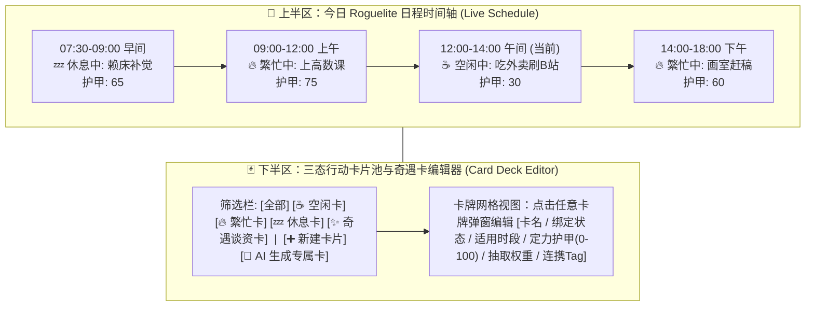

# OnlyYou (只有你) —— WebUI 可视化控制台设计方案 (基于 AstrBot Pages / Views)

| 文档版本 | 适用机制 | 页面入口路径 | 通信桥接对象 |
| :--- | :--- | :--- | :--- |
| v1.0 | AstrBot Plugin Pages (`views/`) | `views/console/index.html` | `window.AstrBotPluginPage` + `context.register_web_api` |

---

## 一、 为什么需要使用 AstrBot Pages 替代普通 `_conf_schema.json`？

AstrBot 默认的 `_conf_schema.json` 仅适合静态、扁平的基础键值对配置。而 **OnlyYou (`astrbot_plugin_only_you`)** 的核心数据是**动态演化的多角色（`Soul`）生命体数据**，具有强烈的交互式管理需求：
1. **人格导入与 `Soul ID` 管理**：需要读取 AstrBot 原生 `PersonaManager` 中的所有人格，支持一键导入、查看/修改 `Soul ID`、以及触发 LLM 自动扩写角色卡。
2. **Roguelite 行动卡片（`StateEventCard`）与奇遇卡池增删改查**：每个角色拥有几十张绑定了【`💤 休息中` / `🔥 繁忙中` / `☕ 空闲中`】三态的行动卡片，需要直观的卡牌网格编辑器来调整卡名、状态、定力护甲（`armor`）与抽取权重，甚至让 AI 一键生成新卡。
3. **今日三态时间轴实况监控与手动干预**：需要实时查看 Bot 当前处于哪个日程槽位、什么状态，并支持一键重新随机抽卡（Reroll）或手动切换状态。
4. **L1 / L2 / L3 三级用户关系与分级记忆可视化**：需要直观地提拔/降级群友等级、合并跨平台账号，以及查看/钉选/清理 Tier 1/2/3 记忆。

### 职责切分原则：
- **`_conf_schema.json`（极简底层配置）**：仅保留最基础的全局模型 Provider 绑定（`model_hub_config`）与 B站/抖音 API 地址，避免配置面板臃肿。
- **`views/console/`（全功能可视化工作台）**：承担所有与 **Soul 角色卡、Roguelite 行动卡片池、今日三态日程、三级用户关系、分级记忆库、冲浪视频库存** 相关的交互式管理。

---

## 二、 WebUI 整体布局与五大功能模块设计

页面通过 `const ctx = await window.AstrBotPluginPage.ready()` 获取当前主题模式（`ctx.isDark`），自动适配 AstrBot 面板的亮色/暗色主题。整体采用 **“顶部全局 `Soul ID` 切换栏 + 左侧五维导航栏 + 右侧主工作区”** 布局：

```text
+--------------------------------------------------------------------------------------------------+
| 🧬 当前管理角色 (Soul ID): [ ▾ 星野 (soul_hoshino) ]  [📥 从AstrBot导入人格] [✏️ 修改ID] [➕ 新建] |
| 🚦 实时状态: [ ☕ 空闲中 · 边吃麻辣烫边刷手机 | 护甲:30 | 今日微调: 1/2 ]   [⚡ 强制切状态] [🎲 重抽] |
+--------------------+-----------------------------------------------------------------------------+
|                    |                                                                             |
|  🗂️ 1. 角色与人格   |   (主工作区：根据左侧选中的 Tab 渲染对应视图)                                  |
|  🃏 2. 行动卡与日程 |                                                                             |
|  💖 3. 用户关系网   |                                                                             |
|  🧠 4. 分级记忆库   |                                                                             |
|  📱 5. 冲浪视频池   |                                                                             |
|                    |                                                                             |
+--------------------+-----------------------------------------------------------------------------+
```

---

### 模块一：🗂️ 角色灵魂与人格导入 (`Soul & Persona Studio`)

解决 **“导入 AstrBot 原生人格”、“查看/修改 `Soul ID`”** 以及 **“多平台会话路由绑定”** 的核心需求：

1. **从 AstrBot 原生 Persona 导入向导**：
   - 点击顶部 `[📥 从 AstrBot 导入人格]`，前端调用 `bridge.apiGet("personas/native")`，后端通过 `self.context.persona_manager` 获取平台已配置的所有原生人格列表。
   - 用户选择一个原生人格后，提供两种导入方式：
     - **方式 A（直接继承导入）**：以原生 Persona 名称作为初始 `Soul ID`（允许用户自定义修改 `Soul ID`），直接导入其设定文本并挂载默认通用行动卡池。
     - **方式 B（✨ AI 扩写并生成专属行动卡池）**：调用小脑模型，根据原生 Persona 的一句话设定，自动生成结构化性格描述、说话口癖，并自动生成 `6~10` 张贴合该人设的**专属三态行动卡片**与**奇遇卡**！
2. **`Soul ID` 查看、修改与角色档案编辑**：
   - 支持直接修改 `Soul ID`（后端在 SQLite 事务中级联更新关联的卡片池、用户关系表与记忆表中的 `soul_id` 外键）。
   - 可视化表单修改：角色自称（`name`）、人设定位（`archetype`）、口癖与语言规范（`speaking_style`）、B站/抖音冲浪喜好标签（Tag 胶囊增删）。
3. **群聊 / 私聊会话 (`UMO`) 映射表**：
   - 展示插件已捕获的所有活跃群聊与私聊 `UMO` 列表，允许用户为特定群聊显式指定绑定到哪个 `Soul ID`（默认自动跟随该会话在 AstrBot 配置文件中选定的 Persona，也可在此手动覆盖）。

---

### 模块二：🃏 Roguelite 日程实况与行动卡片编辑器 (`Action Cards & Schedule`)

解决 **“查看与干预今日三态日程”** 以及 **“可视化增删改查行动卡片与奇遇卡”** 的需求：



1. **上半区：今日日程时间轴 + 奇遇谈资实况**：
   - 直观展示今天 6 个时间段抽到的卡片及其颜色状态标识（`💤 休息中` / `🔥 繁忙中` / `☕ 空闲中`），以及今天抽出的 2 张 **【奇遇谈资卡】**（显示 `未聊` 或 `已聊`）。
   - **快捷操作**：
     - **`[🎲 重新抽取今日日程]`**：立即重新运行一次 Roguelite 随机引擎。
     - **`[⚡ 手动切换当前状态]`**：点击任意槽位可直接将其状态临时改为 `空闲中 / 繁忙中 / 休息中`（方便管理员随时拉 Bot 出来水群或让它闭嘴休息）。
2. **下半区：行动卡片 (`StateEventCard`) 与奇遇卡 (`EncounterCard`) 管理器**：
   - **可视化卡牌编辑弹窗**：
     - `卡片名称 (title)`：如 *“窝在沙发里刷短视频”*、*“苦逼赶周报”*
     - `绑定状态 (state)`：**单选按钮 [`☕ 空闲中 (IDLE)` | `🔥 繁忙中 (BUSY)` | `💤 休息中 (RESTING)`]**
     - `有效时间槽 (valid_slots)`：多选复选框 `早间 / 上午 / 午间 / 下午 / 晚间 / 深夜`
     - `定力护甲 (armor)`：`0 ~ 100` 滑动条（实时提示：`<=35 极易被消息拉去摸鱼`，`>=75 雷打不动`）
     - `抽取权重 (base_weight)`：`1 ~ 100` 滑动条
     - `作用域 (scope)`：`当前 Soul 专属卡` 或 `全局通用卡`
   - **AI 辅助造卡**：点击 `[🤖 AI 根据人设生成新卡]`，自动生成 5 张候选行动卡与 3 张奇遇谈资卡，一键勾选入库。

---

### 模块三：💖 三级用户关系与跨平台身份管理 (`Relationships`)

1. **三级关系分栏管理**：
   - **★ L3 核心用户（管理员）**、**◆ L2 重要用户（群聊熟人）**、**L1 普通用户** 分 Tab 展示。
   - 支持在界面上直接点击修改任意用户的等级（如一键将某个群友设为 `L2 重要用户` 或 `★ L3 核心用户`）、调整好感度分数（`0~100`）、编辑该用户的专属称呼/外号。
2. **跨平台账号可视化合并**：
   - 选择主用户 A 与待合并的跨平台账号 B（如 `QQ:12345` 与 `TG:88888`），点击 `[🔗 合并身份]` 即可在后台完成 `GlobalUser` 归一。

---

### 模块四：🧠 分级记忆库与上下文监控 (`Memory Vault`)

1. **Tier 3（核心永久） / Tier 2（近期衰减） / Tier 1（今日瞬时）记忆列表**：
   - 每条记忆展示：内容、关联用户、关键词标签、重要度星级（`1~10`）、以及当前 **活力值进度条 (`Vitality: 0~100%`)** 和被召回次数（`AccessCount`）。
   - 支持手动新增核心记忆、修改记忆文本、将某条近期记忆**一键锁定为永久核心记忆**、删除单条记忆，或点击 **`[🗑️ 立即执行遗忘清理 GC]`**。

---

### 模块五：📱 赛博冲浪视频池与测试台 (`Surfing Pool`)

1. **已刷视频卡片墙**：展示 Bot 在 `☕ 空闲中` 从 B站/抖音刷到的视频封面、标题、前排高赞热评、多模态视觉模型生成的《看片画面笔记》与拟人吐槽文案。
2. **手动调试动作**：提供 **`[🚀 立即刷一次 B站]`**、**`[🚀 立即刷一次抖音]`**、以及将库存中的某个视频 **`[📤 立即分享给核心用户 / 指定群聊]`** 的快捷按钮。

---

## 三、 前后端实现架构与 API 契约设计

### 3.1 插件目录结构增量 (`views/` + `core/web_api.py`)

```text
astrbot_plugin_only_you/
├── main.py                      # 初始化时调用 self.web_api.register_routes()
├── core/
│   └── web_api.py               # 封装所有 context.register_web_api 路由处理函数
└── views/                       # AstrBot 标准插件视图目录 (兼容 pages/)
    └── console/                 # 视图名称: console
        ├── index.html           # 控制台主页面骨架
        ├── app.js               # 前端状态管理与 AstrBotPluginPage Bridge 通信逻辑
        └── style.css            # 响应式布局与深浅色主题 CSS 变量
```

### 3.2 前端 Bridge 通信封装 (`views/console/app.js`)

利用 AstrBot 自动注入的 `window.AstrBotPluginPage`（兼容 `window.AstrBotPluginView`）与后端无感通信：

```javascript
const bridge = window.AstrBotPluginPage || window.AstrBotPluginView;

class OnlyYouConsoleApp {
    async init() {
        // 1. 等待 AstrBot Dashboard 握手并同步深浅色主题
        const ctx = await bridge.ready();
        document.documentElement.classList.toggle("dark", !!ctx.isDark);

        // 2. 加载所有 Soul 列表与 AstrBot 原生 Persona 列表
        const initData = await bridge.apiGet("init_summary");
        this.souls = initData.souls;
        this.nativePersonas = initData.native_personas;
        this.currentSoulId = this.souls[0]?.soul_id || "default";

        await this.loadSoulWorkspace(this.currentSoulId);
    }

    // 导入 AstrBot 原生人格并可选 AI 扩写生成行动卡池
    async importNativePersona(personaName, targetSoulId, autoGenerateCards = true) {
        return await bridge.apiPost("souls/import_persona", {
            persona_name: personaName,
            target_soul_id: targetSoulId,
            auto_generate_cards: autoGenerateCards
        });
    }

    // 修改 Soul ID (级联更新)
    async renameSoulId(oldSoulId, newSoulId) {
        return await bridge.apiPost("souls/rename", {
            old_soul_id: oldSoulId,
            new_soul_id: newSoulId
        });
    }

    // 保存或新增三态行动卡片 (StateEventCard)
    async saveActionCard(soulId, cardData) {
        return await bridge.apiPost("cards/save", {
            soul_id: soulId,
            card: cardData
        });
    }
}
```

### 3.3 后端 Web API 路由注册清单 (`core/web_api.py`)

在插件初始化时，通过 `self.context.register_web_api(path, handler, methods, desc)` 注册以下 RESTful 风格接口：

| 路由路径 (`/{PLUGIN_NAME}/...`) | 方法 | 功能说明 |
| :--- | :--- | :--- |
| `/astrbot_plugin_only_you/init_summary` | `GET` | 获取已创建的 `Soul` 列表、AstrBot `persona_manager` 中的原生人格列表、全局模型状态 |
| `/astrbot_plugin_only_you/souls/detail` | `GET` | 获取指定 `soul_id` 的完整角色卡、今日三态日程实况、绑定的会话 `UMO` 列表 |
| `/astrbot_plugin_only_you/souls/import_persona` | `POST` | 从指定的 AstrBot 原生 Persona 导入人格（支持 AI 自动扩写角色卡并生成专属三态行动卡池） |
| `/astrbot_plugin_only_you/souls/save` | `POST` | 新建或修改指定 `Soul` 的基础设定与冲浪标签 |
| `/astrbot_plugin_only_you/souls/rename` | `POST` | 修改 `Soul ID`（事务级联更新 `souls`、`action_cards`、`daily_runs`、`memories`、`users` 表） |
| `/astrbot_plugin_only_you/souls/delete` | `POST` | 删除指定 `Soul` 及其关联数据 |
| `/astrbot_plugin_only_you/schedule/reroll` | `POST` | 重新运行 Roguelite 随机引擎生成今日日程与奇遇谈资卡 |
| `/astrbot_plugin_only_you/schedule/force_state` | `POST` | 手动强制切换当前槽位状态为 `RESTING` / `BUSY` / `IDLE` |
| `/astrbot_plugin_only_you/cards/list` | `GET` | 获取指定 `soul_id` 可用的三态行动卡片池与奇遇谈资卡池 |
| `/astrbot_plugin_only_you/cards/save` | `POST` | 新增或修改单张行动卡片（`title`、`state`、`valid_slots`、`armor`、`base_weight`）或奇遇卡 |
| `/astrbot_plugin_only_you/cards/delete` | `POST` | 删除指定行动卡片或奇遇卡 |
| `/astrbot_plugin_only_you/cards/ai_generate` | `POST` | 调用小脑模型根据当前角色设定自动生成一批新的三态行动卡与奇遇卡 |
| `/astrbot_plugin_only_you/users/list` | `GET` | 获取该 `Soul` 下的 L1/L2/L3 用户关系列表与好感度 |
| `/astrbot_plugin_only_you/users/update` | `POST` | 修改用户等级（L1/L2/L3）、好感度、称呼或合并跨平台账号 |
| `/astrbot_plugin_only_you/memories/list` | `GET` | 按分级（Tier 1/2/3）与用户筛选查询记忆列表及当前活力值 `vitality` |
| `/astrbot_plugin_only_you/memories/mutate` | `POST` | 新增、编辑、删除记忆，将近期记忆钉选为永久核心记忆，或手动触发一次 `Forgetting GC` |
| `/astrbot_plugin_only_you/surfing/list_and_trigger` | `GET/POST` | 查看最近刷到的 B站/抖音视频及多模态看片笔记，或手动触发一次后台冲浪 |
